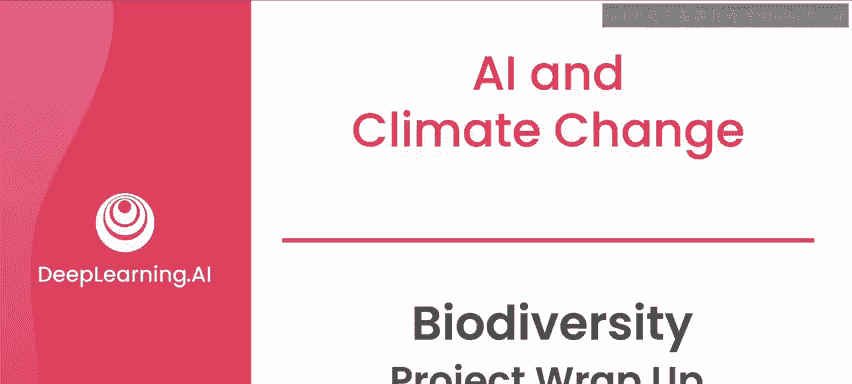
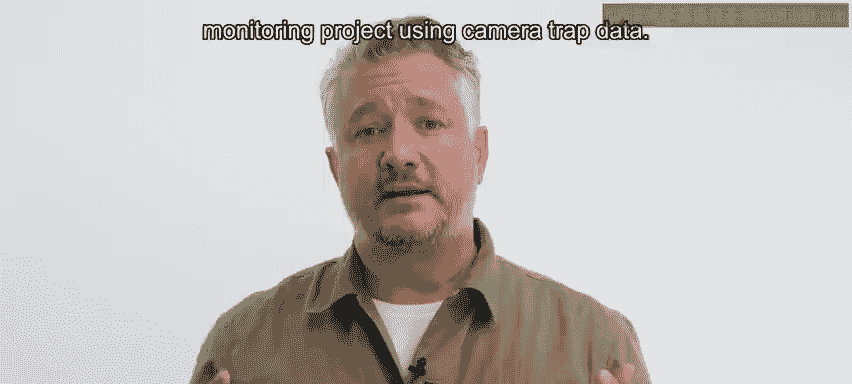
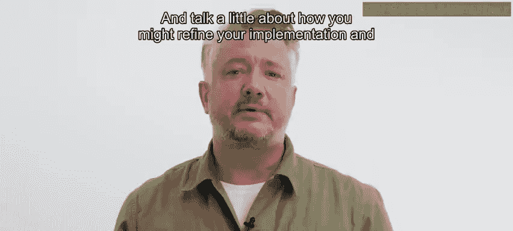
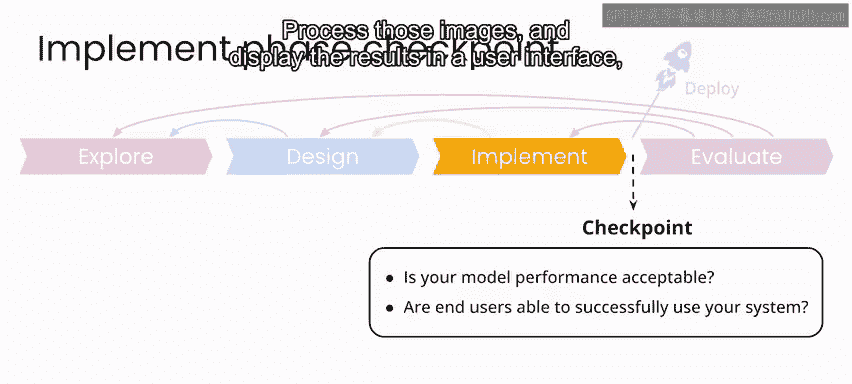
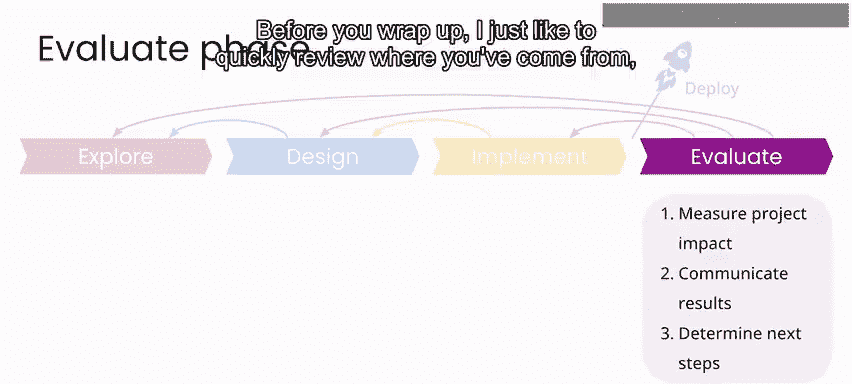
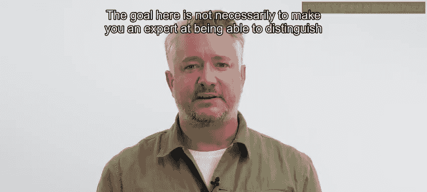
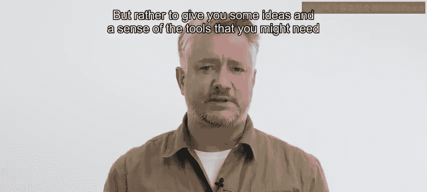
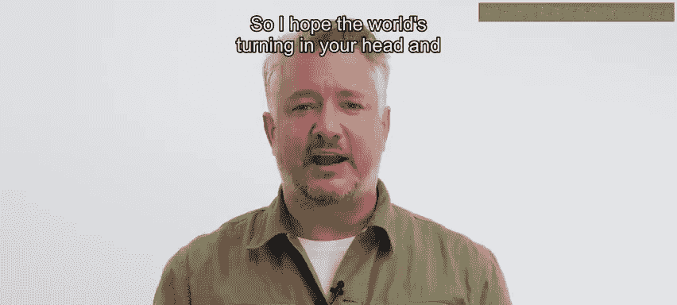
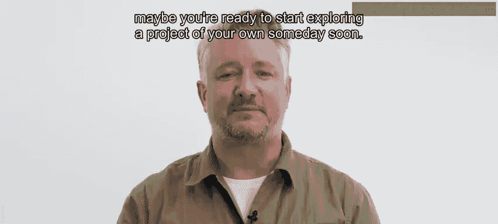

# 吴恩达《AI for Good专业课程》 AI与公共卫生、气候变化、灾难管理｜中英字幕 - P79：42_生物多样性项目总结.zh_en - GPT中英字幕课程资源 - BV13u411F7xZ

Throughout the labs in the last several lessons you put together an image processing pipeline that could work as an automatic animal detection tool for biodiversity monitoring now of course to implement a project like this in the real world there would be more details that you would need to attend to and each phase of the project would be more complex。

 but you now have an idea of all the key components including how to build a state of the outdoorural network model and in principle you could develop this further into any biodiversity monitoring project using camera trap data。

In this video， I'll review these key components of your implementation and talk a little about how you might refine your implementation and evaluate your results。

😊。

The two questions you would need to be able to answer in the affirmative to conclude the implementation phase are。

 is your model performance acceptable and are the end users able to successfully interact with your system？

In this case， your model performance is okay， but could likely have been made much better with additional training data。

 The user interface that you prototyped allows users to explore existing images in the database or upload their own images for processing。

 and I hope you played around with this a lot。If you have experience in software engineering or work with a team that does。

 then you might be ready to go ahead and deploy your system such that you could further iterate on it to get to a level of accuracy where it became more useful for end users。

Similar to the other projects in these courses， the deployment step would include many technical challenges that we're not going to cover here。

 but in principle you could apply an application like this to receive automatic image uploads from camera traps。

 process those images， and display the results in a user interface。

 as well as generate reports on the summary of results。

In terms of the evaluation phase for a project like this。

 you could measure the project's impact in terms of the value that you provide to researchers in the field of conservation biology。

The information that you're able to provide to policymakers and in the long term。

 the degree to which your project helped to direct the needed resources towards the protection and restoration of natural ecosystems。

Before you wrap up， I'd just like to quickly review where you've come from。

 start to finish in this project。

In the explore phase， apart from engaging with stakeholders and defining the problem that you wanted to work on。

 you needed to have a labeled data set of images in order to begin work on this project。

The labeled data set you had access to for this project was data from the snapshot Carou project that had been labeled with help from citizen scientists in the Zaverses。

or platform。Well it's nice to be able to start with data that someone already labeled for you。

 you saw that by taking advantage of pret models， you were able to come up with a working animal detection pipeline。

 starting with a relatively small collection of labeled images。In principle。

 if you wanted to start your own camera trap project tomorrow。

 it wouldn't take very long to collect and label the data for a similar sized project。

The snapshot Car data presented some interesting challenges in that the animals are not always easy to identify in the labeled images。

In a real world implementation of this project， you might consider developing a system that worked with sequences of images。

 such that your confidence in classification could be made more robust。

 even when you're only looking at a horn or a tail in one particular image。😊。

Another reason it would make sense to work with sequences is that your goal here is to count animals。

 if you had one baboon， for example， walking back and forth across the field of view。

 then you might count it many times， even though a closer inspection of the sequence could reveal that just the same animal being photographed again and again。

 Spea of which if you really wanted to get serious about counting individual animals。

 you might attempt to build an animal recognition pipeline。

 like a face recognition system for humans where you could distinguish individual animals in an attempt to count and track individuals in the population and that way you'd know when the same baboon had gone across your camera at multiple different times。

 but that is definitely out of scope for this project realistically。

 even if you didn't worry about tracking sequences of images or recognizing individual animals。

 if you simply collected more training data， you can improve the performance of your model。

 and then through statistical approaches， get a sense of the prevalence of animal populations and bydi in the park。

Essentialentially smooth and over when you say the same animal multiple times and this could be valuable to researchers and policymakers I hope you found this project interesting and inspiring and fun just like the other projects in these courses。

 the goal here is not necessarily to make you an expert being able to distinguish a koooo from a red heartbe but rather to give you some ideas and a sense of the tools that you might need if you are going to tackle a project like this Sundayday so I hope the world's turning in your head and maybe you're ready to start exploring a project of your own someday soon。

😊。

Before we close out this week in this course， I'd like to share one more project spotlight with you Priya Dunty is the cofounder and director of climate change AI and also an incoming professor at MIT She will share a little bit about her work on climate change AI and how you can get involved in climate change work that is of interest to you。

