# 吴恩达《AI for Good专业课程》 AI与公共卫生、气候变化、灾难管理｜中英字幕 - P7：6_考虑你的人工智能为善项目的影响.zh_en - GPT中英字幕课程资源 - BV13u411F7xZ

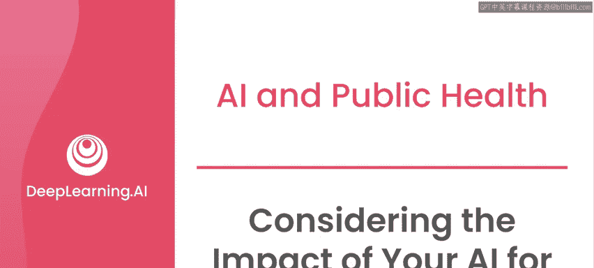

As you've seen from the previous videos， the possible applications of AI are really wide ranging and being able to get an algorithm to reliably perform what might be a relatively simple task for you or me。

 like recognizing what's in an image can actually be a powerful tool for many kinds of projects。

I'd now like to spend a little time discussing some of the potential issues that you'll need to keep in mind when it comes to applying AI to your projects。

The goal of any AI for good project is of course， to have a positive impact on the world。

 whether that's improving people's health， reducing the impacts of climate change or helping communities recover from a natural disaster or something else however。

 with any project that you work on there will also be a risk of having a negative impact in this video I'll go over a few of the major areas for concern when embarking on any AI related project。

And just to be clear for as long as people have been thinking about how technology can be used to improve humanity and the environment。

 people have also been concerned about the potential negative impacts of technology on people and the environment and this is true for AI as well and there are a large number of people currently focused on research in AI ethics。

 fairness bias and representation and there are many good papers and educational materials published on these topics here I'll touch on some of these issues but in this course there it simply isn't the time to go into great detail with that being said I do recommend you do take the time to look at some of these resources and we've included many at the end of the week。

 so I encourage you to go look at these resources think about how they apply to the use cases in this course and also to any of the use cases that you're working on in your projects。

When it comes to the impact of using AI in various projects， first off。

 I want to emphasize that AI does not necessarily add value to every new project for the majority of technologies that I've built in any domain when I thought AI could work out most of the time it did not and so this is why we really need to keep in mind that we can't harm people in the process of trying to work out whether AI can help or not with all the hyp around AI in its capabilities it can be easy to fall into some sort of AI first mindset when it comes to problem solving where every problem you see is a nail an AI is the hammer。

 when it comes to working on real world problems， it's best to think of AI is one potential tool in your toolkit。

 particularly so it doesn't become a distraction away from what might have otherwise been a much simpler solution。

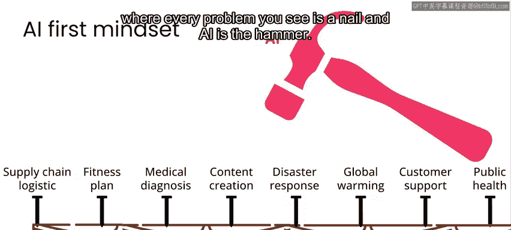

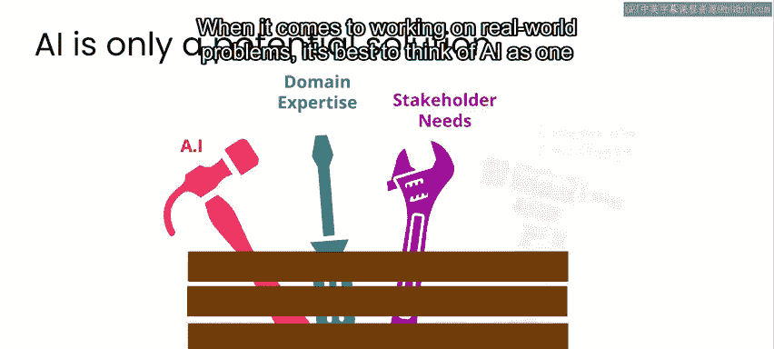

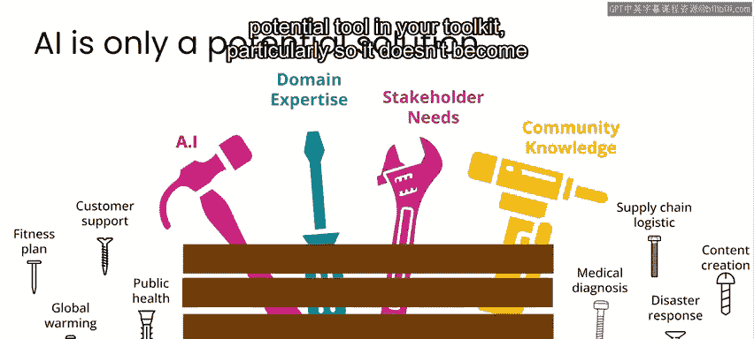

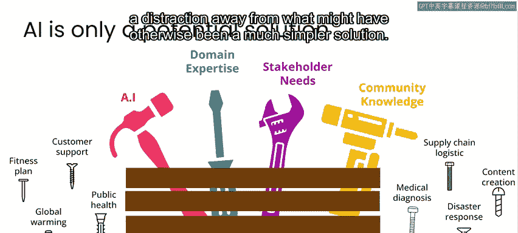

In the lessons that follow in this course， we'll be walking through a framework for approaching any problem you might want to work on that could involve AI。

 and literally one of the first steps is determine whether AI could actually add any value as part of the solution for many real world problems。

 AI simply doesn't add value， and it's important to be able to recognize that as early as possible。

 so don't waste your time and resources trying to implement an overly complicated AI solution where simply not needed。

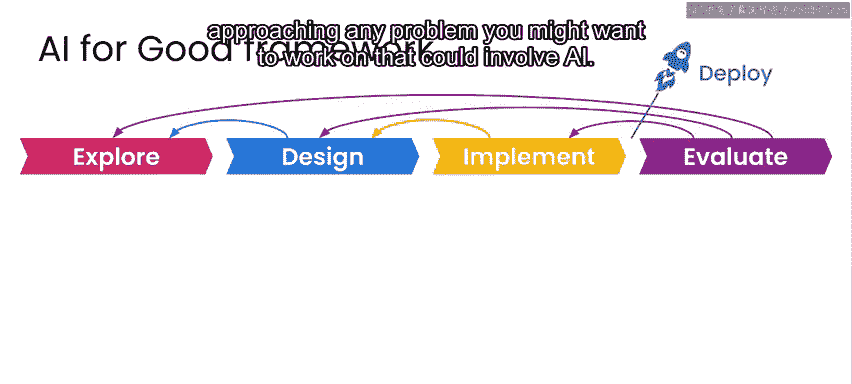

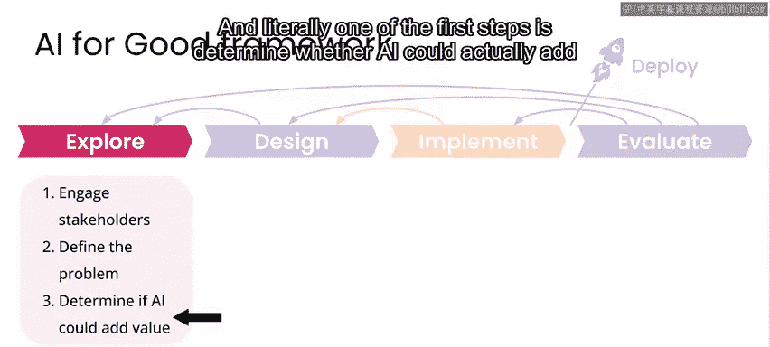

Throughout this course， I'll highlight some cases in which AI does add good value and others where it does not for the projects where AI can add value。

 as I've said before， having good data and plenty of it is typically of critical importance to the success of your project。

 data is also right at the heart of many of the ethical concerns surrounding AI applications。

 For example， in projects that involve imaging data。

 images of people or property should be considered potentially sensitive。

When I've worked on aerial imagery analysis for damage assessments in cases like following Hurricane Sandy in the US in 2012。

 while you couldn't identify individuals in the aerial photographs， if you're familiar with the area。

 you might have been able to work out the specific locations that were damaged and most vulnerable to theft。

Following the disaster response period， we let one other organization conduct an analysis of how successful we were in our aerial damage assessments。

 and then we all deleted the data because of the privacy and security concerns。

So even though there were very good benefits from keeping the data and allowing more people to assess the damage and conduct research on it。

 we couldn't guarantee that the principle of do no harm applied because there would be people who could be identifiable based on their property in those images。

Other forms of data that contain personal identifying information like the names， phone numbers。

 addresses， medical or financial information also need to be treated with the utmost care and confidentiality on the one hand you need to make sure that you're handling your data with the appropriate security considerations in place to avoid having it leaked or stolen。

 but you also need to make sure that you're not inadvertently publish in or sharing any data that might reveal personal information about any individuals or particular groups。

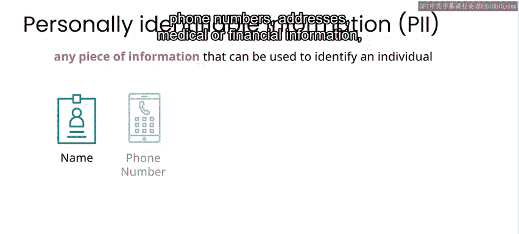

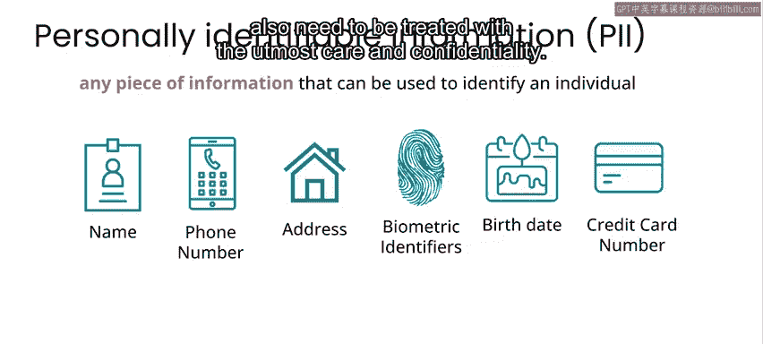

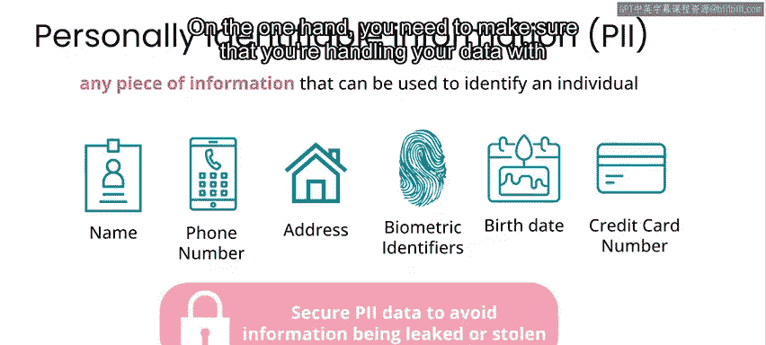

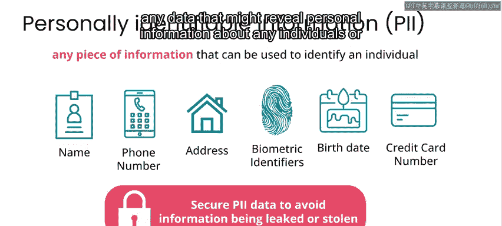

Ideally， whenever possible you should never store any personally identified information， for example。

 when I worked in disaster response in Haiti following the earthquake in 2010。

 while we did store and make some data available and we ensured that any publicly shared data did not include any personally identified information and then following the response period we deleted all data that might have had personally identified information in it。

Even data that might seem like it's already public， like posts on social media。

 should be still considered potentially sensitive information。

 and you should avoid insseurely archiving or republishing such data the same way you would any other data that contained personal identifying information。

The reason you need to take extreme care with any data that you could consider private information is not just because it's the right thing to do。

 but because not doing so can pose real and potentially serious risks to the security and well-being of those individuals whose information has been compromised unfortunately there have been many cases of groups working in unintensibly for good projects where the data they collected。

 shared or published was eventually used by authoritarian regimes to target those individuals whose views or political affiliations or activities was seen as a threat to the continuation of those regimes In fact。

 nowadays the authoritarian regimes in many countries around the world actively engaged in projects where they are collecting and analyzing social media and other data purportedly for some project to do with public good when in fact their goal is profiling and targeting dissidents and this would clearly not meet most people's definition of for good and it certainly doesn't satisfy。

The principal of dunoham。Beyond the ethical considerations associated with the data for your project。

 the other major area for concern is any of the actual impacts of your AI solution。For example。

 suppose the AI model that you have deployed is responsible for identifying illegal activity。

 What are the chances that it will wrongly identify such activity and ultimately cause problems for innocent people。

Or a sossion model is responsible for providing a medical diagnosis。

 like as you saw in the last video， whether or not someone has cancer。

 what are the implications of providing the wrong diagnosis？

And if you must have a wrong diagnosis some of the time， what kind of error would you prefer。

 would you prefer a false positive， meaning that you tell someone that they have cancer when they do not。

 or a false negative， meaning that you're telling someone that they don't have cancer when they actually do。

With each project that you work on you'll have a different set of specific considerations for what a failure mode looks like and what happens when things do go wrong and there will often be unforeseen consequences。

 even if the system you build does operate as you initially intended so it's very useful in some cases to imagine specific adversarial use cases and by that I mean ways in which others might use the system that you have built or the data that you publish to do harm rather than good and this as will come back to a few times over these course。

 this is an important area for you to engage in stakeholders。

 especially among the users and people impacted by your technology。

 because you're not going to think about all the potential risks yourself and you need to engage the people who would be harmed by those potential negative use cases。

For example， imagine you deploy a system for automatically tracking the population of an endangered species。

 say a black rhino， if you publish data on exactly where to find the greatest numbers of black rhinos。

 could poachers use that data to further threaten the species， possibly I don't know。

 And so this is a really good example of why you would speak to the stakeholders。

 the people who are responsible for tracking and protecting the rhinos and get their input as to whether or not such a system would obey the dono harm principle。

So whatever you're working on， apply the do no harm principle and you'll be most successful if you take the time to consider all the potential impacts both positive and negative for your project。

 also keep in mind that as someone working on an AI for good project。

 you are not the only one who should be making a judgment call on how to do no harm。

 you need to consider their perspectives and input from all the potentially impacted people。

We've built these courses in collaboration with a number of different domain experts who apply AI for positive social and environmental impact。

 you'll be hearing from these experts directly in project spotlights throughout this course we're particularly grateful to partners at the Microsoft AI for Good Lab for their collaboration in support in development of these courses。

In the next video you'll be hearing from Juan Le Vita Afs。

 the chief scientist and director of Microsoft AI for Good。

 this lab has a large number of projects that they're working on right now and just so you know this next video well have a little bit of a different look and feel from the course of content videos and so I think it's good to think of this more like an inspirational trailer for a lot of the really interesting projects that they're doing at Microsoft AI for good rather than practical content for this course。

 but if you would like to learn more about any of the projects that Juan mentions you can find more details by following the URL in the resources section at the end of this week。

