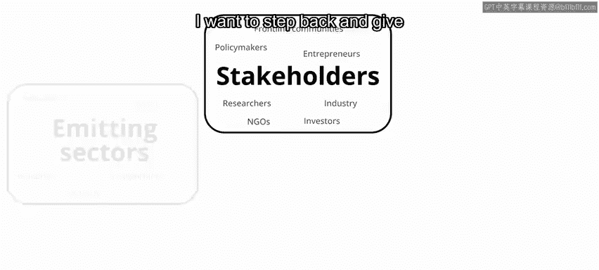
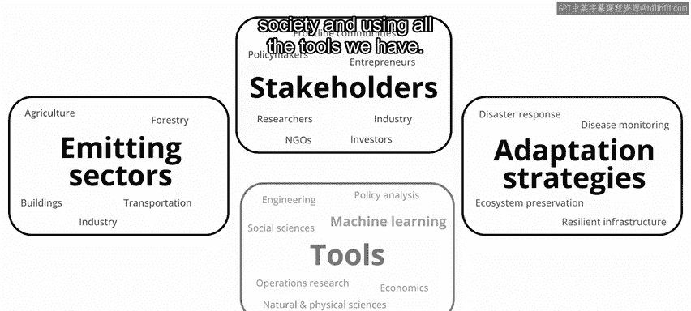
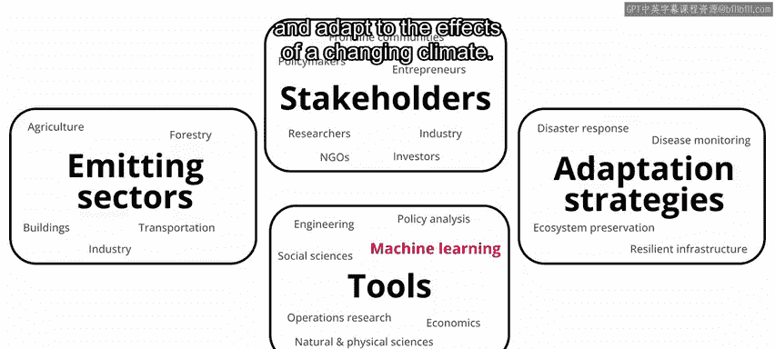
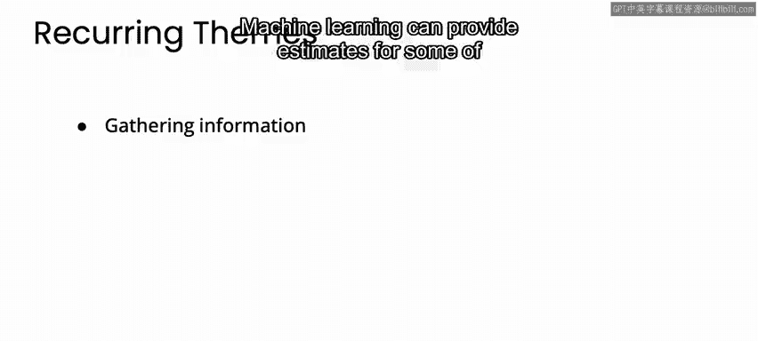
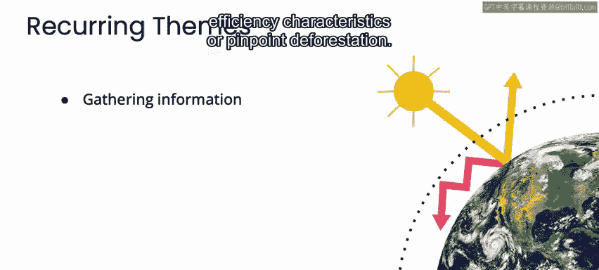
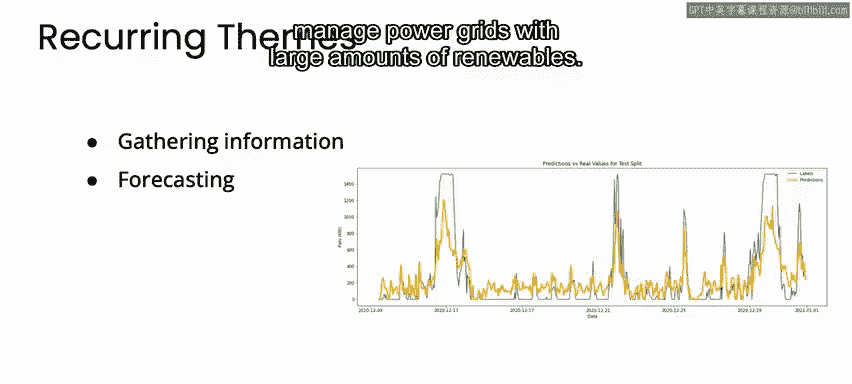
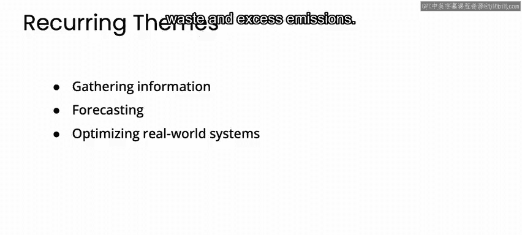
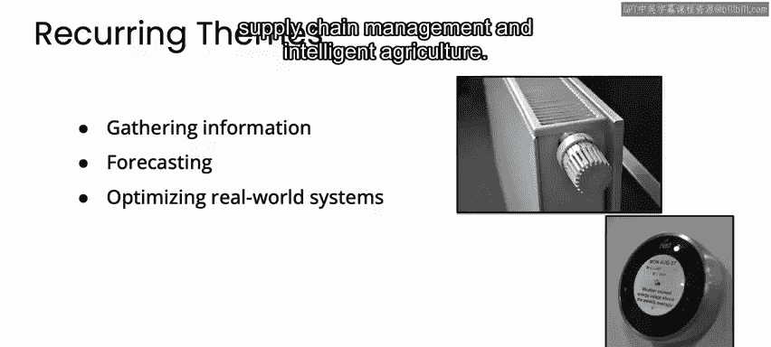
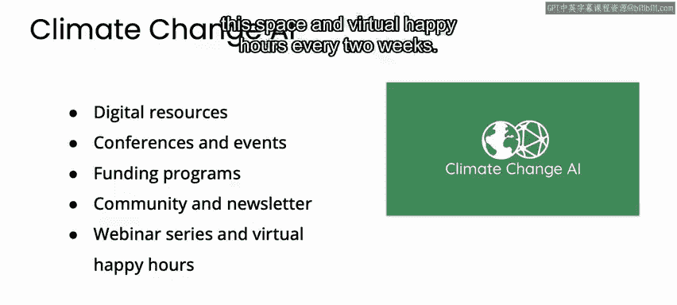
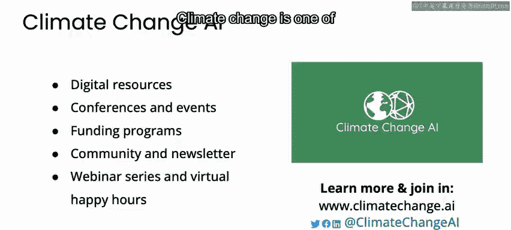

# 吴恩达《AI for Good专业课程》 AI与公共卫生、气候变化、灾难管理｜中英字幕 - P80：43_Priya Donti用机器学习应对气候变化.zh_en - GPT中英字幕课程资源 - BV13u411F7xZ

Hey there。 My name is Priya Ly， and I'm a PhD candidate at Carnegie Mellon University。

 where my work focuses on providing machine learning methods for optimizing electric power grids with large amounts of renewable energy。

 I'm also a cofounder and chair of climate change AI。

 an initiative that aims to foster impactful work in climate change and machine learning through education。

 funding and community building。 I want to step back and give a broad overview of this space。

 as well as talk about how you can get involved。 to address climate change。

 We're going to need action from all corners of society and using all the tools we have This includes machine learning。

 which can play a critical role in climate action by supporting strategies to both reduce greenhouse gas emissions and adapt to the effects of a changing climate。

😊。

In recognition of this， a number of colleagues and I wrote a paper called tackling Climate Change with Maine Learning that details dozens of opportunities for working in this space。

 spanning areas such as energy， transportation， agriculture， disaster response， and more。

While we don't have time to cover all of these applications。

 I definitely encourage you to check out the paper to learn more。

I want to highlight a few key themes that emerge across all these applications。

 One of these themes is gathering information。 There are many situations in which obtaining additional data can help inform climate action。

 For instance， understanding exactly when and where greenhouse gases are being emitted may enable policymakers to more effectively regulate these emissions。

 Machine learning can provide estimates for some of this information by analyzing patterns in large data sets。

😊。

For instance， machine learning can be applied to satellite imagery to detect global greenhouse gas emissions or methane leaks。

 gather information about building efficiency characteristics or pinpoint deforestation。

Another theme is forecasting。 Foresight can be key in many climate change contexts。 For instance。

 the amount of solar and wind power produced varies based on the weather and obtaining accurate predictions of this power production ahead of time can help grid operators manage power grids with large amounts of renewables In the context of adapting to climate change。

 it can similarly be useful to predict climate induced droughts。

 floods or famines ahead of time in order to provide critical early warning to farmers or evacuation planners in these and many other contexts。

 machine learning can be used to forecast relevant quantities using heterogeneous sources of data such as sensors or physical models。

😊。

A third theme is that machine learning can be used to optimize real world systems。

 Real world systems often have many inefficiencies leading to waste and excess emissions。

 For instance， heating and cooling systems in buildings often use more energy than they need to。

 and their efficiency can be improved dramatically by dynamically accounting for weather。

 occupancy patterns and the physics of the building。

As another example， global supply chains are large and complex and there can be savings associated with intelligently bundling shipments together or adaptively adjusting freight transportation schedules to accommodate disruptions or delays。

Machine learning can be used to optimize such real world systems in areas such as heating and cooling。

 supply chain management， and intelligent agriculture。

An important caveat here， though， is that making a system more efficient。

 can often cause it to be used more， potentially negating some of the emissions benefits。

 This is called a rebound effect， and applications in this area should be pursued in a way that is mindful of reducing these rebound effects。

And then a last theme is accelerating scientific experimentation the process of scientific discovery can often be slow。

 for instance， it said that Thomas Edison tried thousands of configurations for the light bulb before finding one that worked。

Machine learning can help accelerate this process of scientific discovery by， for instance。

 learning from past experiments in order to suggest which experiments to try next。

Such techniques can be used for applications such as designing better batteries。

 creating low carbon synthetic fuels， finding optimal equipment settings to guide the manufacturing of solar panels and engineering more effective CO2 sorbents。

 which are basically like sponges for removing carbon dioxide from the atmosphere。

 While these represent many impactful applications of machine learning to climate change。

 it's worth noting that machine learning is not a silver bullet and where useful。

 it's only ever one piece of a broader puzzle。😊，For instance。

 while I previously described that machine learning can provide forecasts of solar and wind power in order to be impactful。

 these forecasts ultimately need to be used。 for example。

 by being integrated into existing power system optimization models or being coupled with policy incentives that encourage the use of low carbon power。

Climate change is also an inherently multidisciplinary problem， spanning multiple sectors。

 so collaboration and co development with stakeholders from across these backgrounds is key to doing impactful work。

How can you find the specific problem you want to work on。

 how can you find the right collaborators or otherwise get started As a start。

 I'd encourage you to check out some of the resources available through climate change AI in order to learn more and connect with others。

There are lots of ways that you can plug in。For instance。

 we have digital resources that you can check out that provide more info on the space of climate change and machine learning。

 including our foundational report， as well as summaries， tutorials， a resource wki， and a blog。

We hold workshops at the main machine learning conferences where you can learn more。

 meet others and present your own work if you're new to this space。

 we also have a mentorship program where you can get paired with an expert mentor to help further develop your work。

😊，We have funding programs for impactful research to which you can apply。

And we also have various ways that you can engage on an ongoing basis to meet others and learn more about the overall space for instance。

 we have an online community discussion platform where you can ask questions。

 meet others and participate in discussions， a community directory where you can sign up and discover others。

 and a monthly newsletter featuring events， readings and job opportunities。

And we also host a monthly webinar series featuring experts in the space and virtual happy hours every two weeks。

😊。

You can learn more on our website or by following us on social media。

Climate change is one of the greatest challenges of our time。

 and I hope that you'll join in and help us address this challenge， thanks。😊。

