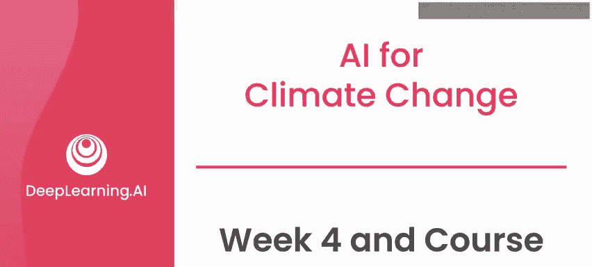
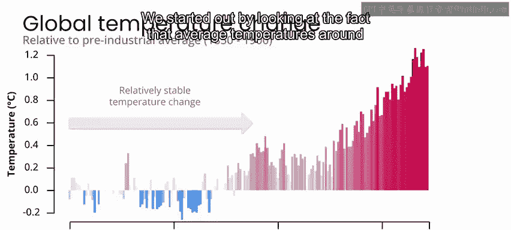
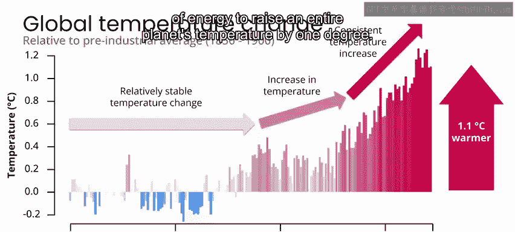
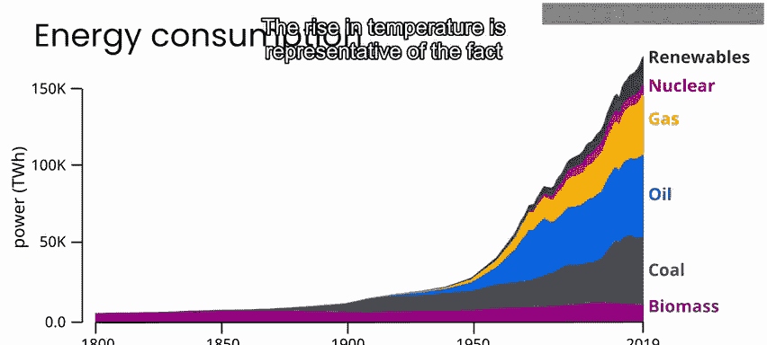
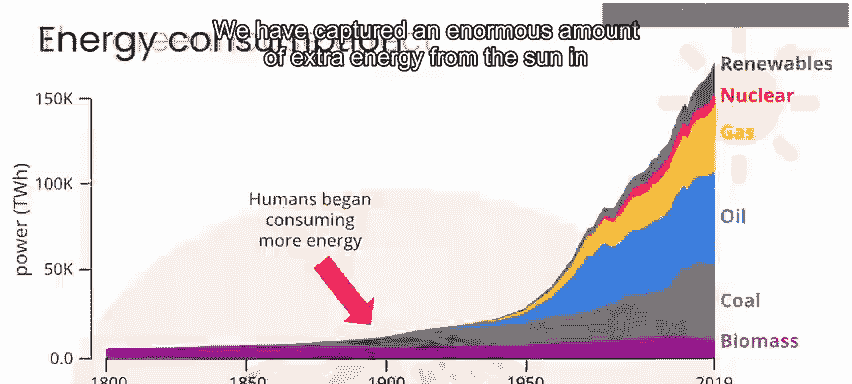
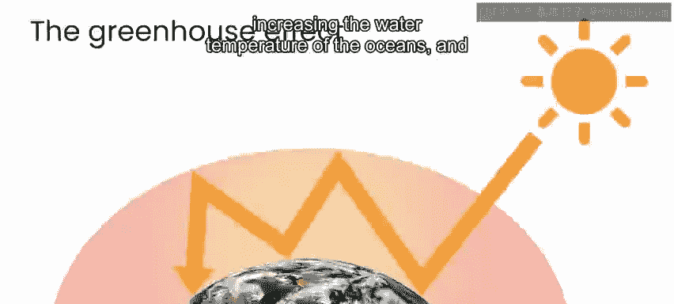
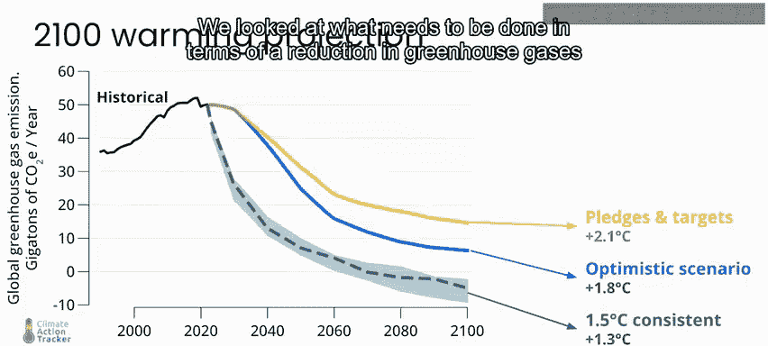
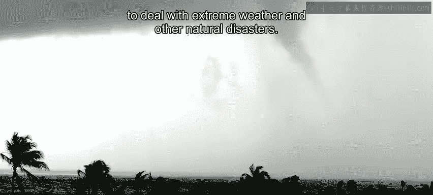
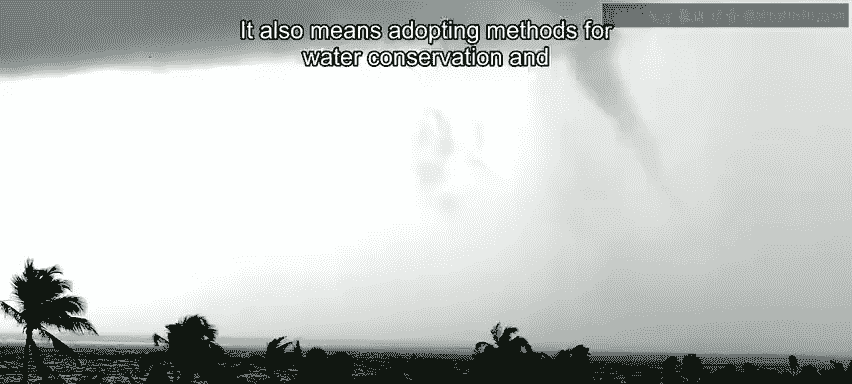

# 吴恩达《AI for Good专业课程》 AI与公共卫生、气候变化、灾难管理｜中英字幕 - P81：44_第4周和课程总结.zh_en - GPT中英字幕课程资源 - BV13u411F7xZ

Congratulations on coming to the end of this course on AI and climate change。

 We started out by looking at the fact that average temperatures around the globe are rising and are already more than 1 degree Celsius higher than they were on average 100 years ago。

 While one degree Celsius might not sound like a lot it takes a tremendous amount of energy to raise an entire planet's temperature by one degree。

 The rising temperature is representative of the fact that due to increased greenhouse gases in the atmosphere we have captured an enormous amount of extra energy from the sun in recent decades。

 It's that extra energy that is causing more extreme weather events increasing the water temperature of the oceans and driving an increasing rate of extinction among plant and animal species。

😊。

We looked at what needs to be done in terms of a reduction in greenhouse gases in the atmosphere to achieve the goal of limiting global warming to just 1。

5 degrees Celsius， as well as some of the consequences of what could happen if we fail to achieve those goals。

The necessary reductions in greenhouse gases will be achieved through a combination of replacing fossil fuels with cleaner。

 renewable alternative energy sources like wind and solar。

 as well as through naturebased solutions to protect and restore forests and other natural ecosystems。

As we work towards the mitigation of climate change by reducing greenhouse gases in the atmosphere。

 it is also important that we develop approaches to adapt to climate change。

 given that maniv' its impact will be unavoidable even under the most optimistic scenarios。😊。

Adapting to climate change means being better prepared to do with extreme weather and other natural disasters。

 It also means adopting methods for water conservation and sustainable agriculture to become more resilient to droughts and heat waves。

There are many ways in which AI can help in projects aimed at mitigating and adapting to climate change。

In this course， you saw examples of how AI can be used to make commercial solar power installations less impactful and more predictable in terms of power output。

You developed a project to make wind energy a more viable alternative to fossil fuels。

You saw how AI can be used in weather forecasting， making preparation for extreme weather more robust。

And in the final project of this course， you build out an example of how AI can be used in monitoring the biodiversity of ecosystems。

What I hope you take away from this course is a sense of urgency as well as a sense of inspiration for the wide range of ways in which you might be able to engage in projects to mitigate and adapt to climate change。

 and some of the powerful ways in which machine learning can be one part of that solution。😊。

With what you've learned here， I encourage you to get started exploring your own projects。

 I also encourage you to join me in the next course of this specialization。

 where I'll do a deep dive into my own area of expertise， which is AI for disaster management。

 so I'll see you in the next course。😊。