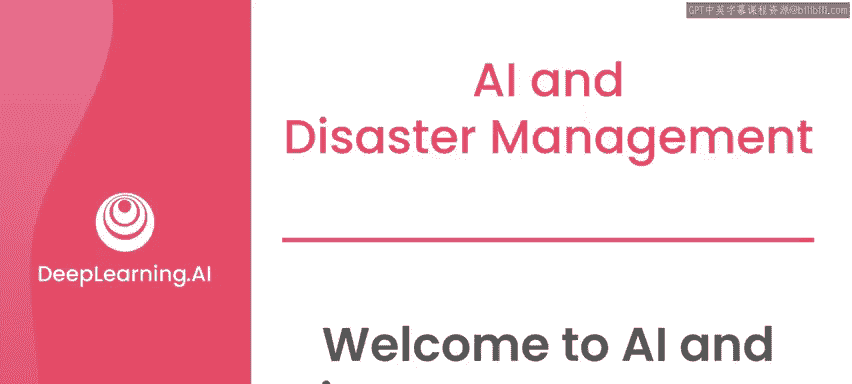
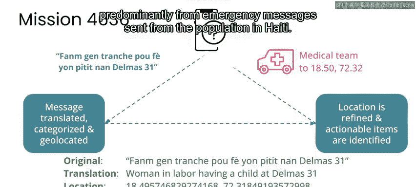
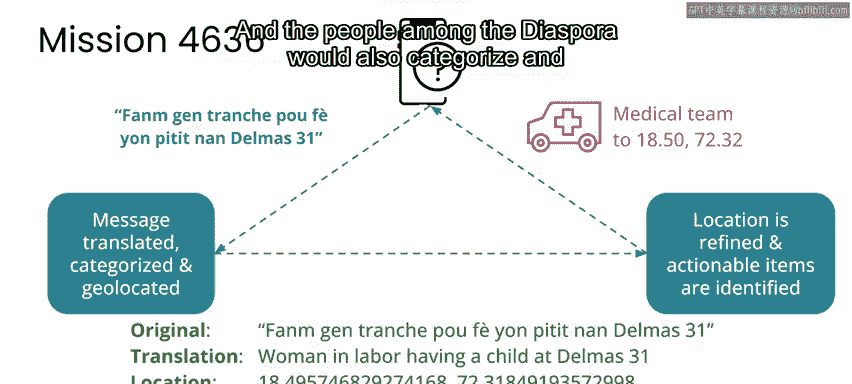

# 吴恩达《AI for Good专业课程》 AI与公共卫生、气候变化、灾难管理｜中英字幕 - P82：0_欢迎来到人工智能与灾害管理.zh_en - GPT中英字幕课程资源 - BV13u411F7xZ

Welcome to AI and disasteraster Management， the third course in the AI for Good Specialization。

In the first two courses， you learn about how AI can play a role in FS Azure's big challenges in public health and climate change in this third and final course of this specialization。

 you look at case studies of natural disasters and how AI can aid in disaster response and management。

Here again with Robert Monch， who will again be your instructor for this course。

In addition to developing many AI products in Silicon Valley。

 Robert is also a deep expert in disaster response and he has been involved in numerous disaster response and recovery efforts over the past few decades。

Thank you Andrew yeah it's great to be here and to speak about an area that I really care a lot about so before I moved to Silicon Valley I was working in postconflict development for the United Nations in Sierra Leone and Liberia and then even after moving here I've continued to work in disaster response so here in the US for cases like Hurricane Sandy where the company I running did aerial imagery analysis for FEMA immediately following landfall through to other projects worldwide so following earthquake in Haiti in 2010 following floods in Pakistan at the same time and most recently working with a number of organizations responding to the COVID-19 outbreak。

I feel like there are many people whose lives you have impacted that probably did not realize your technical skills or even your pre AI days。

 that that work was making recovery from some of these tragedies around the world much better for many people。

Yeah， I appreciate that and for me at least I worked in disaster response for a long time。

Having studied AI as an undergraduate and not initially even thinking that there was much of an overlap there。

 and it's been interesting to see as time has gone on how ubiquitous AI has become in the world in general。

 which also means that there are cases where when people are the most at risk following a disaster。

 AI can be part of a solution for them to help themselves recover from that disaster。

So remember one of the first projects you worked on was on language because you realize that with cell phones coming online。

 a lot of AI was done in English but not necessarily in the native language that would allow governments and systems and disaster recovery organizations to understand native languages as sort of the needs in a disaster response scenario Yeah I think a very important fact about the world's languages of that there are so many so it's about 7000 languages in the world and if you speak one of the less widely spoken languages then you are more likely to be the victim of a natural or men-made disaster and so for a lot of the problems that we face in disaster response scenarios as international responders we're going into an area where there's almost no one who speaks that language from among the international response community and so some of the most important things we can do are enabling communications between responders and the affected populations and also。

😊，allowing the affected populations to themselves discover information。

 to differentiate real news from disinformation and to help share whether it's market information or information about education or personal healthcare in their own language so that they can help impact their own recovery。

In fact， I know that sometimes people still wonder can AI make a difference。

 how can AI help people and save lives， I think Ra work and what you learn in this course is one very clear exciting solid tragic in some ways but really exciting and promising applications of these AI technologies So the first project that you see in discourse you illustrate important concepts using the application of using satellite imagery to assess damage and hope with disaster recovery after their hurricane and I think one of the most interesting things I heard from you was paying attention to privacy。

 the fact that satellite imagery can be very sensitive data and being respectful privacy even while we're trying to be responsive and quick in a disaster response scenario Yeah this is something we think about quite a lot in disaster response a lot of the time we I record information about people when theyre at their most at risk So in the case of。

ricaneane Sandy， the company I was running at the time coordinated aerial imagery analysis in this case it wasn't satellite images it was images taken by the Civil Air Patrol and we saw that these were high enough resolution that they could be used to identify individual properties and so after the response period we share the data with just one other company or an organization who could evaluate the quality and then everybody deleted the data so at no point was it made public and then no point was it stored long term and this is something that's really important to think about in any use case similarly in the first use case here in the case of Haiti we deleted all messages that could be used to identify an individual so it's not the full data set but it's a small enough set that the Haitian community looked at and agreed that we could share with the broader world I think these are great case studies in how to address important challenges to individuals。

Also being thoughtful about the privacy implications and being very respectful of that too Yeah that's exactly right and as we'll go over a few times in this course and you've seen already in the earlier courses。

 we have this principle of do no harm so when we try to release any technology whether it's AI or otherwise in critical situations like public health in disaster response we want to ensure that no one is at risk of being harmed who would not otherwise have been harmed so we're not looking like in maybe in an academic paper whether the net impact of an algorithm is higher accuracy we are looking for impact where there is no one losing out as well and then in the second project of this course will'll be one involving understanding text messages sent in the aftermath of a disaster say more about Yeah so this case is one that I worked on myself so following an earthquake in Haiti in 2010 more than 100。

Thouousand0 people were killed immediately and as the international response community came in we only had English as a common language while most people in Haiti only spoke Haitian Creole so I organized about 2000 members of the Haitian diaspora who could do real-time translation between Haitian Crele and English predominantly from emergency messages sent from the population in Haiti and the people among the diaspora would also categorize and geolocate these messages and so one of the things that was important to me following this disaster was understanding what could have we've done more with machine learning than we did at the time we used some machine translation but we didn't automate the categorization or the analysis of the data and so this actually became part of my PhD research applying methods like LDA to analyze these messages to understand how does a population communicate foreign a disaster versus a few weeks later and so this is what we'll be doing in this lab so you'll be using LDA。

Um to to analyze these messages and to get an understanding of how the the topics of these messages change over time。

 very inspiring work and so I'm excited。For you to jump into this third and final course of the specialization to learn about these important key studies in disaster response and recovery。

 so please go on to the next video and learn about these important concepts。

