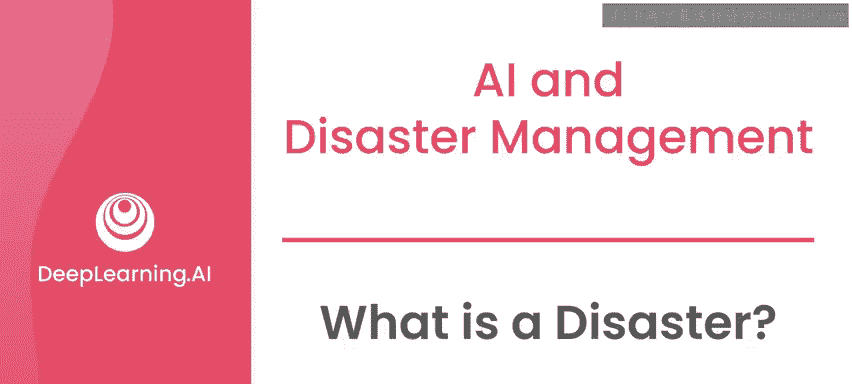
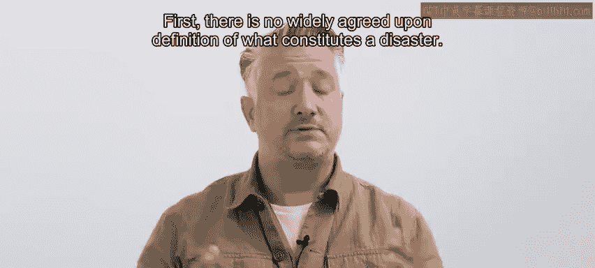
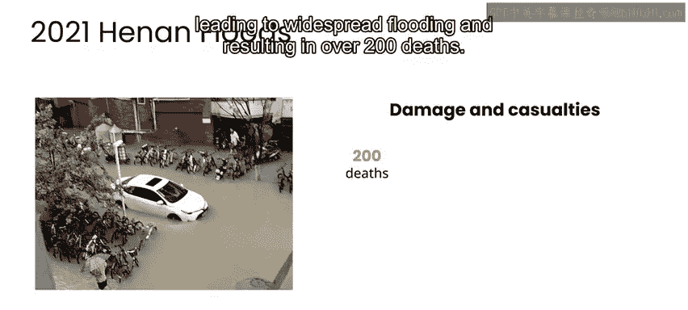
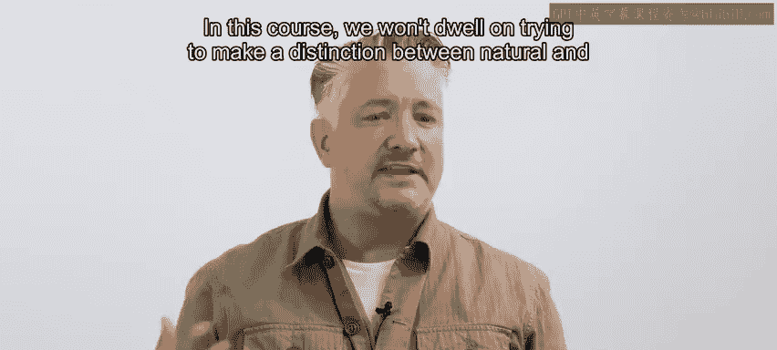
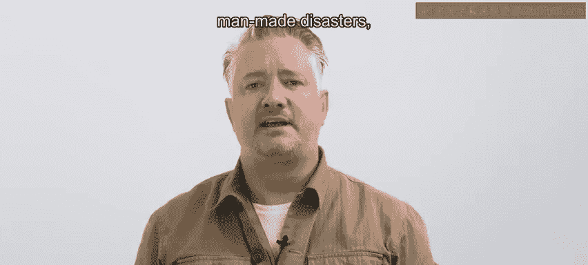
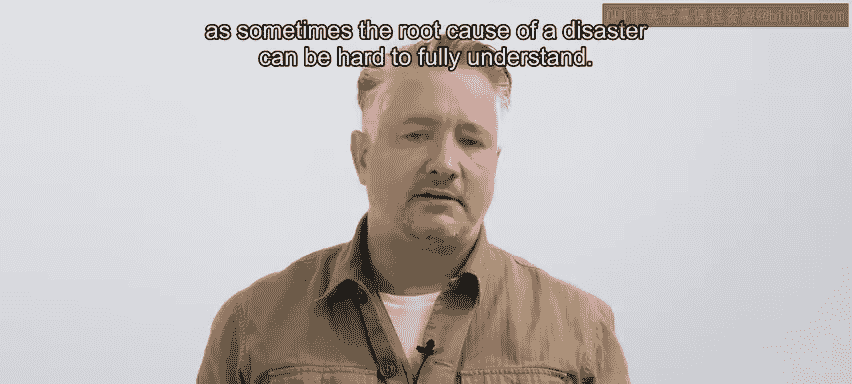
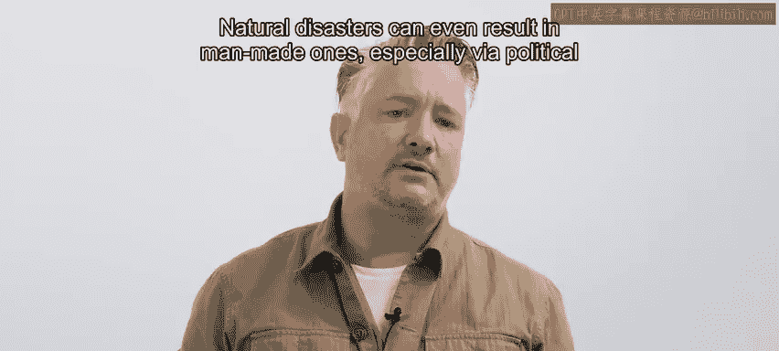
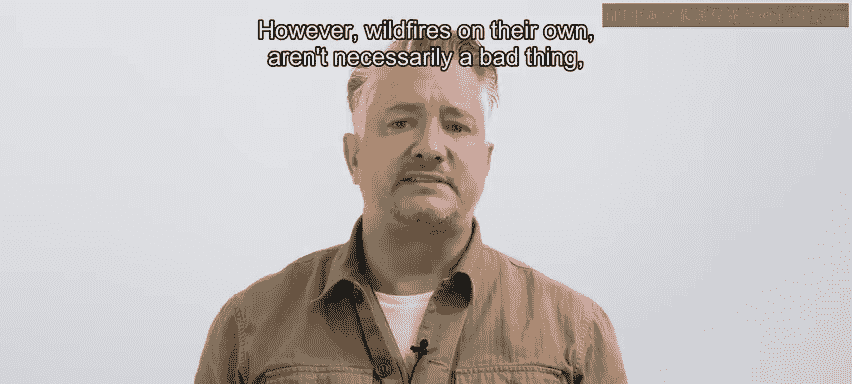
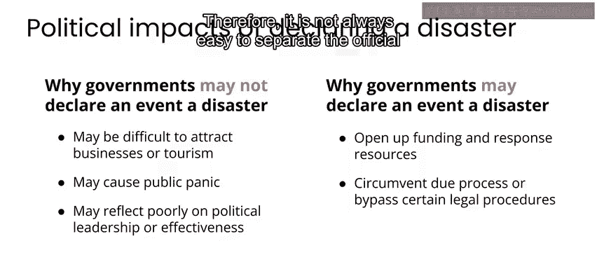

# 吴恩达《AI for Good专业课程》 AI与公共卫生、气候变化、灾难管理｜中英字幕 - P83：1_什么是灾害.zh_en - GPT中英字幕课程资源 - BV13u411F7xZ

Disaters are events or situations that cause extensive harm to people。

 property or damage to the environment this course is focused on how AI can help in efforts to mitigate and prepare for disasters as well as in the response and recovery efforts after a disaster takes place。

First， there is no widely agreed upon definition of what constitutes a disaster。

 but the United Nations Office for disasterster Ri Red has defined a disaster as a serious disruption of the function of a community or society involving widespread human。

 material， economic or environmental losses and impacts。

Let's look at an example in July 2021， Hean Province in China experienced one of the worst floods in its recorded history。

 a period of heavy rainfall for three straight days quickly overwhelmed the region's drainage system leading into widespread flooding and resulting in over 200 deaths。

The flood in displaced more than 1。5 million people and caused probably somewhere around $14 billion dollars worth of damage。

 roads， bridges and other critical infrastructure were destroyed。

 which disrupted transportation and communication networks。

 This left many people stranded in the floods。 The floods also caused significant economic losses and disrupted global supply chains。

 as Hainan is one of China's major centers for agriculture and manufacturing。

Disasters can also be manmade like the results of armed conflictflicts or industrial accident like a nuclear plant malfunction。

In some cases， it can actually be a combination of both or somewhat ambiguous。For example。

 on the 8th of November in 2018， strong winds caused power lines to go down。

 igniting one of the most destructive wildfires here in Northern California。

Excessive heat and drought conditions exacerbated by climate change。

 as well as decades of fire suppression efforts， caused the fire to quickly get out of control。

 The fire burned more than 600 square kilometers， destroying more than 18000 structures and taking the lives of 85 people。

 In this case， it might be hard to say whether this was a natural or a man made disaster。

On the one hand， it all started with wind and the damage was done by a wildfire。

But it was a power line that sparked the fire， and men made climate change in decades of fire suppression。

Made the fires worse than it might have otherwise been。In this course。

 we won't dwell on trying to make a distinction between natural and man-made disasters as sometimes the root cause of a disaster can be hard to fully understand natural disasters can even result in man-made ones。

 especially via political insecurity and the vulnerability of displaced people in impacted communities in any case throughout this course。

 you'll be focusing on disasters that are at least natural in origin。

 so situations that are the result of things like storms， floods， earthquakes。

 wildfires and droughts。

In disaster management circles， you will hear people talk about risk management。

 and really this is at the core or of disaster management。 For example。

 very dry conditions in a particular area might lead to a higher risk of wildfires。 However。

 wildfires on their own aren't necessarily a bad thing。 In fact。

 many plants rely on wildfires to germinate。

But when a fire causes is harm to people and damage to property。

 the result is often considered a disaster。Risk management in this case might mean fire suppression activities to keep a fire away from structures and early evacuation to keep people out of harm's way。

Similarly， earthquakes and volcanic eruptions are natural phenomena。

 and they occur regularly on land and under the ocean。

 and they carry a risk of impacting people in infrastructure。

 In many cases they occur far from population centers and no damage is done。 However。

 when these events occur near population centers， they can result in extensive damage and harm to people。

 Often the extent of the damage done is more a reflection of risk management or risk reduction efforts that took place ahead of the event。

 then the severity of the event itself。Disasters that occur rapidly or unexpectedly。

 like the damage done by earthquakes， tsunamis， floods， fires or hurricanes。

 are considered sudden onset disasters。On the other hand。

 slow onset disasters refer to crises or events that develop gradually， often over weeks。

 monthsth or years， like droughts， feamines and epidemics。

 exactly which events get officially designated as disasters may depend on what a particular government has to gain or lose by a dec in a state of disaster。

 and in some cases， a government may be reluctant to classify an event as a disaster due to potential repercussions。

 For example， reporting a disaster might make it more difficult for a country or region to attract businesses or tourism caused public panic or unrest in communities。

 or reflect poorly on political leadership or effectiveness。The opposite can also be true。

 declaring an official disaster in a region can open up funding and response resources that can be used to combat that disaster and more controversially to circumvent due process in the name of expediency like declaring martial law。

Therefore， it is not always easy to separate the official declaration of a disaster from politics。

Whatever the nature of a disaster， governments， emergency management agencies。

 humanitarian organizations and crisis impacted populations need to think about how to address the situation and not just after a disaster strikes。

But also how to take steps to prepare for and mitigate the impacts of a disaster。

Join me in the next video where I'll walk you through how disaster response organizations work to reduce the impact of disasters。

