# 吴恩达《AI for Good专业课程》 AI与公共卫生、气候变化、灾难管理｜中英字幕 - P84：2_灾害管理周期.zh_en - GPT中英字幕课程资源 - BV13u411F7xZ

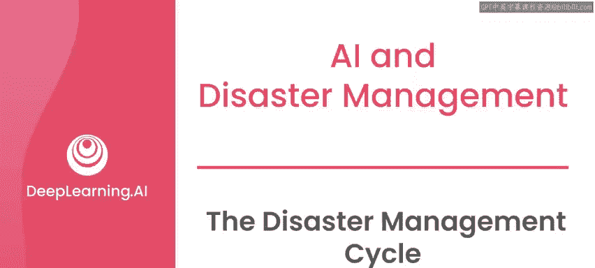

Disasters can have long last in impacts on the affected communities。

 this can be from significant damage to infrastructure to economic and social disruptions。

 and it may take some communities months or years， even decades to recover from a disaster and some cases impacted communities never recover In general。

 the degree to which an impacted community can recover will have a lot to do with risk management。

 response and recovery efforts that happen before and after any disaster。

 and so if that's what we're going to talk about here。

 You can think of disaster management as comprising four phases which are mitigation， preparation。

 response and recovery。

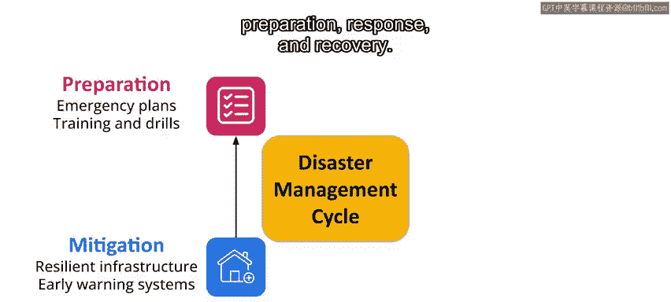

These phases can be thought of as part of a cycle in a sense， with each phase leading to the next。

 there isn't necessarily any starting or ending phase in this cycle and the work from one phase to the next may overlap significantly。

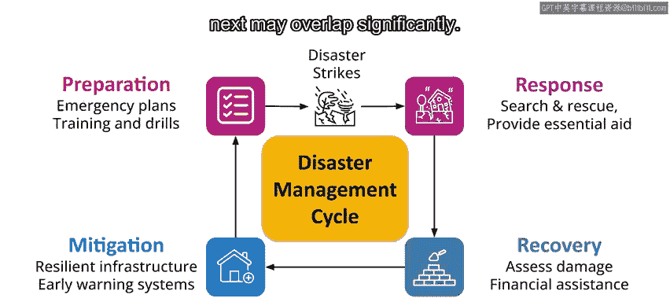

Effective mitigation and preparation measures are crucial for reducing the impacts of disaster on affected communities After a sudden onset disaster。

 the response effort is critical in the hours and days immediately following and a longerterm recovery effort is needed to help communities rebuildbuilt。

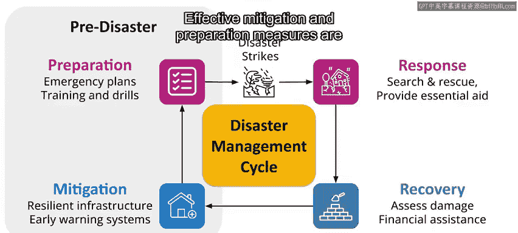

With the lessons learned post disaster， mitigation and preparation continue in order to reduce the impacts of future events。

For the context of this course， it is important to point out that immediately following a disaster is often the worst time to try to introduce new technologies to a community or a disaster response organization。

Therefore， a lot of work in AI and disaster response is focused on the preparation and mitigation phases。

This disaster management cycle is a sequence of phases that many organization uses a framework to plan for and reduce the impacts of a disaster you might see different versions of this cycle published by various organizations。

 you might even see it referred to as an emergency management cycle and applied to a wide range of scenarios。

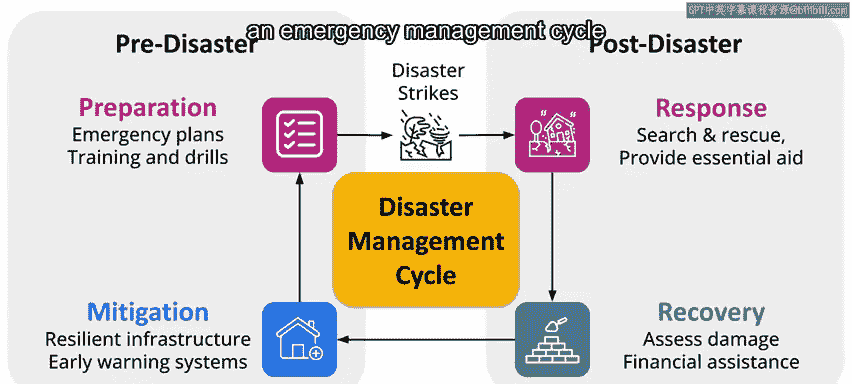

Dpenending on the nature of a given disaster and associated risks。

 the details of each phase in the psch call might look a little different。

 but overall the goals in each phase are generally consistent across different types of disasters or emergencies。

Let's take a look at some examples of actions taken with regard to the different risks and disasters at each phase of the disaster management cycle。

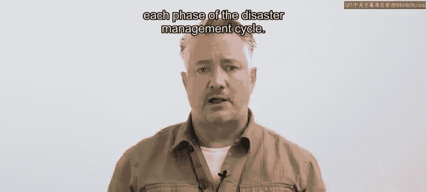

During the mitigation phase， emergency management professionals focus on taking actions to reduce or eliminate the risks and hazards associated with potential disasters in the Netherlands。

 for example， where much of the country is at or below sea level the sea itself can be considered a risk due to the potential for floods。

 in order to reduce the risk of flooding， the country has developed an extensive system of dikes and leviees。

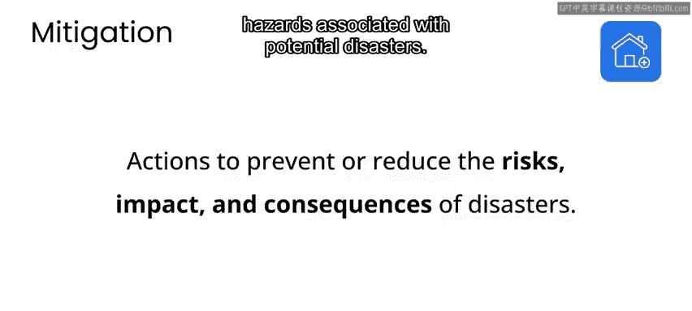

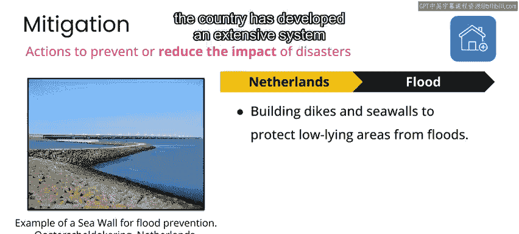

In the preparation phase， individuals and communities make plans and preparations for responding in the event of the disaster。

 For example， in Japan， advanced earthquake and tsunami warning systems are in place。

 along with extensive public education campaigns to raise awareness about natural disaster risks。

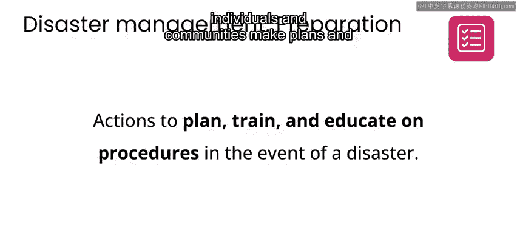

In the response phase， the focus shifts to taking in action to save lives， meeting basic needs。

 and managing the immediate aftermath of a disaster。

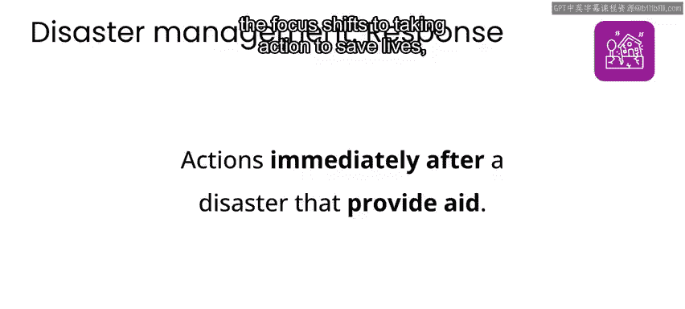

In the Philippines， for example， during the Mount Pinaubba eruption in 1991。

 the government coordinated such and rescue efforts to affected areas to help those who were trapped or injured。

 temporary shelters and relief centers were set up to provide aid。

 and international aid organizations also provided food and other supplies as well as medical care。

Finally， in the recovery phase， efforts are made to restore affected areas to pre disaster conditions and help communities rebuild。

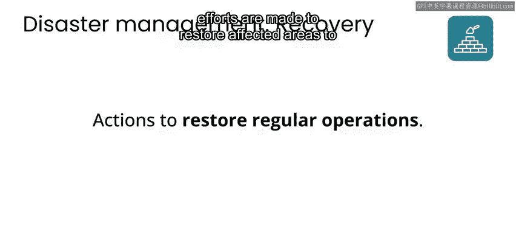

For example， in the United States after Hurricane Katrina in 2005。

 the government implemented a number of recovery programs。

 and this included financial assistance for affected businesses and individuals。

 a program to rebuild damages infrastructure， including buildings and levies。

And a housing assistance program for those who are displaced from their homes。

One consistent challenge across all phases of the disaster management cycle is that data-driven decision making is essential in most cases some amount of manual processing and analysis is required but manually processing large amounts of data can be tongue consuming and errorprone。

 and this is where there can be an opportunity for AI to be part of a solution in the response phase the data that needs to be analyzed and processed quickly will include things like satellite imagery。

 whether sensor data， text and voice communications。As efforts shift from response to recovery。

 the data is required to make informed decisions for longer term。

 logistical planning and resource allocation。During the mitigation phase。

 data plays a key role in many early warning systems。

 including forecast and real time sets of measurements。In the preparation phase。

 analysis of historical data on the causes and outcomes of disasters can help to develop more robust emergency response plans。

When implemented successfully， AI can play an important role in all phases of the disaster management cycle by providing timely and accurate information。

 optimizing resources and logistics。And hoping to reduce the impact of disasters on affected communities。

Like you saw in the case studies in previous courses。

 it is important to note that not all disaster management efforts will benefit from AI if data plays a significant role in the problem。

 then it might be worth considering an AI approach but in practice artificial intelligence might not provide added value and could even distract for more straightforward solutions。

 so it's important to be looking at all options。It's also worth noting that many people find themselves moved to take action in the immediate aftermath of a disaster。

 and this is natural given that the impacts of disaster may be appearing in media stories and there's a sense of urgency however。

 I can say that if you want to get involved in disaster relief efforts。

 the response phase is often the worst time to get started as emergency responders are usually overwhelmed and most critically need help from people with existing specialized skills as well as robust systems for data handling and decision making。

😊。

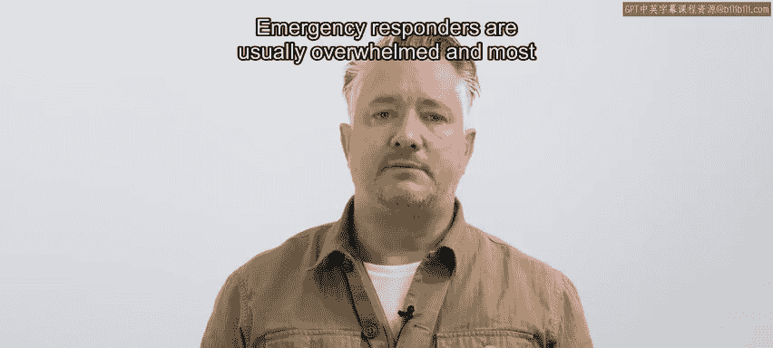

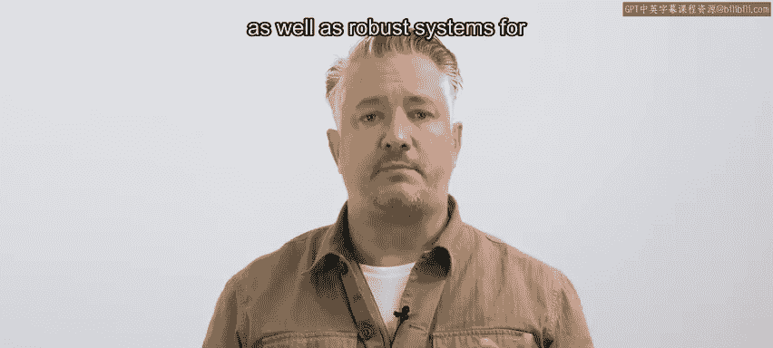

Instead， if you want to help， it's often better to get involved in the long-term recovery effort or work towards the mitigation and preparation for disasters once you're well oriented to the problems that need addressing through the work in these other phases。

 then your efforts in the response phase are more likely to be impactful。Next。

 we'll look at how each of the phases of the disaster management cycle precedeed for a particular disaster。

 well what was actually two disasters closely following each other when two cyclones hit Mozambique in rapid succession in 2019。

