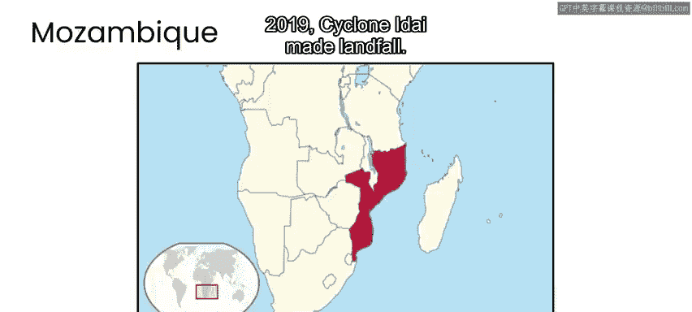
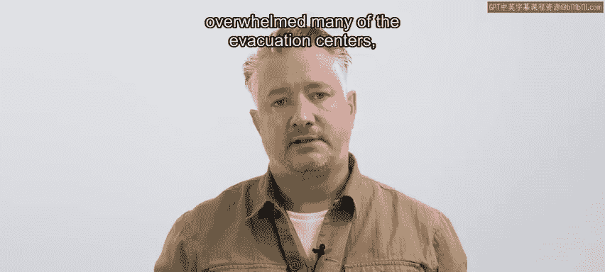
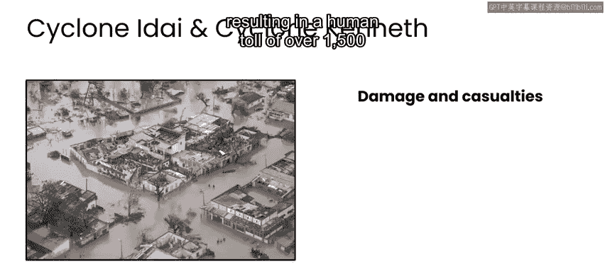

# 吴恩达《AI for Good专业课程》 AI与公共卫生、气候变化、灾难管理｜中英字幕 - P85：3_台风伊代肯尼思.zh_en - GPT中英字幕课程资源 - BV13u411F7xZ

Through the next few videos， I'll walk you through the actions taken at each phase of the disaster management cycle when two cyclones hit Mozambique one after another in 2019。

First， let's take a look at what happened and the immediate impact of the disaster。

The country of Mozambique lies on the eastern coast of southern Africa On 14th March 2019。

 cyclone idai made landfifall。 A cyclone is a tropical storm that typically consists of strong winds and heavy rains。

 and depending on where you live， you may be more familiar with these storms being referred to as hurricanes or typhoons。

When cyclone id I struck， the storm brought heavy rainfall。

 flooding and high winds up to 195 km per hour to put that into perspective。

195 kilomre per hour winds strung enough to pick up andhulll heavy objects。

 like concrete blocks and even more vehicles。 It would nearly be impossible to stand or move against the force of such a wind In anticipation of the storm。

 Mozaique issued a red alert and urged residents to seek shelter on higher ground or in sturdy buildings。

 In some areas， emergency services went door to door to encourage people to evacuate。

As a result over 800，000 people were evacuated before the storm hit。However。

 despite the warnings and evacuation efforts， many people in the affected areas were still caught off guard by the storm severity and some could not evacuate in time。

 The sheer scale of the disaster overwhelmed many of the evacuation centres leading to overcrowding and unsanitary conditions。

The storm caused power outages and damage to crops leading to food shortages。

 and in some cases the wing lifted dangerous debris such as sheet metal from homes。

 causing further destruction， severe injuries and fatalities。On April 25th， 2019。

 just six weeks after Cycloone die， Cyo and Kenneth made land for in northern Mozambique。

The storm caused significant damage to critical infrastructure， including roads。

 bridges and airports， which resulted in delays in the delivery of aid supplies to impacted communities。

As Kenneth hit a different location in Mozambique， relief efforts were divided。

 which further exacerbated the scarcity of essential resources and aid。

According to the final report from the Mozambican government in May 2020。

 the impact of both cyclones was extensive resulting in a human toll of over 1。

500 fatalities and 160，000 people displaced In addition there was about 3。

2 billion U worth of damage to the region。

The storms also damaged or destroyed over 700000 homes， leaving many families without shelter。

 The floods caused significant damage to crops， which cripple the economy and LED to food insecurity in the impacted areaer。

😔，In the first few hours， following  Cyone Iai's landfallll。

 impacted communities were faced with widespread flooding， power outages。

 and communication breakdowns， making it difficult for authorities to assess the extent of the damage and to initiate response efforts。

In order to ensure a quick and effective response， coordination and critical information sharing on the ground is essential。

So join me the next video where we will look at the details of the responses and recovery after cyclcloin's die in Kenneth struck Mozambique。

