# 吴恩达《AI for Good专业课程》 AI与公共卫生、气候变化、灾难管理｜中英字幕 - P86：4_台风伊代肯尼思响应与恢复.zh_en - GPT中英字幕课程资源 - BV13u411F7xZ

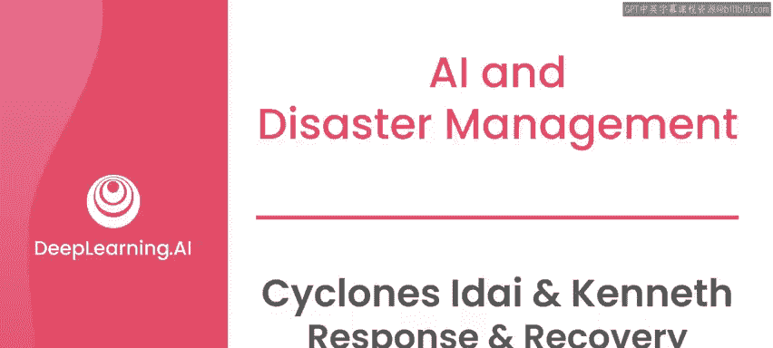

After Cyone Day struck on the 14th of March， 2019， the disaster responsese organizations had to act quickly in order to assess the damage。

 locate safe shelters， send search and rescue teams and determine the needs of the impacted areas。

As you saw previously， the disastermentnstru cycle has full phases， mitigation， preparation。

 response， and recovery。

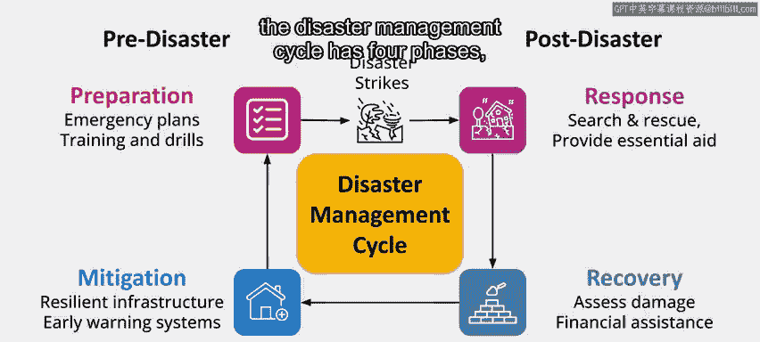

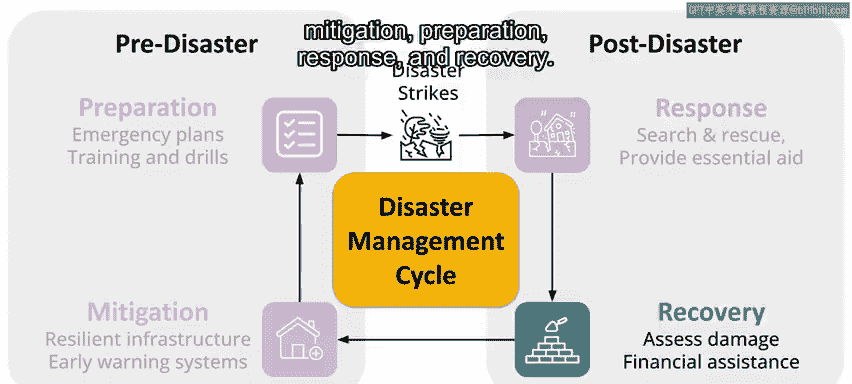

In this case， we'll start in the response phase。Within hours after Cyity Day struck。

 the Mozambique government deployed its National Institute of Disaster Management to coordinate emergency response efforts。

 including search and rescue。

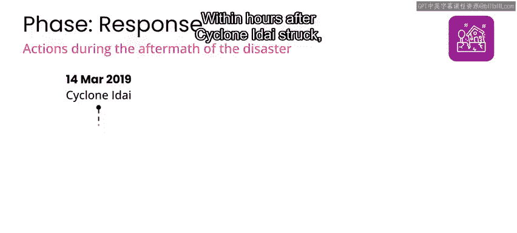

International organizations， including the UN and medicine onroniers。

 also known doctors Without borders， deployed teams to work alongside Mozamban authorities to provide emergency aid in a project led by the UN Institute for training and research and the European Space Agency AI was used in satellite imagery analysis to identify map damaged infrastructure。

 allowing organizations to quickly assess the extent of the damage and prioritize response efforts。

 they were also able to locate roads and bridges affected by the flooding allowing for the optimization of the delivery of emergencyer supplies to impacted communities。

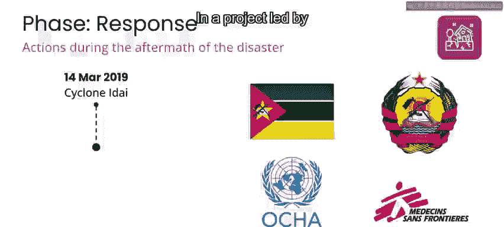

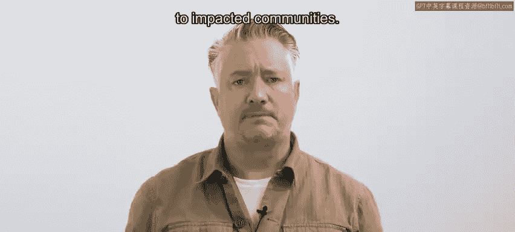

To collect and respond to requests for assistance from individuals and communities。

 the United Nations Children's Fund or UNICEF used an AI powered chatbot that was part of their U report system to analyze the requests and identify appropriate aid response。

This project supported multiple languages， including Portuguese and local languages including Choonno and Bello。

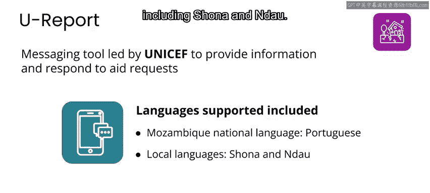

And just a side note here， a chatot like this takes years of trial and error to get right。

 It is not deployed for the first time in a disaster。 In fact。

 UNICF began developing your report in 2011 as you'll recall。

 if you took course one of this specialization I was part of an effort in Nigeria focused on a maternal In health where we built an AI system for use whether you report tool to automatically categorize and prioritize text messages and while our project was ultimately not successful。

 the lessons learned through our project and others like it。

 allow the U report tool to become more robust in situations like this in the response efforts in Mozambique。

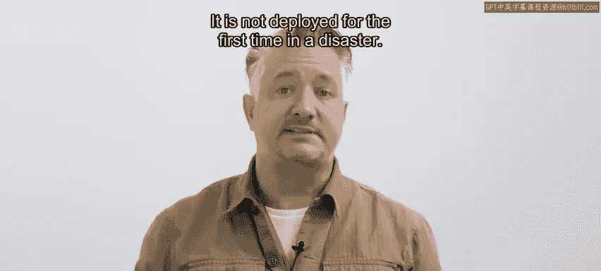

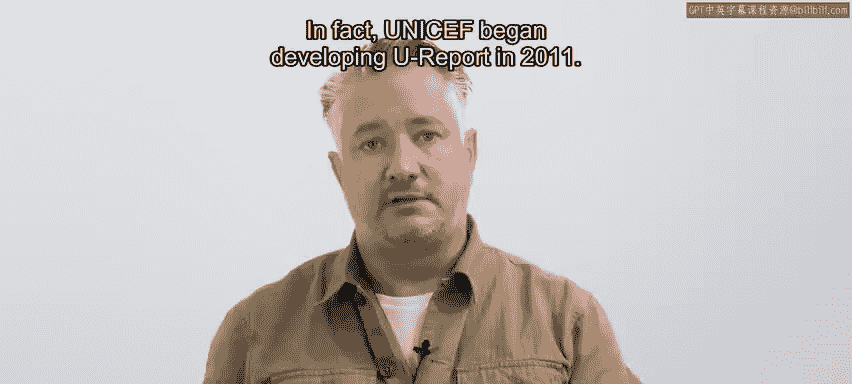

On the 19th of March， so five days after the Cyone made landfall。

 the Mozambique government declared a state of emergency and established an emergency operation centre to coordinate response efforts and a central point of contact for international assistance。

😊，On the 25th of March， the World Health Organization declared the situation to be a grade three。

 which is the maximum grade in their emergency response framework。

These declarations were important actions as they allowed the mobilization of resources and expertise from the international community to help respond to the disaster。

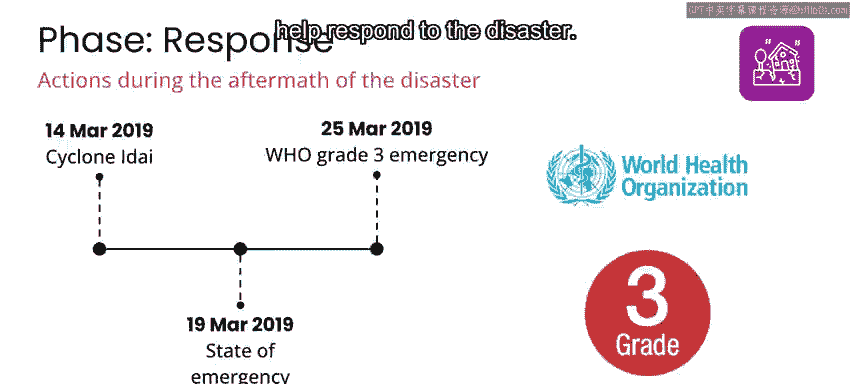

The flooding from the cyclone led to contaminated water sources， damaged， sanitation infrastructure。

 crowded and unsanitary living conditions， and limited access to healthcare services。

These factors combined to create the perfect environment in which cholera and other waterborne diseases could spread quickly。

The first cholera cases were reported on the 27th of March。

 and soon after the outbreak spread quickly， by 15th of April。

 only three weeks after the first cases were reported， a total of 4。

000 cases of cholera were confirmed and 28 deaths were reported。

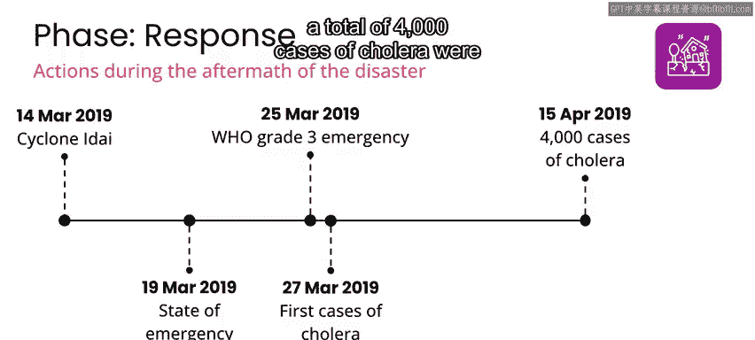

An early warning system deployed by the World Health Organization also included a machine learning algorithm that analyzed data on rainfall patterns。

 water levels and water quality to predict where outbreaks of waterborne diseases like cholera were most likely to occur These machine learning signals。

 along with a very large number of manually collected signals。

 helped guide the deployment of medical personnel and resources to at risk areas。

To combat the outbreak， the World Health Organization provided technical guidance to support response efforts and help set up cholera treatment centers and cholera vaccines for at risk people。

 organizations including healthcare facilities that already existed in the region， UNICF。

 doctors Without Borders， and the International Federation of Red Cross and Red Crescent societies。

 helped to set up treatment centers， medical teams， medical equipment and emergency supplies。

 and this included things like water purification tablets， hygiene kits and soap。

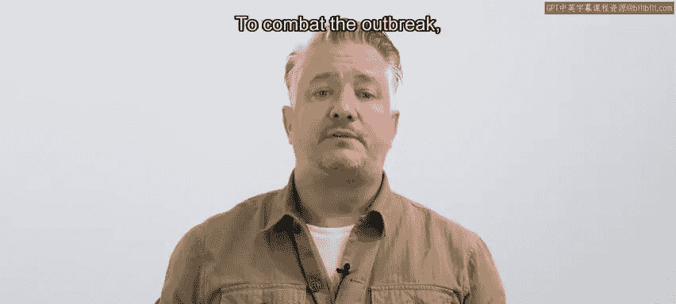

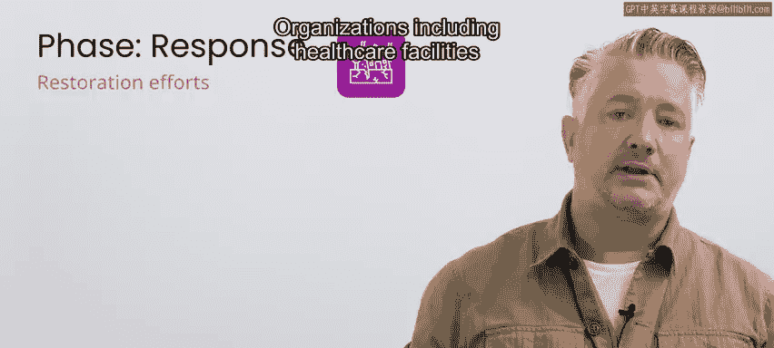

Organizations work closely with the local communities to better understand the needs of the impacted populations and to target the people who needed help the most。

The recovery phase began as the situation stabilized。 It's important to note， however。

 that the start of the recovery phase does not necessarily mean the end of the response phase。

 It only means that some organizations began conversations about repairing and restoring the community。

 in general， the recovery phase for any disaster has for main objectives。 First。

 to restore essential services， such as access to food， water， sanitation。

 health care and school openings， as well as information about access to those services。Second。

 to rebuild infrastructure， including roads， bridges and buildings。Third。

 to provide support to impacted communities to rebuild their homes and livelihoods and fourth to support disaster risk reduction efforts to prepare for future disasters。

The Mozambique government， along with the support of various organizations。

 provided assistance in different areas of recovery efforts after Cycle only Day， for example。

 the International Organization for Migration offered support in the form of repairing damaged homes and supply materials to families for rebuilding。

😊，The World Health Organization provided assistance to restore health facilities and deliver medical care。

UnICEefF facilitated the rehabilitation of schools and provided educational materials to children Additionally。

 they offered psychosocial support to aid children in coping with the trauma caused by the cyclone。

The United Nations Development Program provided assistance to restore livelihoods in affected communities by offering support in agriculture。

 fisheries and small businesses。They also provided job training and tried to establish new economic opportunities。

The overwhelming majority of disaster responders are typically not international。

 but are local organizations and individuals that are essential in rebuilding and supporting communities after a disaster。

 they are typically better equipped to identify and respond to the specific needs of the impacted populations and they can build trust and facilitate communication with that community。

 despite their vital role， local organizations and individuals often receive less media attention than their international counterparts。

Who have greater resources and outreach capabilities？For example。

 when I worked for UNHCR so the UN's Refuge Commission in Liberia。

 I was technically working for a local organization and employed by someone who grew up there。

 but we were funded by the UN who also provided us with trucks and other logistical assistance。

It's important to recognize and support the work of local organizations who are often the first on the ground and continue to work long after international organizations have moved on。

With support from local organizations， communities can rebuild and recover sustainably and equitably。

 and so the best way to support disaster response efforts is to work directly with local organizations。

 which will lead to a more immediate and direct impact。

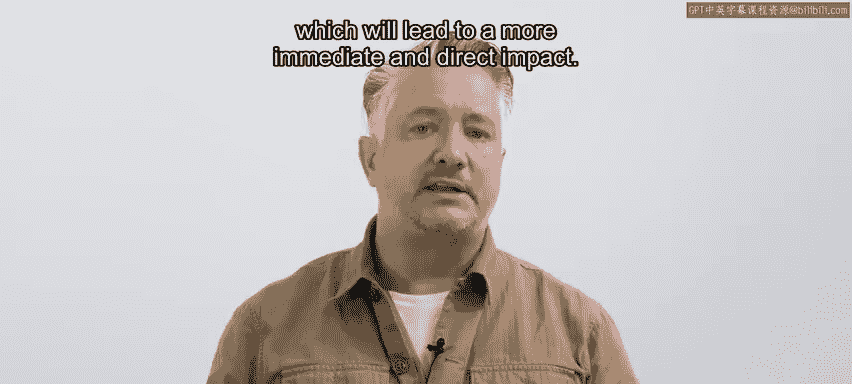

In the midst of the response to recovery efforts after  Cyoneia die。

 Cyone Kenneth struck Mozambique on 25th of April。 that was just six weeks after the previous storm hit。

This second cyclone triggered an immediate response by the government and aid organizations。

 but the severity of the storm and its impact devastated the ongoing humanitarian relief efforts and caused further damage to roads。

 bridges and airports， making it difficult for aid workers to access。

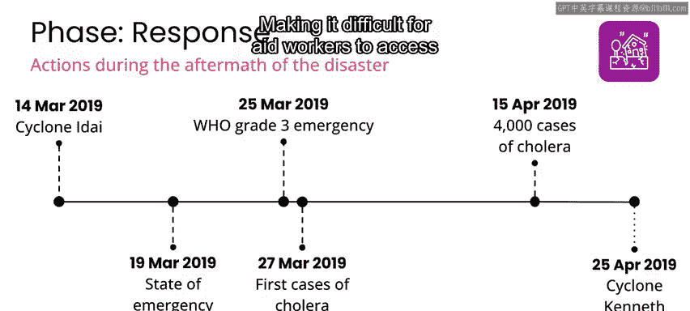

The impacted areas and delaying the delivery of essential aid。

In the years leading up to the cyclones， Mozambique had made efforts to improve disaster preparedness。

 it had already established a natural disastera Management Agency and developed a risk reduction strategy。

 However， these efforts were still in the early stages and were not fully prepared for the devastating sequence of cyclones。

The takeaway here is that in order to be the most effective in your work in the response and recovery phases of disaster management。

Your work in the mitigation and preparation phases is critical。

 and that's what we'll talk about next。Join me in the next video to look at the mitigation and preparation that Mozambique has engaged in both leading it up to and after the twocyclones in 2019。

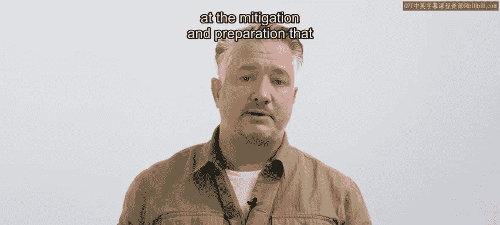

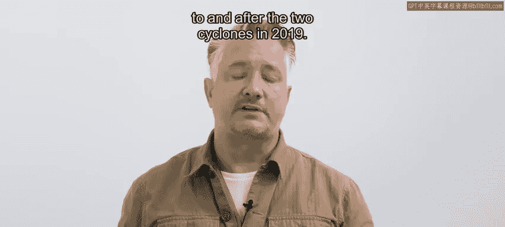