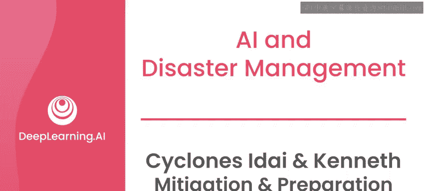
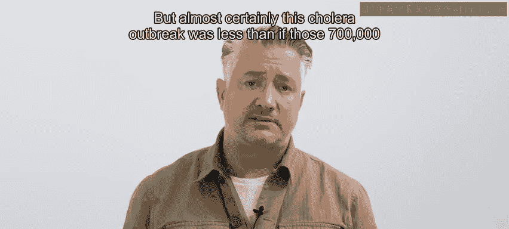
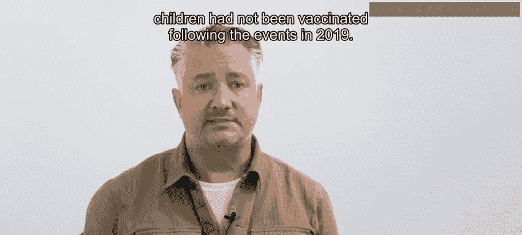
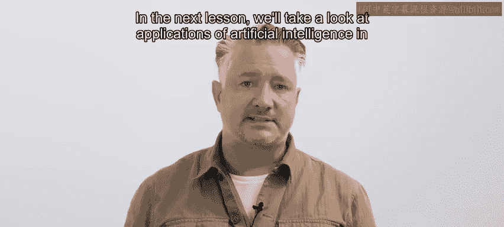
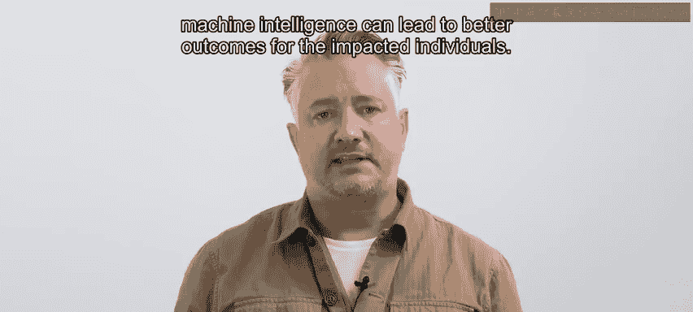

# 吴恩达《AI for Good专业课程》 AI与公共卫生、气候变化、灾难管理｜中英字幕 - P87：5_台风伊代肯尼思缓解与准备.zh_en - GPT中英字幕课程资源 - BV13u411F7xZ

Moszambique's existing infrastructure and communication systems were not equipped for the intensity of cyclones Iai and Kenneth。

 the storms highlighted the need to shift towards a more proactive approach to disaster management。

To mitigate future disasters， Mozambique invested heavily in early warning systems。

 the United Nations Development Program was involved in installing weather monitoring stations that provided realtime data on weather patterns and help forecast the likelihood of extreme weather events。

In addition， improvements were made to phone based alert systems。

 including broader and more reliable coverage and support in additional languages。

 such as the Chu and Nnja languages。To make infrastructure disaster resilient。

 many buildings were rebuilt using concrete and steel， to better withstand extreme weather events。

 Architects also considered the topography of the region and built new infrastructure on higher ground and implemented draining systems and wetlands to prevent flooding。

To prevent future disease outbreaks， medical professionals vaccinated upwards of 700。

000 children for cholera。In addition to implementing various mitigation measures。

 efforts were then directed towards a preparation phase aimed at enhancing the country's ability to anticipate。

 prepare， and train for in respond to future disasters。

The Mozambique government worked with international partners to improve disaster preparedness and response in the event of future disasters。

😊，Existent emergency plans were improved and this include things like preparing contingency stocks of a essential relief in prepositioned locations close to where the impact of communities would be。

😊，The International Organ for Migration， trained Commun on disaster risk reduction strategies。

 including evacuation and emergency response planning。😊，Many organizations。

 including UNICEF and the WHO and first local nongovernment organizations。

 conducted hygiene promotion campaigns， entering train community health workers and volunteers on how to promote safe water practices and conduct hygiene and sanitation activities。

Community participation was critical in raising awareness and building resilience to future disasters。

 people were trained in disaster preparedness and risk reduction measures and encouraged to play an active role in monitoring and responding to potential hazards。

Since cyclones had die in Kenneth in 2019， Mozaique has seen three other significant cyclones in the region。

 cyclone Freddie， which formed over the Indian Ocean in February of 2023。

 was measured to be the longest last in and most powerful cyclone ever recorded anywhere in the world。

The cyclone made landform Moam big on the 2 of March that year。

 with heavy rains and sustained winds of 270 kilometers perph。

Thanks to community basically warning systems， Mozambique was able to alert residents ahead  Cy Freddie's arrival through text messages and local radio and TV announcements in multiple languages。

 This gave people more time to move to shelters resulting in a much lower death toll than previous disasters。

Unfortunately， the impact on water and sanitation systems。

 as well as health facilities was extensive and the cholera outbreak was even worse than following cycling in 2019。

But almost certainly this cholera outbreak was less than if those 700。

000 children had not been vaccinated following the events in 2019。

Hopefully this highlights why mitigation and preparation for disease outbreaks and other risks or ongoing challenges in any region that faces natural disaster events。

😊，Studying and analyzing the impacts of disasters in these mitigation and preparation phases can help identify ways to improve mercy response systems。

 infrastructure and preparedness for future events。

By incorporating these learnings into future planning and actions。

 communities and governments can work towards reducing the impacts of future disasters and ultimately save more lives。

😊，In the next lesson， we'll take a look at applications of artificial intelligence in disaster management and how combining human and machine intelligence can lead to better outcomes for the impacted individuals。

