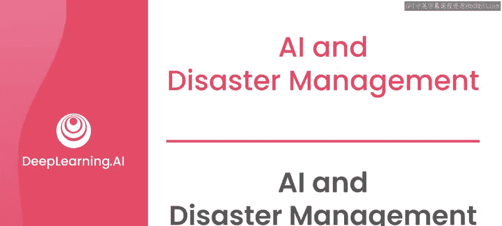
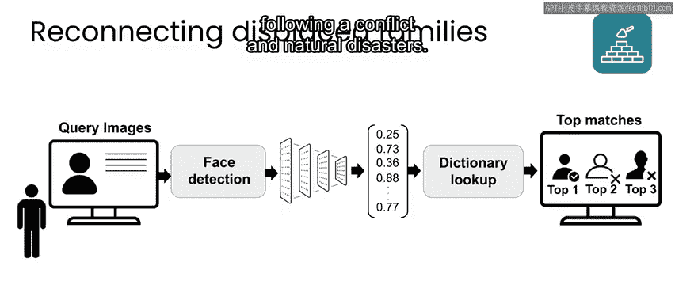
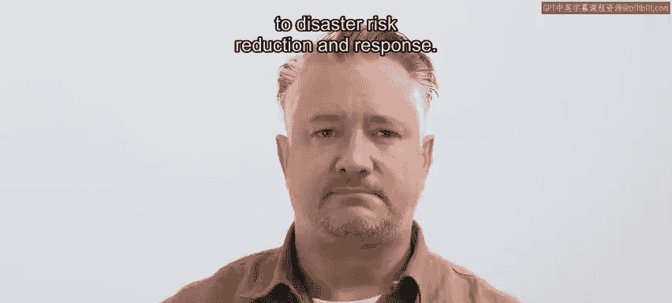

# 吴恩达《AI for Good专业课程》 AI与公共卫生、气候变化、灾难管理｜中英字幕 - P88：6_人工智能与灾害管理.zh_en - GPT中英字幕课程资源 - BV13u411F7xZ

There are many sources of information that can be relevant in disaster management。

 and this includes digital communications， forecast and sensor data。

 aerial imagery and more this data can be used to monitor and predict the progression of a disaster。

 identify areas of high risk and help prioritize response efforts In many cases for a human to manually make sense of all the relevant data would be time consuming and in some cases impossible。

 and this is where AI has the potential to add value。 In fact。

 there are many general purpose AI products that you might take for granted if you speak a dominant language like English tools like search engines and translation apps。

 These tools can be incredibly useful in facilitating communication and the dissemination of information following a disaster or as an early warning in system。

 Unfortunately， the majority of the words' languages are not supported in search or translation applications。

 For this reason， one great way to help support disaster preparedness and response。

Is to build more general purpose AI applications for speakers of low resource languages。

 this will help them more easily communicate and find information or distinguish real from fake news。

Let's take a look at some examples of where AI can be part of this illusion。

In order to improve disaster risk reduction and early warning capabilities around the world。

 the United Nations Development program has created a multihazard early warning system The system uses AI to process and analyze various data sources。

 including meteorological sources， hydrological data。

 seismic and geophysical data as well as satellite imagery to provide accurate forecasts and hazard maps for severe events。

 This includes things like windstorms， droughts， wildfires and more。

This tool uses historical data from data rich locations and then extrapolates to assist in areas with relatively little onsite observation data。

 This project is ultimately aimed at reducing the exposure of communities。

 livelihoods and infrastructure to weather related disasters。Once the data has been analyzed。

 the tool uses AI to automatically detect and trigger early warning in alerts based on specific criteria to mobilize response efforts quickly。

 several countries have launched this system， including in to date， Bangladesh， India。

 Indonesia and the Philippines。To improve response times to wildfires。

 a company called Pano AI employs ultra high definitionfin cameras， along with AI to detect。

 evaluate and pinpoint new wildfire locations， because the initial minutes after a fire starts。

 critical in minimizing the potential damage to lives and property。

 Penno AI's deep learning computer vision algorithms as well as their human in the loop monitoring center rapidly detect。

 verify and classify events in real time。 traditionally。

 bystanders would report wildfires to local authorities and in some cases it could take hours to precisely locate where the fire is and to dispatch the first responders。

 however， when Penno AI detects a potential threat。

 it can immediately alert a fire monitoring professional and provide intelligent autocented images with enhance them and this allows the professional to then confirm or realize that it was not in fact。

 a fire at a given location。Looking at another example。

 Microsoft's AI for humanitarian Action Project partnered with the Turkish Red Crescent to develop an AI powered platform that helps reunite families separated during a disaster or a conflict This work is an extension of the restoring family links project of the Red Cross。

 which for decades has worked to reconnect people following on conflict and natural disasters。

I worked on a similar system with Google after the Haiti earthquake in 2010 and that project evolved into a general purpose tool for people to post and reconnect with loved ones after a disaster you can find more information about both these projects in the resource section at the end of this week。

AI has the potential to offer many benefits in disaster management such as improved situational awareness。

 faster response times and more effective resource allocation， however。

 AI has some important limitations in this context as well， including the need for accurate data。

 the potential for biasers and non-representative data and challenges related to communication with the impacted communities Additionally。

 deploying AI systems may require significant resources and technical expertise and ethical considerations such as privacy and accountability are often amplified when using AI。

As a result， it is essential to evaluate AI's potential benefits and limitations in disaster management and incorporate that as part of a broader integrated approach to disaster risk。

 reduction and response。

Join me through the next few videos where we will go over some guidelines that I use to ensure projects I'm involved in or reviewing are set up for success and minimizing doing harm。

