# 吴恩达《AI for Good专业课程》 AI与公共卫生、气候变化、灾难管理｜中英字幕 - P89：7_帮助社区自助.zh_en - GPT中英字幕课程资源 - BV13u411F7xZ

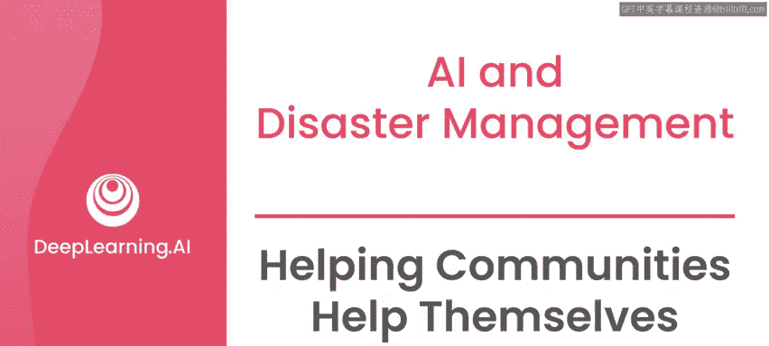

There are many individuals and groups around the world that are actively pursuing research and development of machine learning tools designed to help with disaster management。

A very large number of these people aim to make a positive impact and many are indeed working on solutions that will lead to positive outcomes A few years ago I chaired the first ever track of the major machine learning conference that was focused on disaster response the track was called natural language processing techniques for emergency situations and crisis management and while it was held virtually at the height of COVID-19。

 it focused on natural language processing and disaster response more broadly。

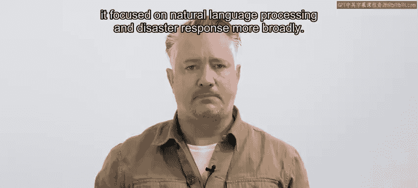

At that time， I wrote an article laying out some general guidelines about applying machine learning applications to disaster management These guidelines are intended to inform researchers。

 but much of what I wrote also applies more generally to any person working in an area of AI and disaster management here I'd like to briefly summarize some of the main points from that article。

 but you can also find the full article linked in the resources section at the end of this week。

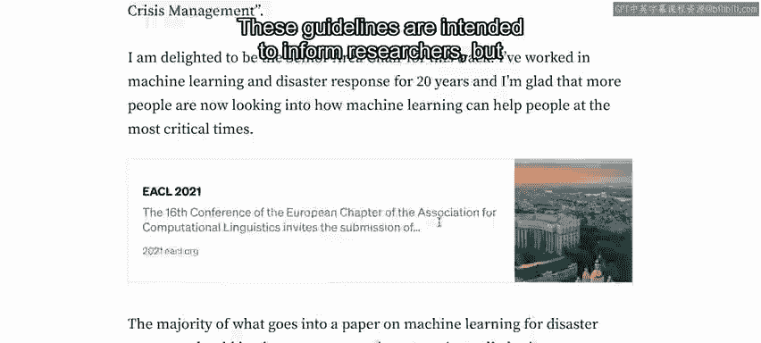

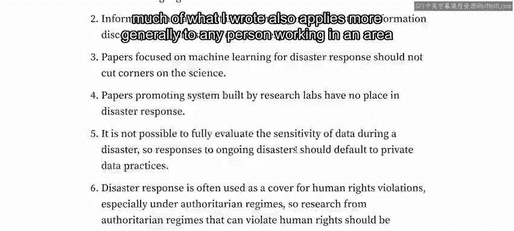

And just a bit of forwarning before we begin with these guidelines。

 we're about to get into some fairly heavy material in disaster management work。

 even with the best of intentions， it is possible to do more harm than good。

 mishandling of data failure to take local language or social practices into account。

 working with oppressive regimes and other missteps can lead you to put lives at risk。

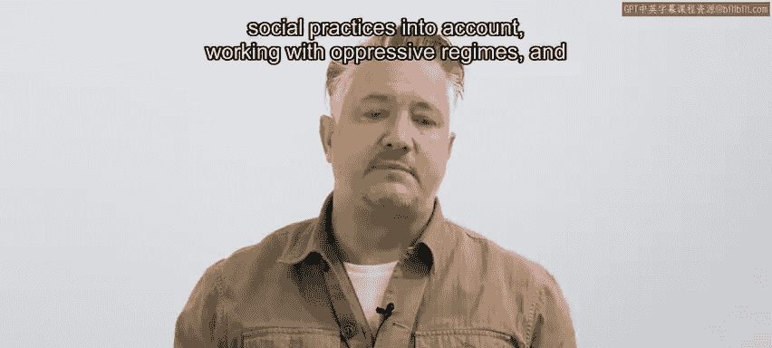

We'll touch on all of these points through the next few videos。 But first off。

 for any large disaster， we simply don't have the resources to help most people directly。For example。

 during a pandemic， it's individuals themselves that must be directly responsible for social distancing and sanitation。

After an earthquake， your neighbors are much more likely to pull you from your collapsed house than a professional search and rescue team。

For this reason， one of the most important things that you can do to help mitigate the impacts of a disaster anywhere is to help communities to be prepared to help themselves。

The most important way to support communities impacted by disaster is with clear communication。

 speakers of low resource languages more likely to be the victim of both natural and man-made disasters and by low resource I mean languages that don't typically get the kind of support within technical applications like search engines or translation apps that you see for English and other more dominant languages。

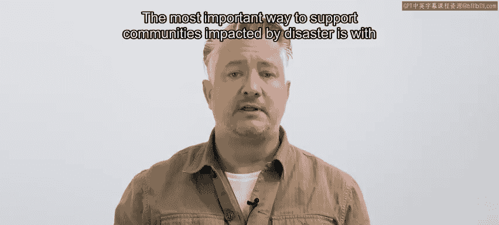

Such technologies are absolutely critical when it comes to communities having access to the best information and being able to communicate their needs。

Any technology that helps get information to linguistically diverse communities will help them in many situations。

 including disasters。 In fact， I believe that some of the work that I have done helping large companies deploy technologies in more languages has probably had a bigger impact on disaster response than some of the time that I've spent working in refugee camps for the UN。

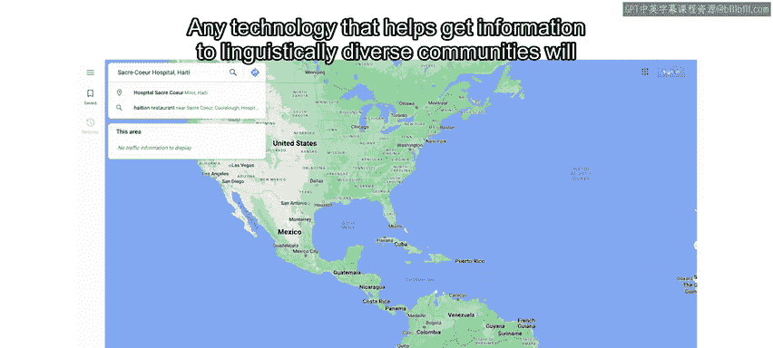

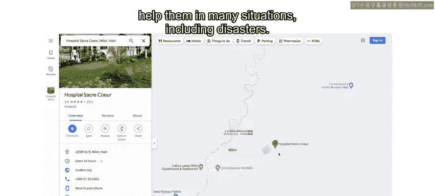

For example， when disease outbreaks occur， they're most likely to be discussed first in a low resource language this is because most of the world's linguistic diversity occurs in the same thin band of the tropics as most of the land based ecological diversity pathogens included。

So if you happen to be working to improve the language support of devices and applications like search engines and translation apps。

 then I have good news for you， you are already working on one of the single most important problems for machine learning in disaster response。

These tools will help disaster responders communicate with the impacted community and help the impacted community search for the right resources online to help themselves。

I've seen the downsides of getting translation and communication wrong many times， for example。

 in Sierra Leone during the Ebola crisis， an international news agency broadcast mandate language announcements in a 1ee speaking area。

 creating distrust because Monday was seen as the language of the opposing political party who happened to be in power at that time as a result。

1ney speakers were more likely to avoid healthcare clinics for fear of contracting Ebola there。

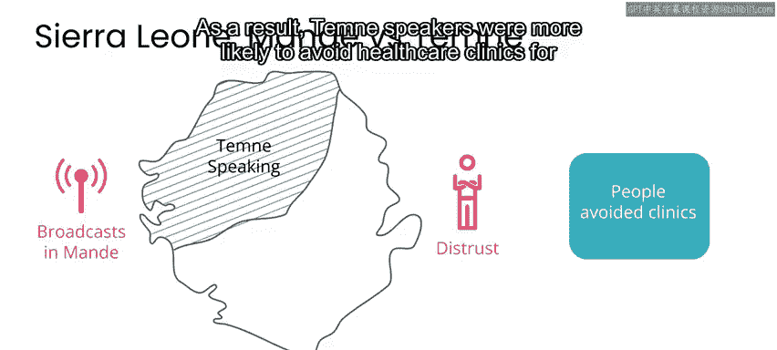

Later， I worked with aid agencies to come up with a deeply sad conclusion that for every person who died from Ebola。

 10 people died nearby from other preventable conditions。

 because they were avoiding the clinics in this way。

 they're broadcasting an amplification of a wealthy nation's fear into the local media combined with too little attention to local languages。

 killed 10 times as many people as Ebola itself。

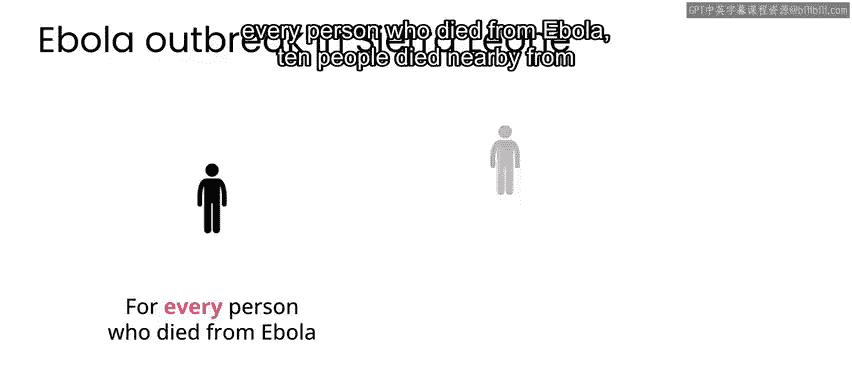

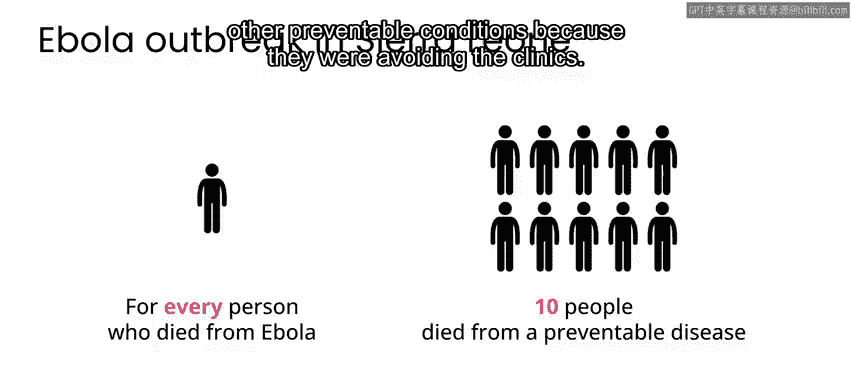

Getting the language and communications right can make a positive impact too， for example。

 following the 2010 earthquake in Haiti， thousands of people among the Haitian diaspora were able to help people within Haiti by translating between Haitian Korea and English the language of the international responders。

 The translator's work save many lives。 it also supported machine learning research for disaster response as part of a multilingual disaster response data As that's now widely used and in fact。

 you'll get a chance to work with that data As in the final week of this course。

And so any work to provide better technical support for low resource languages can potentially be useful for disaster management because it can be part of the foundational technology that allows disaster impacted populations to more easily communicate and access information and services。

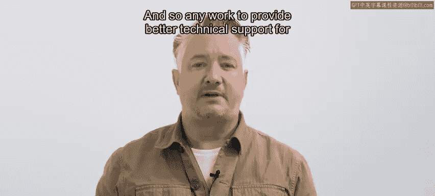

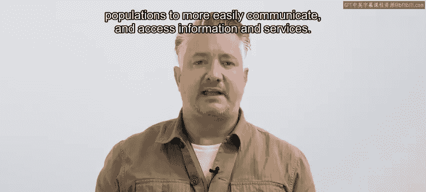