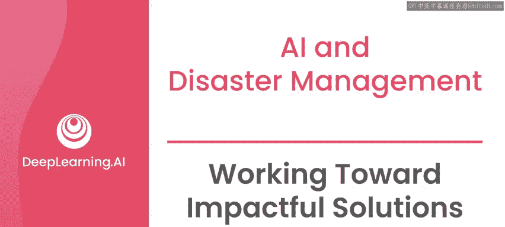
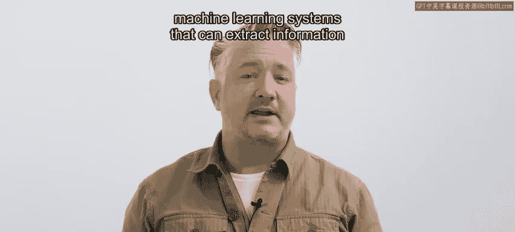
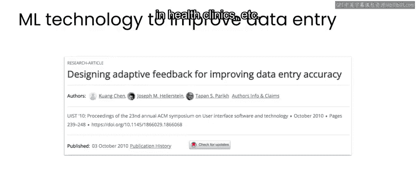
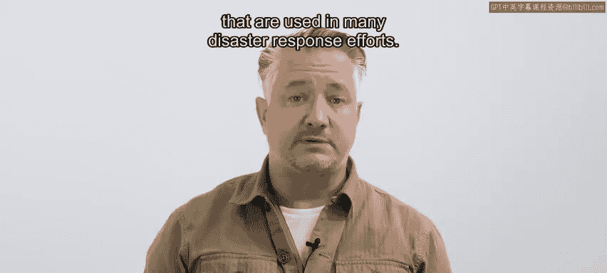
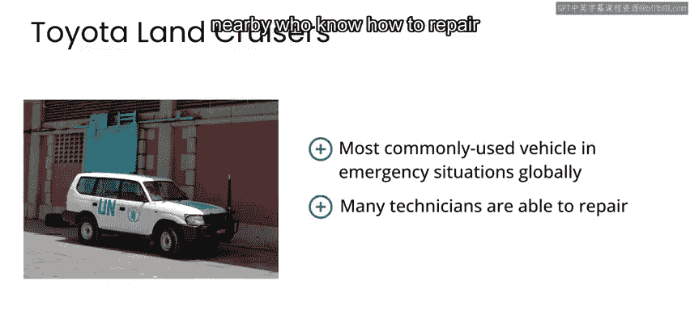

# 吴恩达《AI for Good专业课程》 AI与公共卫生、气候变化、灾难管理｜中英字幕 - P90：8_努力获得有影响力的解决方案.zh_en - GPT中英字幕课程资源 - BV13u411F7xZ

Information management is one of the biggest problems that we often face as disaster responders the problem is not unique to disaster management rather any field ranging from public health to politics or supply chain logistics where information might be collected in many different ways like spreadsheets。

 surveys， forms or other documents will be faced with this same set of challenges in information management。

Most of the work that goes into disaster response is logistics and most disaster response professionals share information via spreadsheets or other structured or semi-structured documents like PDFs It is a myth from too many movies that analytics and machine learning during a disaster is primarily focused on predicting where the next hotspot will be these use cases exist but they are rare In fact I think the movie budgets for pretending these simulations exist exceed the budgets for this kind of situation awareness in actual disaster response。

For example， a disaster response leader in charge of planning drinking water distributions might get hundreds of reports from different agencies across different regions each with pieces of information needed to estimate the overall need。

 that information then needs to be extracted from each of these reports reliably and today that's typically a very manual process。

So if you can develop machine learning systems that can extract information from semistructured tables and forms and spreadsheets and PDF documents。

 then you're already working on one of the most important problems for supporting disaster response professionals。

 a good example from more than a decade ago now that's still relevant is a paper calledDeing adaptive feedback for improving data entry accuracy by Quem Chen and collaborators。

This paper evaluates machine learning assistive technologies to help professional data entry clerks digitize patient data from clinics in rural Uganda supporting a large population of Congolese refugees in addition to work in rural Uganda。

 Kangchn also worked in the US and built an organization that help take unstructured text from things like tax returns and so I think this is a good example of how the kind of technologies that can help in non-disasster situations can also be applied to critical data in refugee camps in health clinics etc。

I've emphasized here that some of the most impactful work that they can do in disaster management would be in the development of general purpose technologies like search engines or translation support for low resource languages or information retrieval from unstructured documents。

However， I also want to emphasize that it's important to work with domain experts and impacted communities to ensure you're not optimizing for the wrong things or working on a laboratory solution that has no practical applications in the real world as useful and allegory is helpful to think about the vehicles that are used in many disaster response efforts。

So if you've worked in the aid world at all you'll know that Toyota land cruisers are a cliche。

 they have often been the majority of vehicles that I have seen in some response situations。

 so land cruisers are not specifically built to be optimized for delivering aid。

 but they've been used for decades in the vast majority of countries around the world。

 and therefore they are reliable and predictable when an emergency situation arises。

When they do have problems， there are going to be many people nearby who know how to repair them。

 and there're more likely to be suitable replacement parts available。

And so could an academic research lab design a vehicle more suited than a land cruiser for disaster response。

 no doubt they could should those vehicles actually be deployed for the first time in a critical situation absolutely not spare parts would be hard to come by and only people who could fix them would be a small number of academics who would have already moved on to other work and perhaps not be available at all to help with the mechanical issues。

So the science from that academic lab might inform future development。

 but they should not build the actual vehicles。The same applies to any software solution software prototypes can inform the science and be used in controlled environments during non-critical periods。

 especially if there are human computer interaction components that are important to test For example。

 like I said in the first course of the specialization when I worked with UNICF or maternal infant health in Nigeria rather than building a brand new AI system for the problem that we hope to address。

 we instead relied in systems that we had already tested and scale across many industry applications。

 So in this way we deployed a land cruiser software solution。

 rather than trying to build a cutin edge but untested solution。Even when I was at Stanford。

 arguably the most industry- focusedcus technical university。

 I did not work with my colleagues there when I needed to develop tools quickly in a disaster response situation。

 I worked with commercial software solutions because reliability was more important than innovation and it was only after the response efforts were over for a particular response effort that I then led research into how machine learning could improve future responses。

So whatever you decide to work on， please keep in mind that expanding upon or building on top of general purpose technologies is often some of the most impactful work that you can do in disaster management。

In the next video， I'll talk about the important issue of data privacy in disaster management。

