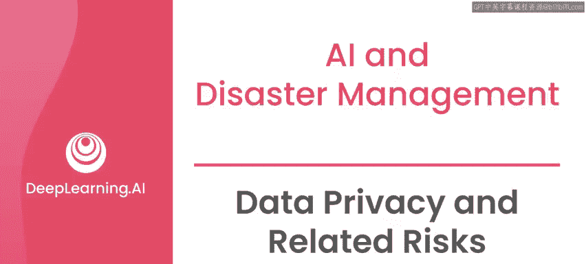
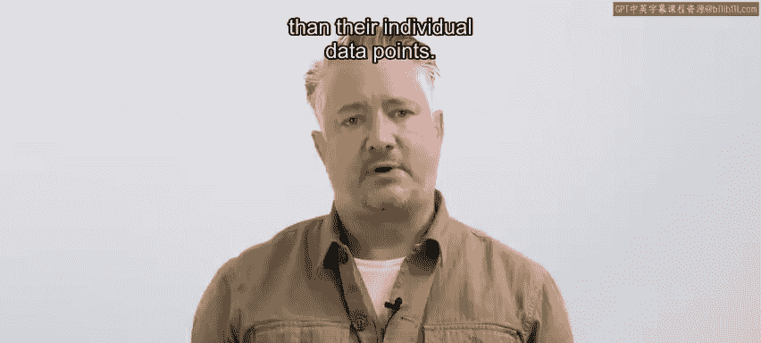
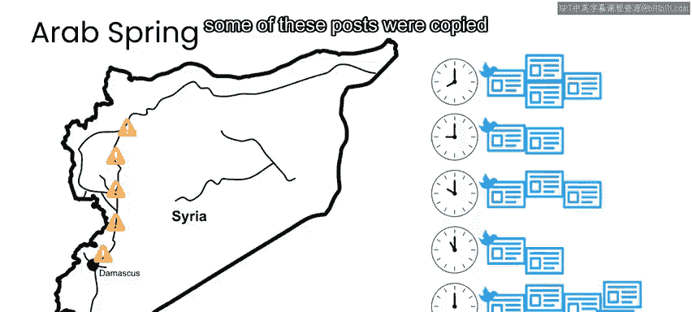
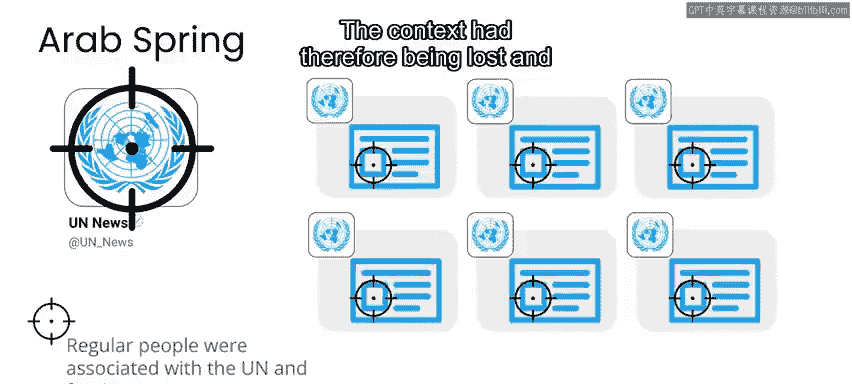
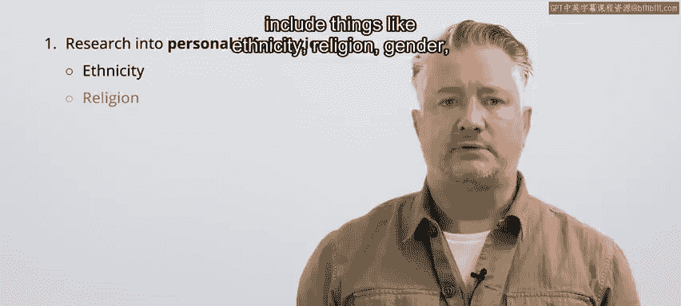
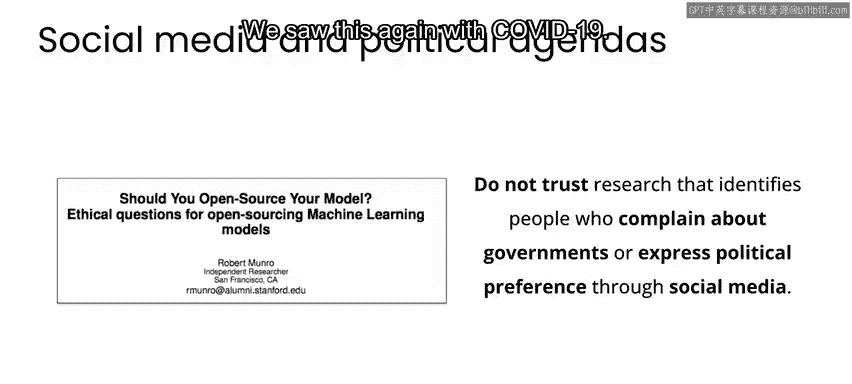
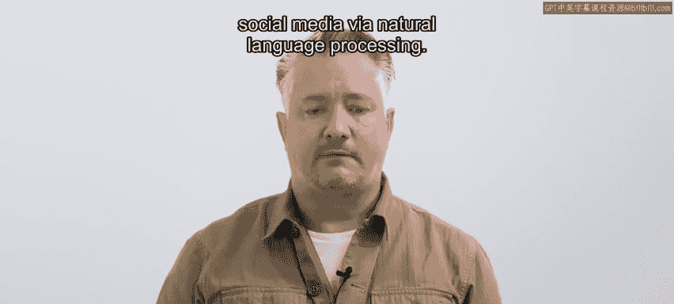
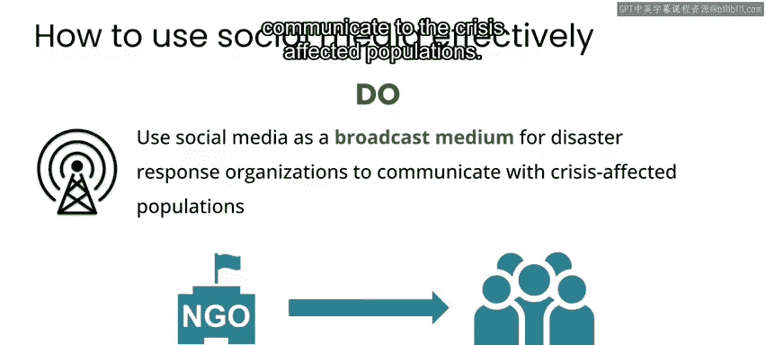
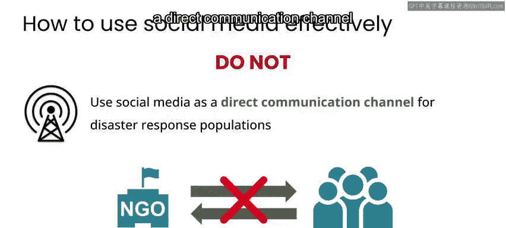

# 吴恩达《AI for Good专业课程》 AI与公共卫生、气候变化、灾难管理｜中英字幕 - P91：9_数据隐私与相关风险.zh_en - GPT中英字幕课程资源 - BV13u411F7xZ

Whatever you work on， your default should always be private data practices and during an ongoing disaster in particular。

 it is not possible to determine whether data that might seem nonsensitive today will in fact become sensitive later so don't publish any personal data and that includes republishing already open information from social media instead wait until the impacted population is no longer at risk and then engage privacy professionals working with the impacted communities to help decide what can and cannot be shared。

Even for data that is seen as open and non sensitiveens。

 know that republishing that data can become sensitive if you republish it in a new context。

And aggregated data， including machine learning models themselves。

 can become more sensitive than their individual data points。

For example， during the Arab Spring， I saw a lot of people share it on social media about their local conditions。

 things like road closures， refugees， etc， while these were public posts。

 the posts were clearly written with only a handful of followers in mind and it is possible that people did not realize that reporting road closures would also help paint a picture of troop movements。

As an example of what not to do， some of these posts were copied to a UN controlled website and republished with no mechanism for the original authors to remove them from the UN sites。

Many actors within the Middle East and North Africa at that time saw the UN as a negative foreign influence or at worst an invader。

 and the people posting were then seen as collaborators。

The context had therefore been lost and the authorities in the repressive regimes in the region didn't care if these people only intended to be sharing practical information with a small number of their followers。

So you need to ask yourself， what is the impact of recontextualizing the data or model so that it is now published by you or your organization or some other organization？

Disaster response has also often been used as a cover for human rights violations。

 while crime typically goes down following a disaster。

 a small number of predators and opportunists will try to gain advantage from the chaos。

 and this is especially true in oppressive governments who use disasters as a cover to identify and silence their critics。

If you are considering projects involving personal information and that could include things like ethnicity。

 religion， gender， or political preferences， then you should take into consideration the use case。

 and whether it could be used for human rights violations， which can happen anywhere in the world。

 but it has be more prevalent under authoritarian regimes。

As a guide for the general level of risk in different parts of the world。

 have a look at the Democracy indexex compiled by the Economist Inlig Unit or EIU。

 the EIU ranks countries and puts them into four buckets， full democracies， fled democracies。

 hybrid regimes， and authoritarian regimes。If there are sensitive use cases like identifying people complaining about the government on social media or expressing political opinions。

 then research in this area can often not be trusted to be safe for those people。

 This happens very frequently。 In a presentation that I gave at KDD some years ago。

 I talked about how countries used the first major CoVID outbreak。

 Sasov 1 or murs as a cover to identify dissidents。 And we saw this again with Covid-19。

Often a researcher working for an authoritarian regime is not able to be independent of their government in the same way that a researcher at a public institution in a democracy is typically independent of their government note however that countries high on the democracy index still commit human rights abuses so this does not give anyone a free pass to deploy machine learning in those parts of the world without considering the risks。

 the EIU's democracy index is heavily focused on country internal factors and a good example of a great area for any country is the military the world's militaries are also the largest disaster response organizations and this can make for a complicated evaluations of risk that typically have to be investigated on a per case basis。

Some cases are unequivocally positive in 2012， a small group of us。

 non-military disaster responders took part in exercises hosted by the Naval Postgraduate School in the US where we aim to discover better ways to make damage assessments from aerial imagery following a disaster。

 we look at the Civil Air Patrol in FeEMA who are technically part of the US military and Department of Homeland Security where the Civil Air Patrol fly over to take pictures immediately following a disaster and then FEMA used those pictures for damage assessments to help with the response。

Just a few months after this exercise in 2012， we used these new techniques to help respond to Hurricane Sandy。

 and there was little doubt that this was completely positive。

 we would not have been able to scale to that level of disaster using the existing approach that the Civil Air patrolrol and FEMA were using。

The US military also participated in the response to the earthquake in Haiti in 2010， however。

 like I said in my after action report for that earthquake。

 there was an uneasy tension because many people in Haiti saw the US military as a former occupier。

 in other cases， like when I worked with UNICEF to support maternal health in West Africa。

 which chose not to work with any US government organization。

 because that would be perceived as like in independence when helping other nations。

So regardless of the employer of researchers or responders。

 the ethics of government involvement need to be considered on a per case basis。

 especially when the disaster and responders are from multiple different nations。

Multiple times in the past， I have seen the analysis of social media portrayed as a positive intervention in a disaster。

 and this was almost always false。Like I've said， most of the work analyzing social media in and around disaster management and response efforts has been carried out by oppressive regimes with ulterior motives。

 for example， during the COVID-19 pandemic， many projects use natural language processing to examine social media posts。

Unfortunately， some government agencies funded these projects had the aim of tracking dissidents。

 a number of nations passed laws at the start of COVID -19。

 making it illegal to spread misinformation during the pandemic and while that sounds good on the surface when you looked at the letter of the laws。

Many of them stated that any criticism of the government counted as misinformation。

 therefore these countries were put it into place a means to arrest and in some cases kill anyone criticizing the government。

 and this was followed by these nations immediately funding and launching programs to identify misinformation in social media via natural language processing。

Even in widely spoken languages like English， social media is typically not useful for disaster responders。

English speaking countries tend to have the most well funded disaster response organizations already。

 so this is one area where English's relevance is amplified。Beyond that。

 oppressive regimes often target intellectuals who are seen as political opponents speaking English often mark someone as being more educated and as someone speaking to international audiences。

The inability to respond to a disaster makes a government look weak。

 and this especially exposes an authoritarian leader who leads by projecting strength。For example。

 in 2013， when Typhoon Hayen hit the Philippines， among the people who were critical of the government's response。

 we identified some English speakers who were particularly in danger of reprisals from the government due to the fact that they had big international audiences among the social media following。

 so in that case we decided it was unethical to ever release English language social media data as part of the disaster response data sets。

For those of us who work in disaster response， we generally recommend that best practice is to use social media as a broadcast medium for disaster response organizations to communicate to the crisis affected populations。

But that open social media should not be used as a direct communication channel for disaster affected populations。

Ultimately， as somebody interested in working in disaster management。

 I want you to be set up for success and not to be drawn into any of the common pitfalls that I've seen in my own work in this space。

So please join me in the next video to look at some guidelines on how best to get involved and do no harm in your work。

