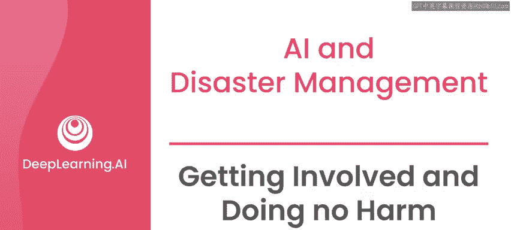
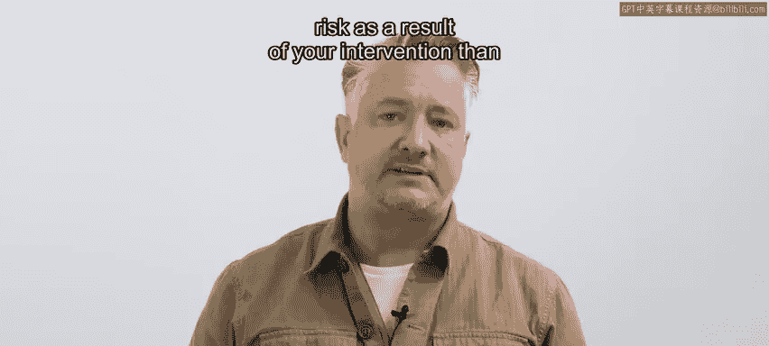
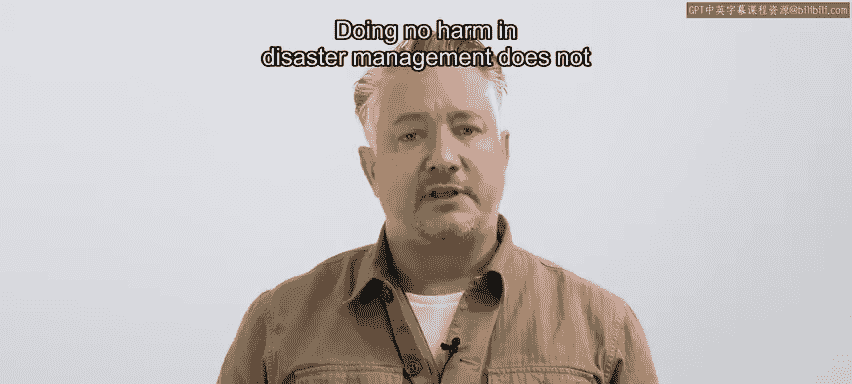
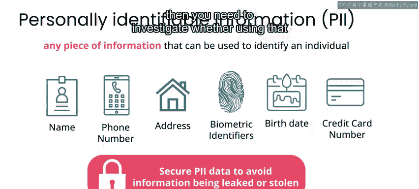
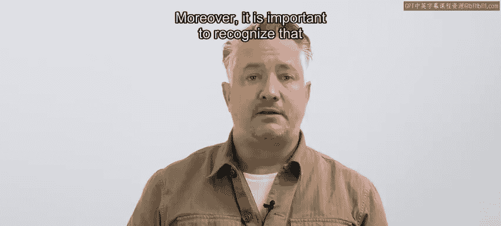
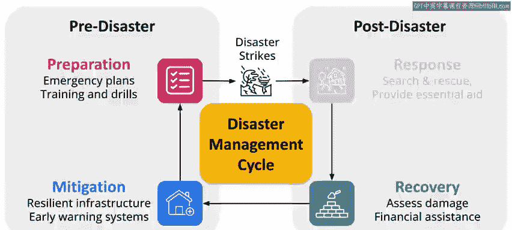
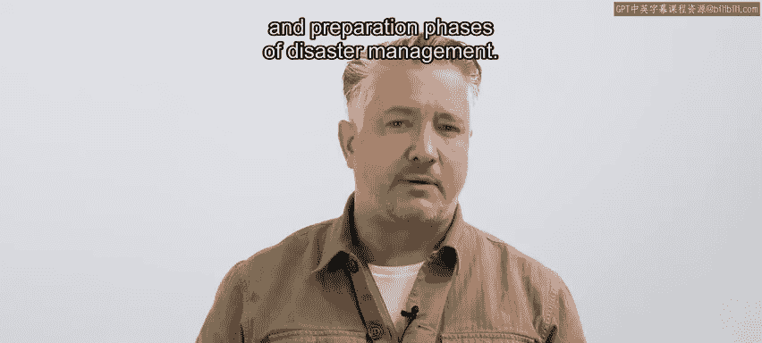
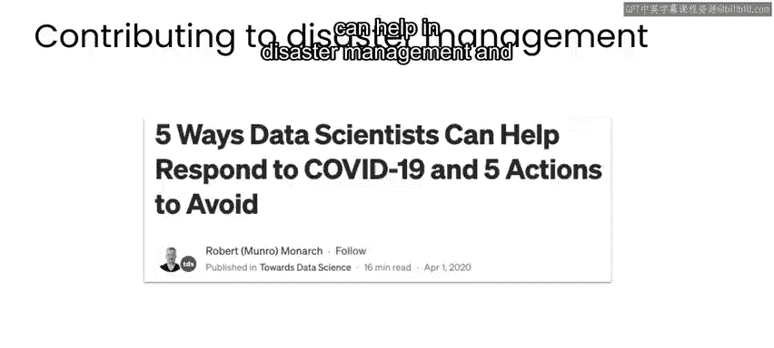

# 吴恩达《AI for Good专业课程》 AI与公共卫生、气候变化、灾难管理｜中英字幕 - P92：10_参与进来并不造成伤害.zh_en - GPT中英字幕课程资源 - BV13u411F7xZ

What all the examples and use cases I've talked about here have in common is an emphasis that in whatever you work on。

 you should be making decisions by applying a do no harm principle when evaluating the impact of your work。

 as I've talked about in the previous courses in their specialization。

 the do no harm principle in disaster management is similar to the one that many medical professionals adhere to。

 namely that no one should experience more harm or risk as a result of your intervention than they otherwise would have。

 do no harm in disaster management does not just refer to physical harm it includes respecting the dignity and social norms of impacted communities and engaging them in a way that prioritizes their needs and perspectives。

It also means ensuring the protection of individual privacy。

 in the sense that if personal data is part of a project。

 then you need to investigate whether using that data risks。

 doing harm to people who would not otherwise be harmed and remember that as someone working on an AI for good project。

 you are not the only one who should be making a judgment call on how to do no harm local community members and organizations are primary stakeholders in the design implementation of your project as well as the assessment of the risks。

And so it is not enough to argue that there is a net benefit from your work。

 if there is a clear negative use case from a project that would potentially harm people who would not otherwise have been harmed。

 then that project should not happen。Moreover， it is important to recognize that most significant impact in humanitarian work may be during recovery。

 mitigation， and preparation phases rather than during the response phase。

People have often asked me how they can get started or get involved in disaster response and it turns out that your efforts to make a lasting positive impact while doing no harm will be most likely to succeed if you begin your work in anything other than the immediate response phase。

 so in the recovery phase or in the mitigation or preparation phases of disaster management。

And this is because during these phases， actions are less time sensitive。

 you'll have more information available and they are focused on assessing and addressing long- term issues with thoughtful preparation and therefore has less risk of unintended harm compared to often frantic disaster response efforts。

With that being said， as I mentioned before， the response phase often receives more attention and more funding。

 and often is the time when people feel the most move to act。

If you do want to help in an ongoing disaster and if you don't have experience。

 remember that people will have the least time to train you during the immediate response to a disaster。

 so don't be surprised if your most valuable skill isn't something very basic。

 like manual labor or data entry。Similarly， if you turned up to a hospital to help in an emergency without any medical training。

 you shouldn't complain if they give you a mopp and bucket， the same applies to disaster response。

 so if you want to get involved， disaster response can certainly be something you work on but your chances of making a last impact in minimizing harm would be most successful if you begin your own work in the recovery。

 mitigation and preparation phases of disaster management。

I've included an article in the resources section for this week that I wrote about how you as a data oriented person can help in disaster management and what to avoid。

If you don't have experience and want to work on something right away。

 consider looking into use cases like supporting low resource languages and information extraction from semistructured text like spreadsheets and PDFs These use cases can also help with other areas of impact like healthcare and the environment so there is a great potential impact with much less chance of inadvertently causing harm when it comes to building AI systems in general。

 there is often a need for humans to be involved in the curation of data and the evaluation of systems so indi management scenarios the most important humans to have involved in building any solution are members of the impacted communities themselves。

Whether you're working on communication tools for low resource language speakers or positive information from unstructured documents。

 you'll likely need significant involvement from individuals with local community language and cultural Under I'd like to wrap up this week of materials with the project spotlight from Mark Binsky and he works on digital innovation at the United Nations Development program Mark is going to talk about an Inter project that he's been working on called I verify which combines elements of machine learning for automatic detectionte of Miinformation and other toxic content with Human in the loop Translation across a diversity of languages。

This is exactly the kind of general purpose technology that can provide value to at riskk populations across many different domains and particularly when it comes to a disaster or crisis situation。

 so check out the next video and then I'll see you after that to wrap up this week。

