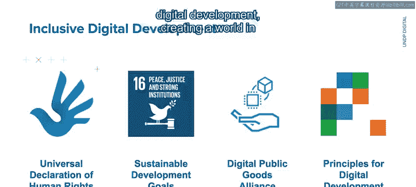
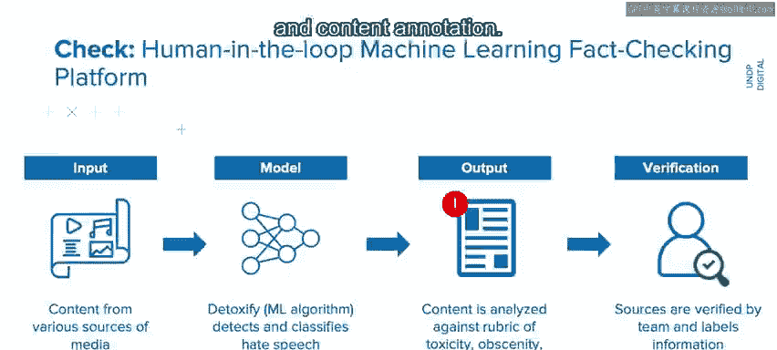
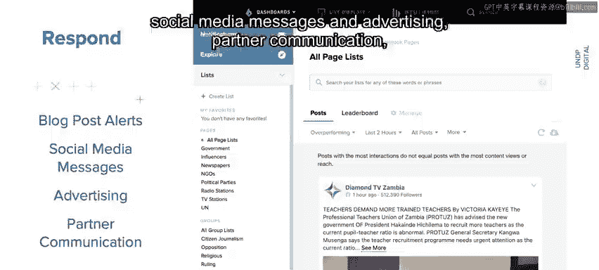
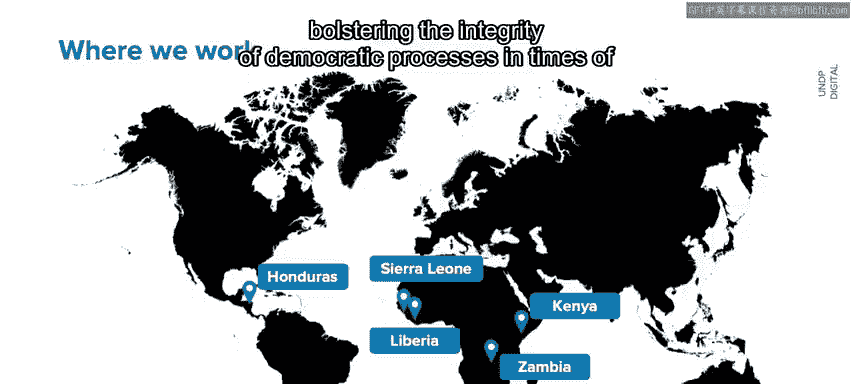
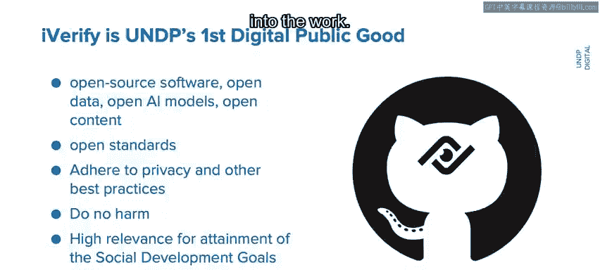
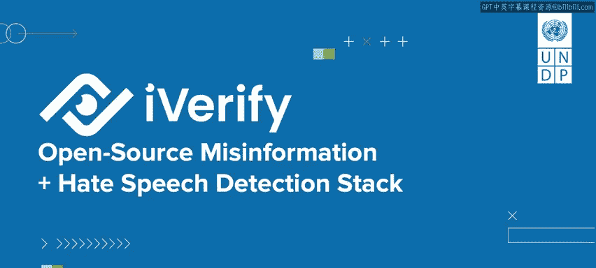

# 吴恩达《AI for Good专业课程》 AI与公共卫生、气候变化、灾难管理｜中英字幕 - P93：11_Mark Belinsky虚假信息与仇恨言论检测.zh_en - GPT中英字幕课程资源 - BV13u411F7xZ

Hi， I'm Mark Leenssky at the United Nations Development Program。

 which is the largest of the UN agencies operating in over 170 countries to eradicate poverty and reduce inequality。

In an increasingly digital world， we are faced with a significant challenge。

The internet's role in this work。The internet has the power to enlighten us。😡。

It also has the potential to mislead。Consider the troubling echo of disinformation in elections around the globe or hate speech appearing on public platforms that so's discord and division where instead we need dialogue and understanding。

😡，For example， there were instances of disinformation circulating regarding the COVID 19 vaccine。

Falsely claiming that it contained cow's blood， making it against Hindu traditions。As a result。

 some individuals from these communities were discouraged from getting the vaccine。

 The internet can be a potent tool for progress， but we must also confront its capacity for destruction。

At the United Nations Development Program， otherwise known as UNDP。

 we are committed to ethical and community centric solutions。Most specifically。

 the team that I work with focuses on inclusive digital development。

 creating a world in which digital is an empowering force for people and planet。

Each year， hundreds of millions， perhaps up to a billion or more people。

 are impacted by national elections。That's a substantial part of the global population。

Affected by the integrity of the information that they receive。

We often operate in countries seeking our help to ensure this electoral integrity。

In response to these challenges and staying true to our commitment to ethical and community centric solutions。

We've developed I verifyify， an open source misinformation and hate speech detection tool。

I verify works in three collaborative stages。😡，Identify， fact， check。And respond。

These steps are powered by artificial intelligence， yet governed by human discernment。

In the identify step， we search for potential issues。

By integrating with the social media companies via their APIs。

 I verify rapidly screens online content， searching for potential disinformation and hate speech。

Citizens can also submit questions via tip line to ask whether what they're seeing is accurate in the fact checking step。

 all input is first scanned by machine learning tool called thetify to detect hate speech。

 We analyze content using a rubric of toxicity， obscenity， threats， insults。

 identity attacks and sexually explicit scoring each set。

 This provides an overall score that we can look for。

 or we can look for peaks within these categories。😡，Next。

 the outputs of this step are then verified by our dedicated team of verifiers who check the sources and labels the information。

Using another machine learning tool， Me Dan。 This human in the loop machine learning step ensures a rigorous and accurate evaluation by humans and uses AI to ensure that the same information doesn't have to be verified more than once。

This combination of a machine learning tool with human verifiers allows for scaled fact checking and content annotation。

 Finally， in the response step， our network of partners and the public our alerted instances of disinformation and hate speech through blog posts。

 social media messages and advertising。😊。

Partner communication and a dashboard for monitoring and evaluation。

We've been deployed ahead of elections in Africa and Latin America。

 often standing as the sole resource， helping to debunk misinformation before it becomes weaponized。

And bolstering the integrity of democratic processes in times of uncertainty。

Looking forward， I see I verify expanding its reach。

 We still have more to do to identify disinformation directly。

 particularly in our international context。😊，In order to expand our reach。

 we need to improve language coverage。While I verify functions in dozens of languages。

 our concern is with thousands。In addition， there are more mediums to integrate from radio to more recently developed social media platforms。

With more digital content being scrutinized and labeled。

 we can empower all Internet users to discern truth from falsehood。 We've developed， I verify。

 as a digital public good。It was important to us that this work happens in an accountable。

 transparent manner with an open source community to help continue driving innovation into the work。

As a developer， I believe in the potential of tools like I verifyify with ethical guidelines and a combination of AI and human effort。

 we're aiming to help everyone navigate the digital world more confidently。 Together。

 we can transform our digital landscape into a space of informed dialogue。 Thank you。😊。

