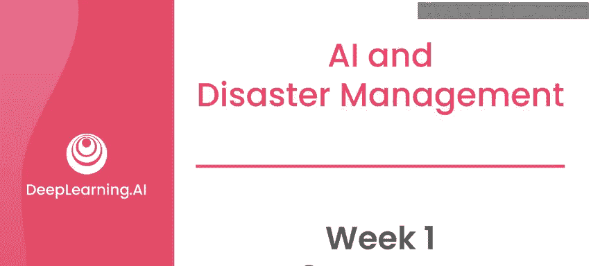
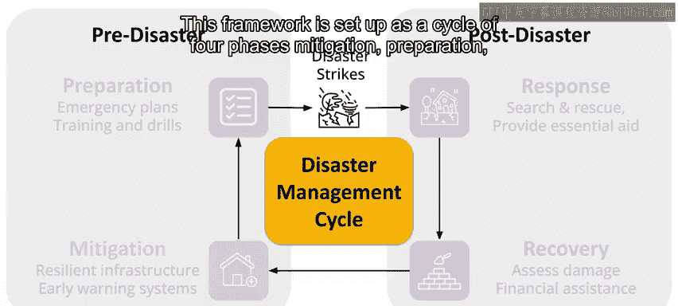
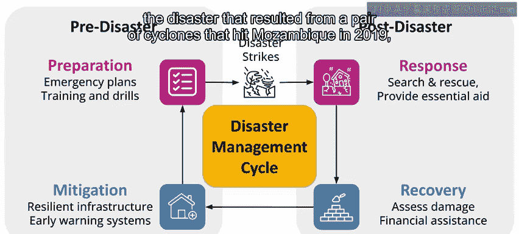
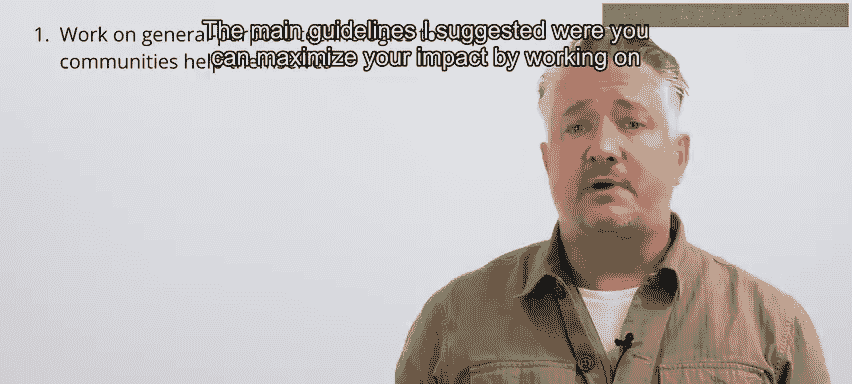
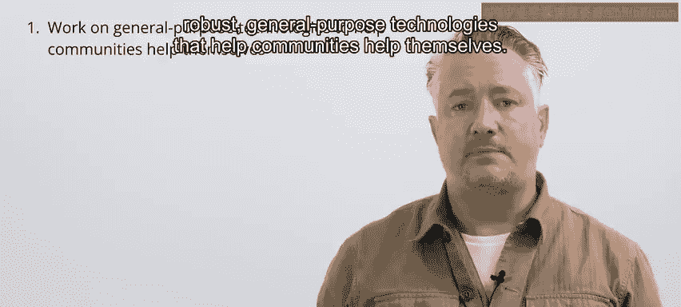
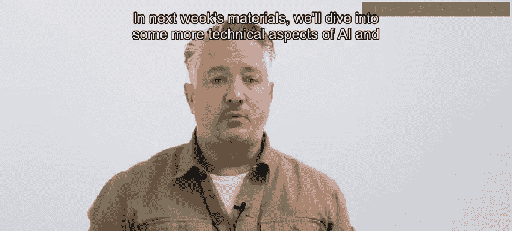
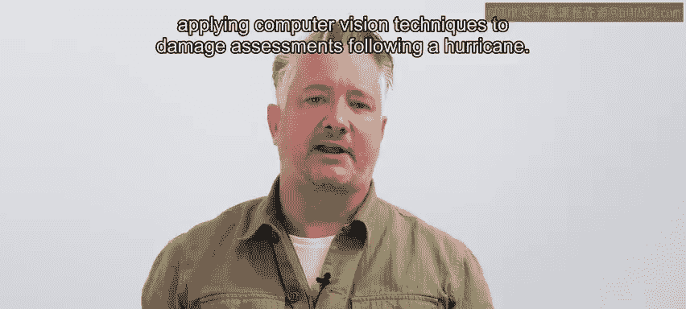

# 吴恩达《AI for Good专业课程》 AI与公共卫生、气候变化、灾难管理｜中英字幕 - P94：12_第1周总结.zh_en - GPT中英字幕课程资源 - BV13u411F7xZ

You have reached the end of the first wig of this course。

 so nice work here I'll briefly recap the major ideas from this week before we move on to exploring the first case study on doing damage assessment after a hurricane using satellite imagery。

We started off this week with some discussion about what exactly constitutes a disaster and what the impacts of a disaster can be on local communities。

 infrastructure and the environment。You looked at a disaster management framework that many disaster response organizations have adopted This framework is set up as a cycle of four phases。

 mitigation， preparation， response and recovery we looked at how each of these phases unfolded for the disaster that resulted from a pair of cyclones that hit Mozambique in 2019 and how AI was involved in those different phases。

After that， we looked at how AI has been used in other disaster management efforts。

 and I shared some guidelines for ensuring that in your own projects。

 you optimize for making a positive impact and doing no harm。

The main guidelines I suggested were you can maximize your impact by working on robust general purpose technologies that help communities help themselves。

Work that helps to support low resource languages better with technologies like translation and search will have a positive impact in disaster response and recovery。

Default to private data practices in all your work and keep in mind that aggregated data and machine learning models themselves can amplify privacy risks。

Avoid projects that involve analysis of social media data and or work that is funded by oppressive regimes。

And engage with impacted communities to ensure that your project has the highest chance of success and that the potential to do harm is minimized。

If you keep these guidelines in mind， you'll be much more likely to succeed in your efforts to help reduce the impacts of disasters no matter the specific context in next week's materials we'll dive into some more technical aspects of AI and disaster management and we'll have a case study focused on applying computer vision techniques to damage assessments following a hurricane so I'll see you in the next week of this course。

