# 吴恩达《AI for Good专业课程》 AI与公共卫生、气候变化、灾难管理｜中英字幕 - P95：13_欢迎来到第2周.zh_en - GPT中英字幕课程资源 - BV13u411F7xZ

Welcome to week two of this course on AI and disaster management this week you'll work on a case study which uses satellite imagery for damage assessments in the aftermath of Hurricane Harvey in the US in 2017。

Aerial imagery is an essential tool used in all kinds of applications。

 including things like mapping and navigation or weather forecasting。

 it is also used in efforts to track deforestation or how glacier and sea ice is melting or for observing animal populations like you saw in the previous course。

In disaster management， overhead imagery can also be used to assess the extent and impact of a disaster on a region or community。

It can provide a means of access and visibility into hard to reach or dangerous areas that might otherwise be difficult to get to on the ground imagery from above might be taken from different platforms like satellites。

 planes or drones and each of these platforms can have its advantages and disadvantages for example。

 satellites can cover huge areas but the images might be relatively low resolution and cloud cover can make satellite imagery useless for assessing on the ground damage。

Planes and drones can sometimes fly under the clouds and gather relatively high resolution images。

 while small commercially available drones can be agile and able to fly closer to the ground。

 they can only go so far where planes can cover up more ground quickly。In my own work。

 as I mentioned in the previous week of materials， I've used aerial imagery to do damage assessments after Hurricane Sandy in the United States in this case this was from planes with a person pointing a camera at the ground and had the advantage that this person could look at areas where the damage might be worse and take additional photographs of those areas。

For Hurricane Sandy， when the Hurric made land for in the Eastern US in 2012， the Civil air Patrol。

 which is part of the US military， flew planes over the damaged areas and took more than 35。

000 images， one of the advantages in flying planes over is that the person holding the camera could see areas that look like they are more damaged and therefore focus on those for the data collection component。

This was part of a standard response after a disaster where the civil air Pat is often the first。

Organization to fly over and provide aerial photographs to various agencies that have then used that data for damage assessment and coordinated response efforts。

However， 35，000 images was much more than for a typical disaster and this was due to the fact that a large area was damaged by the storm and in particular a large urban area as a result it was the first time that the government agencies in the US engaged with third parties included my company at the time。

 Idibon and others to support information process for the purpose of doing damage assessment with the system we built thousands of public non-expert volunteers evaluated the level of damage present in the images。

 fire online crowdlcing system the contributors viewed one image at a time and gave a threeway judgment。

 a little of no damage， medium damage or heavy damage and we gave the same image to multiple people in order to ensure that the errors or biases in one person were relatively minimized。

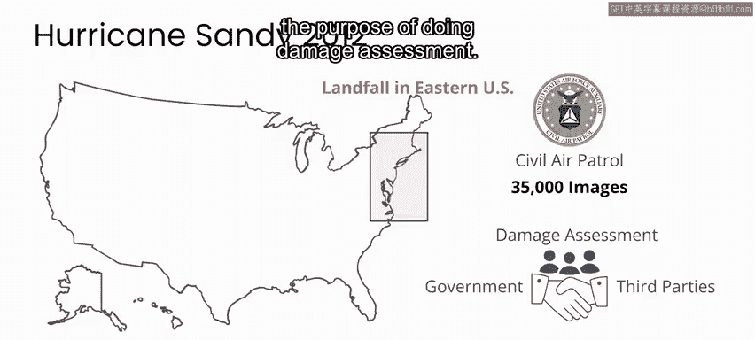

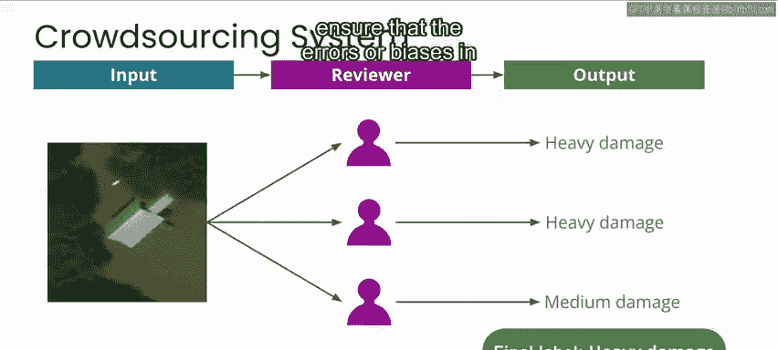

Then with the labeled data we' were able to look at how we might deploy a classifier to automatically go through and do some initial damage assessments。

 maybe in parallel or proceed in a human review， a critical point that I want to emphasize here is that the system we built was successful only because we spent months working on it ahead of time such that it was tested and ready for deployment when the hurricane struck while we used non-experts to do the evaluation of the damage because of the scale of the problem we also later engage professional damage assessors and had them look at some of the same data so that we could work out whether or not we could in fact use crowdsourced people for this kind of damage assessment and what we discovered was that yes。

 we could get as accurate damage assessments from non-experts as we could from experts however that was only if we gave the same tasks to multiple people and aggregated。

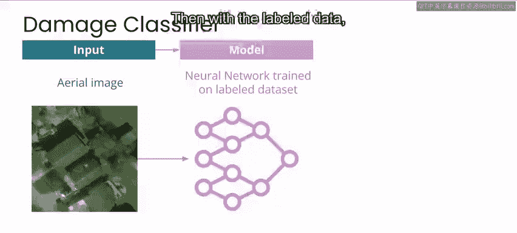

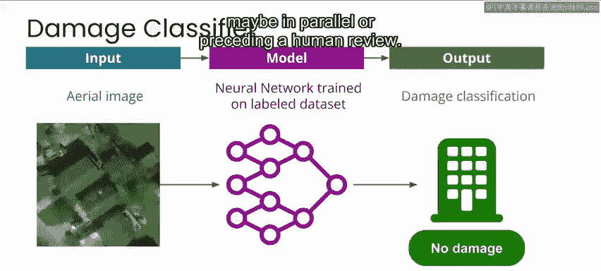

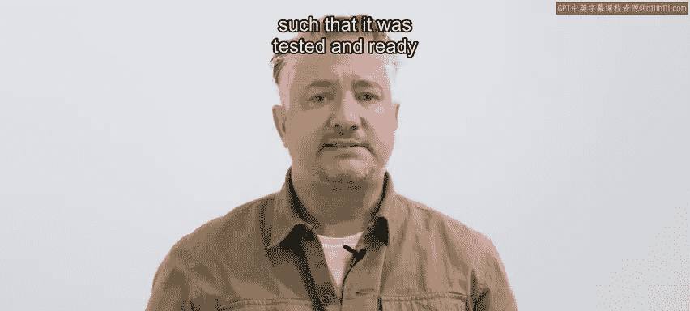

s a way that we're able to compensate for the errors of individuals。

 so I think this was interesting use case， not necessarily in AI。

 but in how we can scale humans to be more accurate collectively than they are individually。

Like I said in the previous week's materials， if you want to be effective in the response phase of a disaster。

 it's best to get started with your work in the longterm recovery。

 mitigation and preparation phases One of the people that we worked with for the Hurricane Sandy response was Kate Chapman of humanitarian OpenStreetmap and she has told I think an interesting story about aerial imagery since where people came in in this case following an earthquake in Nepal in 2015 in the response phase without previous engagement with the community and tried to launch drones of the damage affectedffected area this created a lot of confusion among the local population and in some cases fear because this was a region that had historically been at odds with the central government of Nepal and ultimately despite a lot of resources going into these people coming into the area and trying to deploy their drones they were not able to have a positive impact on the outcome。

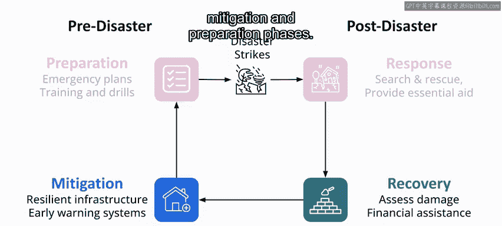

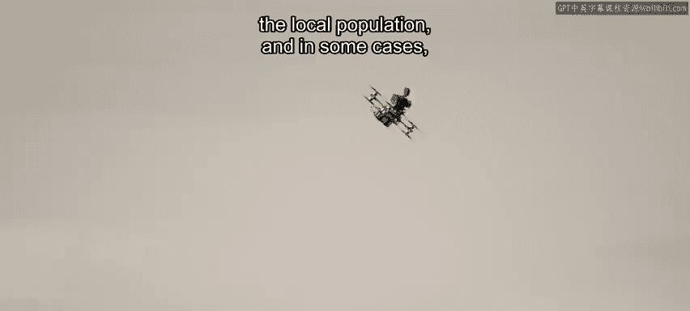

Of the response efforts。And so even though their intentions might have been wellme。

 I think this is a really good example of how in order to have a sustained impact coming into a disaster area as your first engagement is that the least likely to be successful and in many cases can do more harm than good。

In the labs this week， you'll explore satellite images in the regions impacted by Hurricane Harvey to do damage assessments similar to what we did with the aerial imagery after Hurricane Sandy。

 you'll build a model to classify each image as damaged or undamaged and tag the locations of each image on a map that could inform disaster managers。

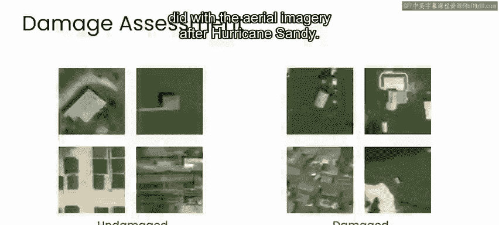

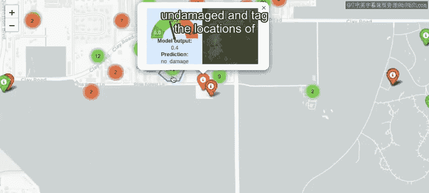

The scenario that I'd like you to imagine for this project is that you're working on the system to provide a way to do automated image analysis for damage assessment after a hurricane。

So this is a project that you will be working on in the mitigation and preparation phases。

 similar to the work they did with Hurricane Sandy。

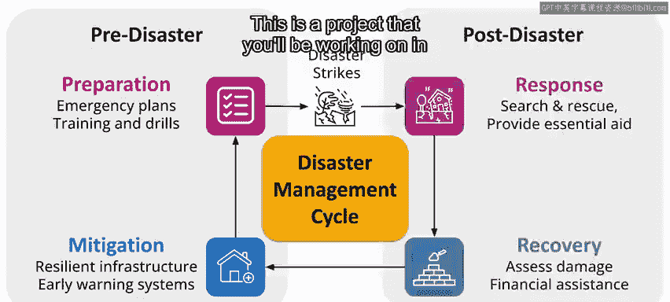

This is the sort of tool that could help inform disaster responders to identify where to deploy resources。

 estimate the cost of damage to a region， and prioritize reconstruction efforts。

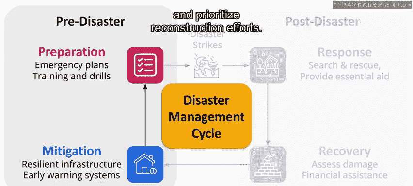

In the next video we'll do a quick recap of the AI for Good framework so if you're coming fresh from one of the previous two courses and the four phases of the AI for Good project are fresh in your mind feel free to skip the next video and you can jump to the following video and there we'll take a look at some of the details of Hurricane Harvey and what the situation was like immediately after the storm after that we'll jump into the explore phase for this project so join me in the next video。

