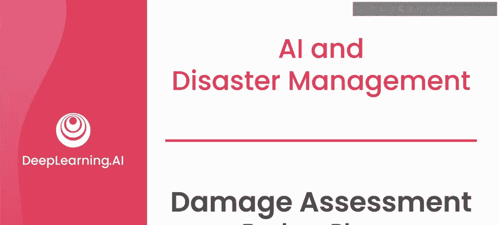
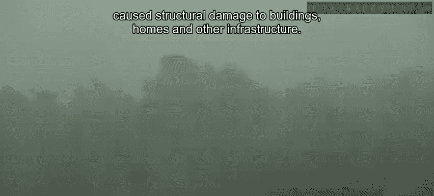
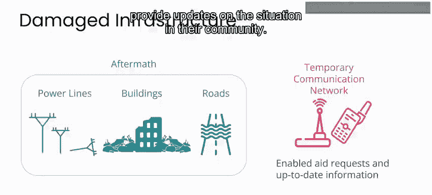
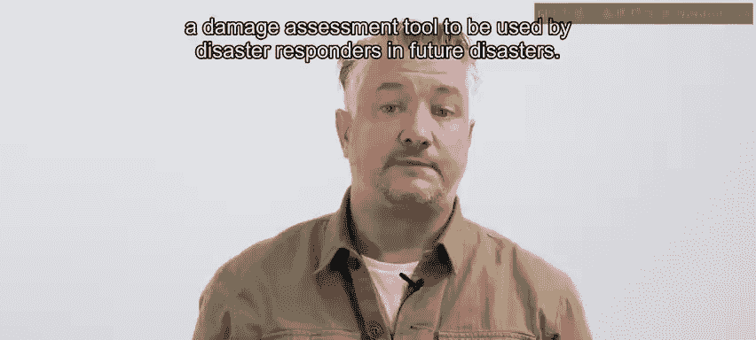
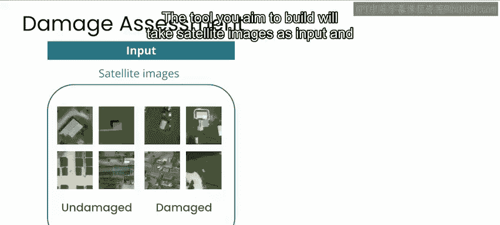
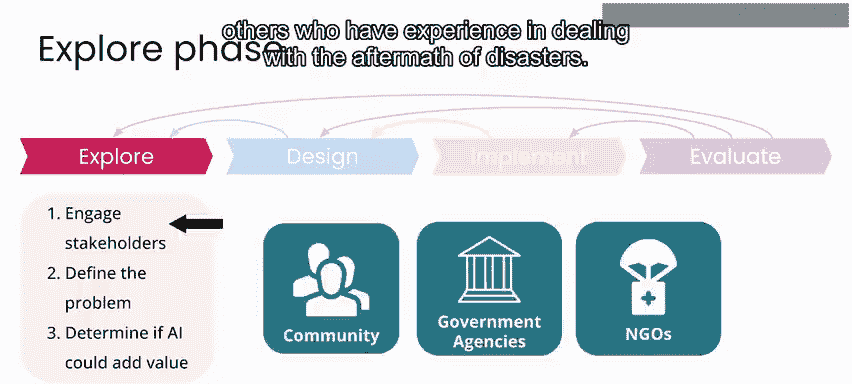
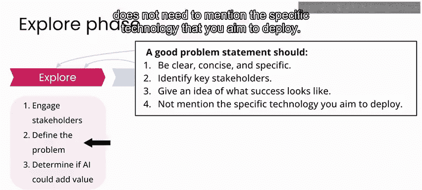
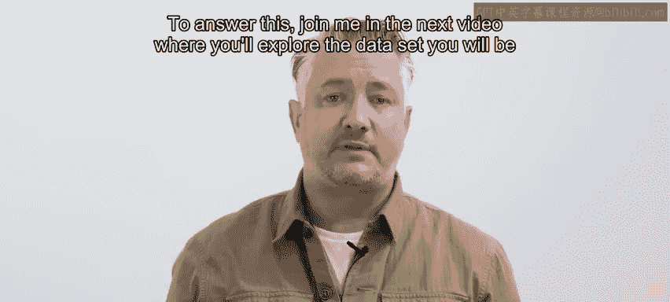

# 吴恩达《AI for Good专业课程》 AI与公共卫生、气候变化、灾难管理｜中英字幕 - P97：15_损害评估探索阶段.zh_en - GPT中英字幕课程资源 - BV13u411F7xZ

Hurricane Harvey was a powerful storm that hit the coastal states along the Gulf of Mexico in the US on the 25th of August 2017。

The storm brought record breaking rainfall to the region with many areas receiving more than one mere of rain over a4 day period。

 The result was catastrophic flooding with more than 100 lives lost and $125 billion in damage done。

Immediately following Hurricane Harvey government response agencies。

 including the Federal Emergency Management Agency or FEMA。

 the National Guard and the Coast Guard were deployed to aid people who were stranded due to the rise in floodwaters。

😊，The American Red Cross and local food banks were essential in setting up temporary shelters and providing food。

 water and other supplies to those impacted by the storm in addition to the heavy rainfall。

 the storm brought strong winds measuring up to 250 kilometers per hour。

The powerful winds operated trees， damaged power lines。

 and caused structural damage to buildings homes and other infrastructure。

With power outages， down phone lines， and damage to cell towers。

 many people were left without phone or internet services。

 complicating communication and access to critical information。

The Federal Communications Commission worked with companies to set up temporary communication networks。

 including satellite phones and portable cell towers。In addition。

 social media and other online platforms allowed people to share information， request assistance。

 and provide updates on the situation in their community By mid-sember， a few weeks after the storm。

 response efforts began to stabilize and many temporary shelters began to close as the number of people in need of emergency assistance had decreased。

FemMA then began coordinateordinating efforts to repair and rebuild damaged infrastructure。

While high winds caused substantial damage， the biggest impact of the storm was widespread flooding。

Which you'll see in more detail when you explore the data。After a major disaster strikes。

 satellite imagery can be one way of getting information about the state of things on the ground for this project。

 consider a scenario where you are working as part of a team to build a damage assessment tool to be used by a disaster responders in future disasters。

The tool you aim to build will take satellite images as input and produce a map of damaged and undamaged locations。

The map will then be used by disaster managers to inform their decisions on distributing aid and prioritizing reconstruction efforts it's important to note that the results of a project like this would not be the sole source of truth in identify damaged locations。

 but rather the tool would be combined with other information sources to inform and deploy teams for rescue and resource allocation on the ground。

Because this tool is informing human actors this could also influence how you evaluate the accuracy of the tool for example。

 you might want to emphasize that the tool not miss any potential damaged areas and so this would be accuracy determined by recall rather than the overall accuracy of identifying a damaged versus a non-damaged area in an image and you'll see this later when we get to the lab and evaluate the project in terms of both precision and recall At this point you're in the explore phase of the project and the key steps that you need to take are to engage with stakeholders define your problem statement and determine whether AI can add value The first and most important stakeholders are the members of the impacted communities The damage assessment you provide will not only help to allocate resources to those communities but also potentially influence how they get access to government relief funds or get compensated for insurance claims in the longterm recovery phase Local community members also have valuable knowledge about the area。

infrastructure that can help inform the damage assessment process key stakeholders could also include government agencies like FEMA and state and local governments。

 as well as any military organizations that are part of the response Other stakeholders could be non-government organizations such as the American Red Cross and others who have experience in dealing with the aftermath of disasters。

With key stakeholders identified， it's time to write your problem statement。

 remember that a good problem statement is clear， concise， specific。

 identifies the key stakeholders and does not need to mention the specific technology that you aim to deploy。

In this case， your problem statement for this project might be。

Disaster managers need to identify and assess damaged areas using large volumes of overhead imagery to prioritize response efforts。

 allocate resources and plan for recovery and reconstruction activities If you've taking the previous courses you'll know that I'm going to remind you here that a good problem statement often takes weeks or months to iterate on with stakeholders in order to determine exactly what it is that you are trying to achieve The next step in the explore phase is determining if AI can add value to your project to answer this join me in the next video you'll explore the data set you will be working with for damage assessment following Hurricane Harvey。

