# 吴恩达《AI for Good专业课程》 AI与公共卫生、气候变化、灾难管理｜中英字幕 - P98：16_损害评估探索数据.zh_en - GPT中英字幕课程资源 - BV13u411F7xZ

You're now in the explore phase for the damage assessment with satellite imagery Project。

 At this point， you have identified the key stakeholders and defined your problem statement。

 The next step is to now explore the data to determine whether artificial intelligence might add value as part of your solution。

Let's jump into the lab and have a look at that data。When you first open this lab。

 you will see the project description at the top。The data you will explore in this lab contains a curated set of images from the 2017 Hurricane Harvey case studyud hosted by IE Dataport。

 This is a platform that hosts a wide variety of data sets for advancing research。

And you can have a closer look by following this link。

The authors who published the data also published a paper to describe their work。

 and you can read the paper by following this link。

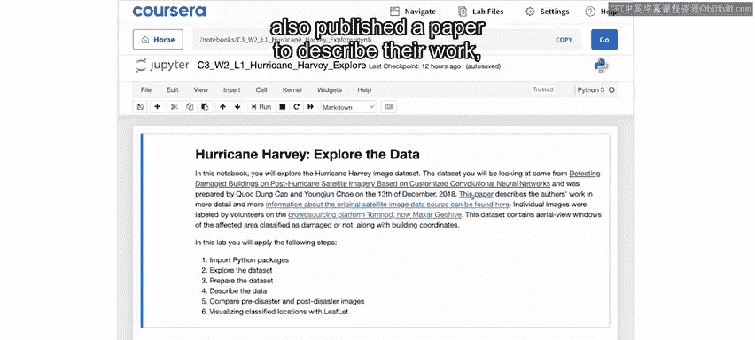

In the paper， you'll find more details about the original source of the data。

 which was a commercial remote sensing satellite called GOI1。

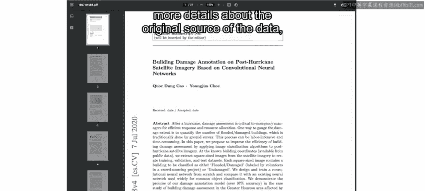

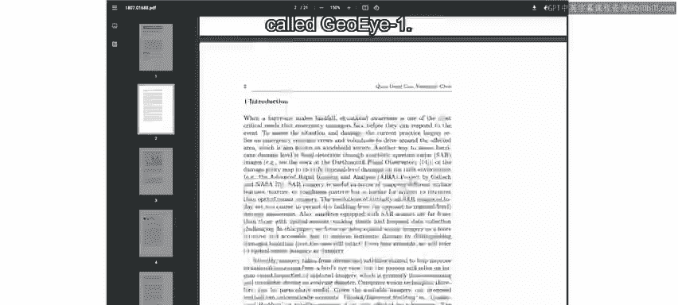

You can learn more about all that by following this link。

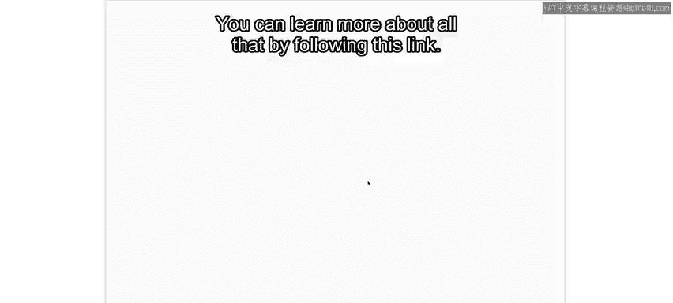

In the paper， you will also find information about how the data was labeled using crowdsourcing on the Tomlo platform。

 which is now called Maxa Geohive。

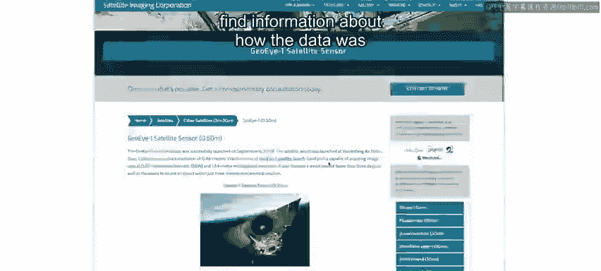

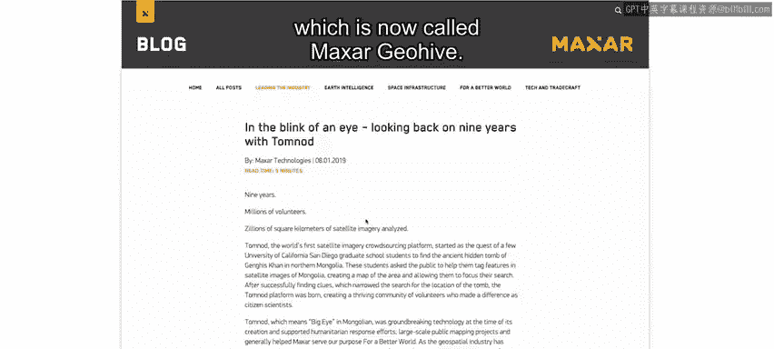

You can find more information about that platform by followinging this link。

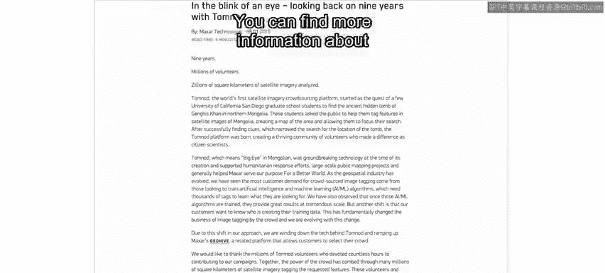

Before diving into the lab， click the Jupyter icon in the upper left corner of your window right here。

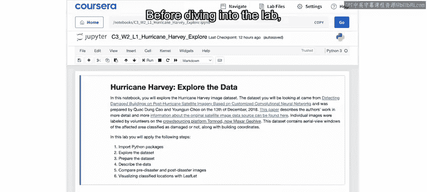

In this view， you can see what else is in this folder and if you open the data folder。

 you'll see you have a data sheet as always， describing where the data set comes from and any potential caveats or concerns regarding the data。

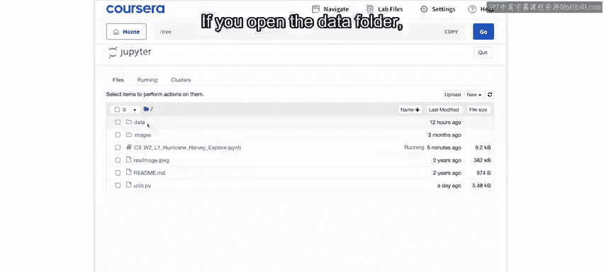

Here at the data sheet is brief， but points back to the website and people describing the data in more detail。

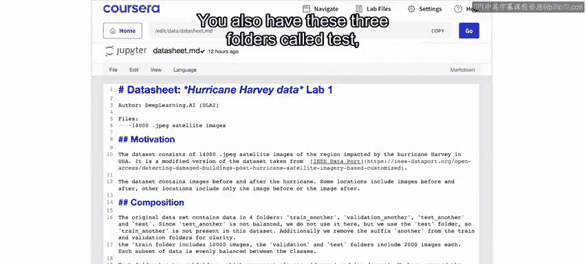

You also have these three folder called test， train and validation。In each of these folders。

 you'll find two folders called damage and no damage。Inside those folder。

 you'll find the images you'll be working with。In these labs。

 associated with the respective folder name。

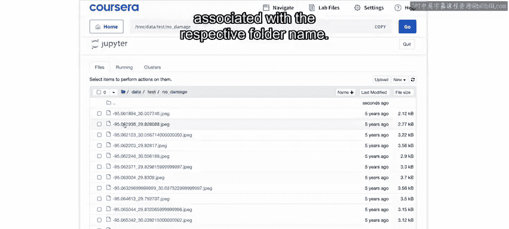

You can click around to see what the images look like， you try to zoom in a little。

You can see that the images are relatively small， in some cases。

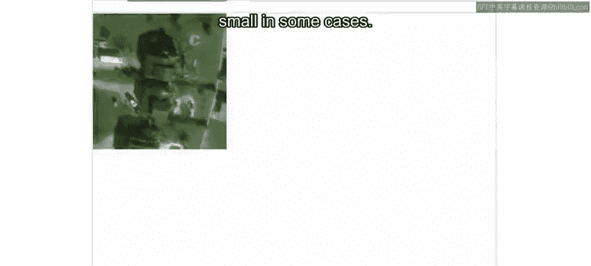

And also， it can be hard to even know what you're looking at。

 particularly with the images showing damage。But in general。

 these are images of buildings and property that are be labeled by human volunteers as showing evidence of damage or not。

As always， you have a UTs file here where some of the code you'll be running in the lab has been stored。

If you're familiar with Python， you can take a look in here to see what's going on behind the scenes with some of the functions that will be running in these labs。

 as with the previous courses， we've just pulled it out here to declutter the main notebook。

Heading back over to the notebook here， the first step， as usual。

 is to import the Python packages that you'll need for this lab。

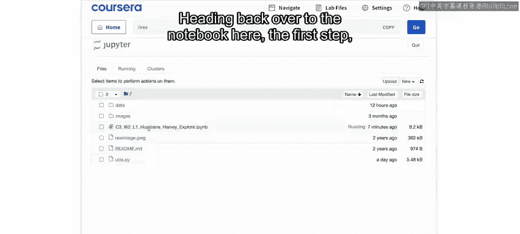

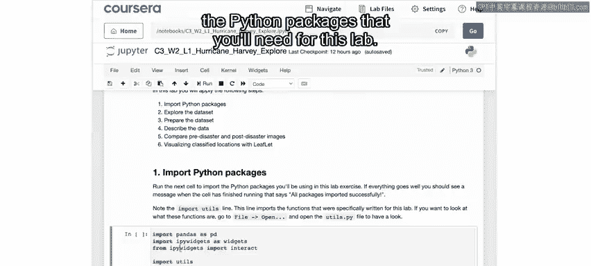

When you see this message， all of the packages imported successfully， you are ready to move on。

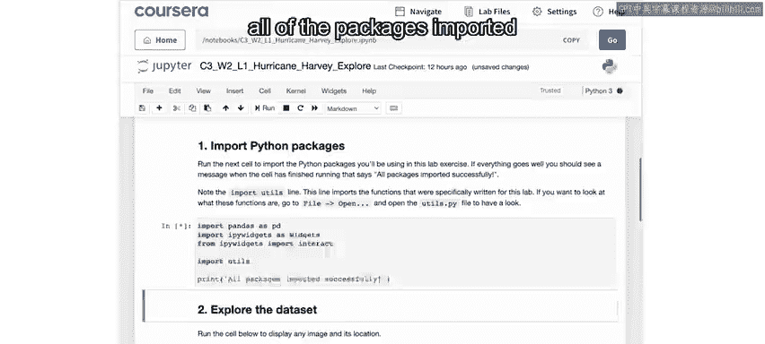

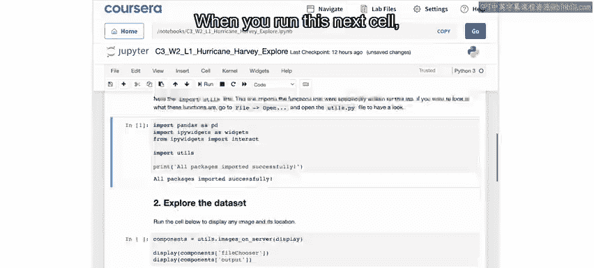

When you run this next cell， you'll get this little select button。

Which allows you to explore the data in the folders you are just looking at。

Here you're in that test folder， but you can also navigate to train and validate。

The numbers contained in each image file name are the latitude and longitude where the image is on the ground。

With this tool， you can look at each image as well as where it is located on a map。

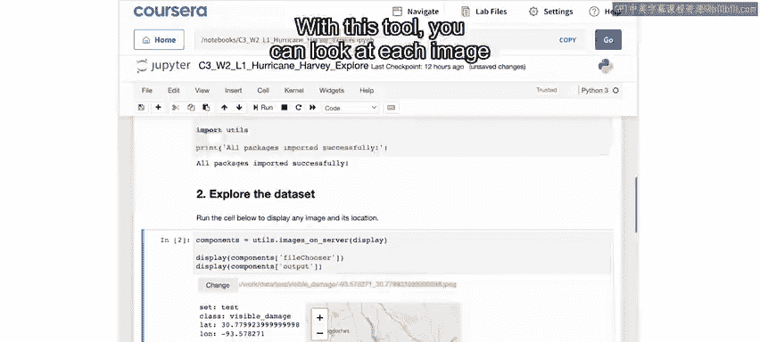

Play around with this and have a look at a few different images and where they are located。

As you've seen already， all the images are located in the data folder， Then there are three folders。

 train， validation and test。

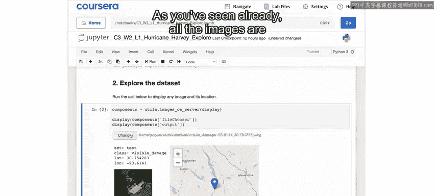

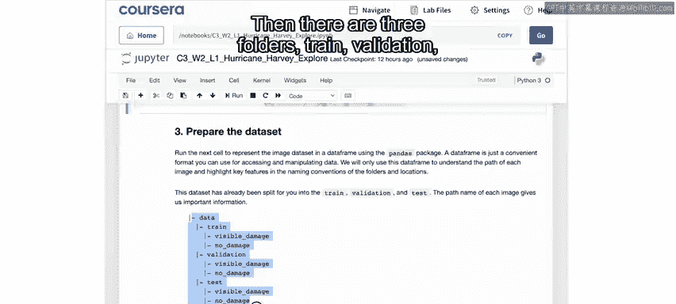

Under that， then damage and no damage folders。

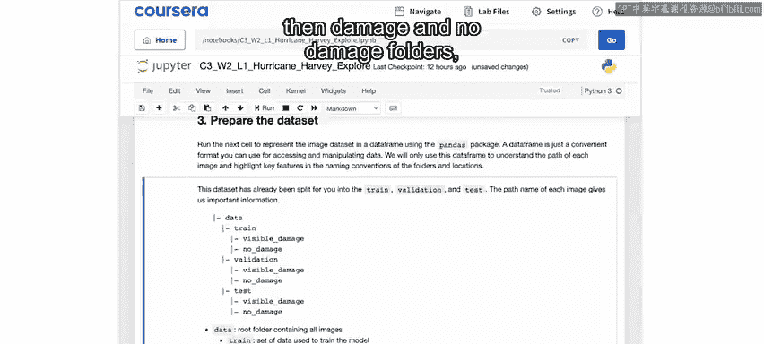

And then each of the images。So in running this next cell。

 you'll pass out that entire file name into a tabular data frame where you now have columns which subset a particular image comes from。

 train， validation or test。

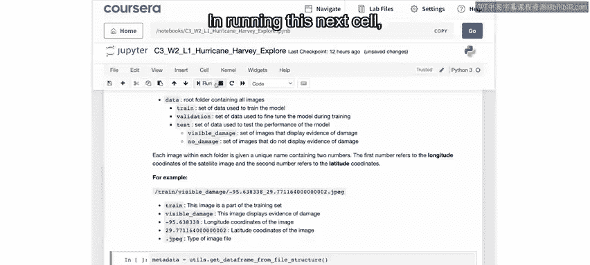

Then whether it was identified as damage or no damage， then the latitude and longitude， and finally。

 the full path to the image。You will use this data frame to work with images and select out what you need for the different steps。

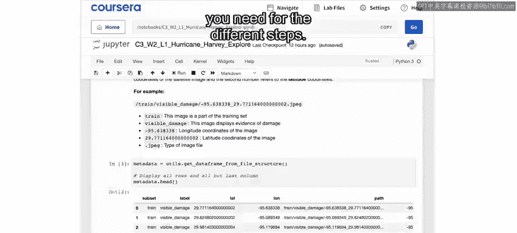

Next， you can create a little pivot table to see how many images you have in each subset for damage and no damage。

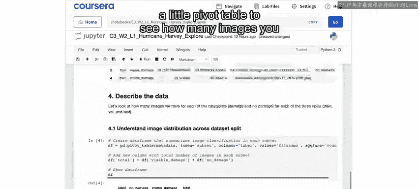

Here you can see you have 14，000 images total with 10000 for training。

 another 200 validation and 2004 testing。You'll also see there is an equal number of。

Damage and no damage or visible damage。Items and each of the subsets。

And this should tell you that this is a highly curated data set。

 I think there's a beishingly small chance that there really were 50% of images with both damage and no damage。

 and so used to be evaluating the quality of the models you build understanding that you are much more likely to have many。

 many images with no damage than visible damage from aerial imagery following a disaster。

So here you have a location that appears with no damage before the hurricane。

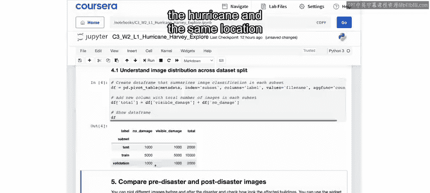

And the same location damaged after the hurricane。You can use this slider to scroll through the different images or just use arrow keys on your keyboard to move through one by one。

Keep in mind that the before and after images aren't always exactly centered on the exact same location。

So in some cases， it might take a moment to identify what the common features are。

So you can see here in image number 330， there is no damage initially。

 and we can see that what looks to be swimming pools on the left hand side here and what looks to be probably some sort of poolhouse between the two。

And when we look at visible damage， the poles are no longer visible and it looks like that structure might be gone entirely near the poles。

 So this is likely why a human decided that there was visible damage in this particular picture。

Here again， looking at 333。The visible damage image is clearly where it is inundated with flood water。

Compared to the no damage prior you can see the road and the driveway and more elements in the yard。

As mentioned before， the most damaging part of this particular hurricane was the flooding。

 so in many images， the buildings appear to be intact， but it's this flat brown color。

 there's the floodwater， and that's often the most recognisably consistent thing between images featuring damage。

Here you're hoping to differentiate between photos showing damage or no damage。

Have a look at different images to see how easy or difficult you find this task for different examples to get a sense of how successful an algorithm might be at the same task。

Finally， when you run this lost cell。

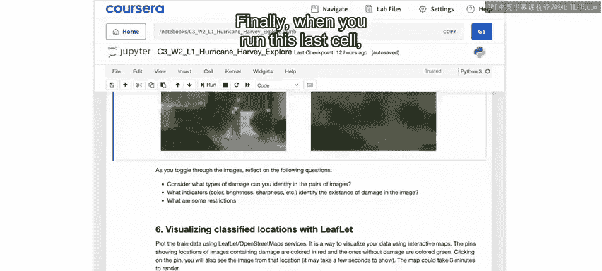

You'll display the location of each of the images on a map。

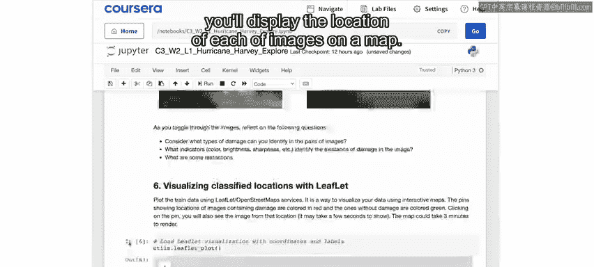

Here you can see that the data is concentrated around Houston， Texas。

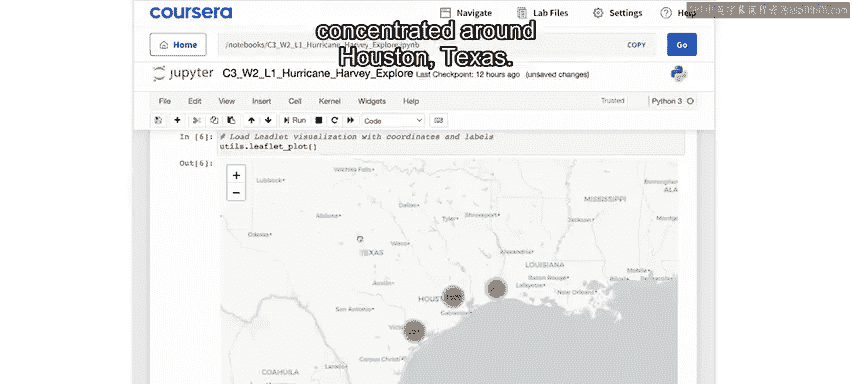

In this case， the storm came up from the southeast here。And made landfall along the Texas coast。

As you zoom in on the map， the data distribution is displayed in a more fine grand way。

 showing the number of records in different areas and finally individual pins。

The individual pins show where the images were taken。If you click on a pane。

 you can see the classification。Damage for red pins， no damage for green pans。

 as well as the image at that location。So have a look around here and get a sense for the geography of the data。

 as well as how the damage is distributed across this area。

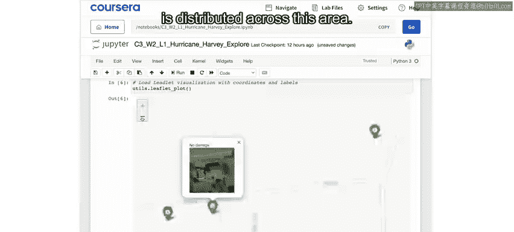

In this lab， you explore the data for this project where you have several thousand labeled examples of damaged and undamaged property。

You'll explore pairs of images to get a sense of what the damage looks like when you have before and after images for a particular location and you also looked at how you can display the data in a map Next。

 you'll work on training in a model to identify damage automatically but first join me in the next video where we will wrap up the explore phase。

