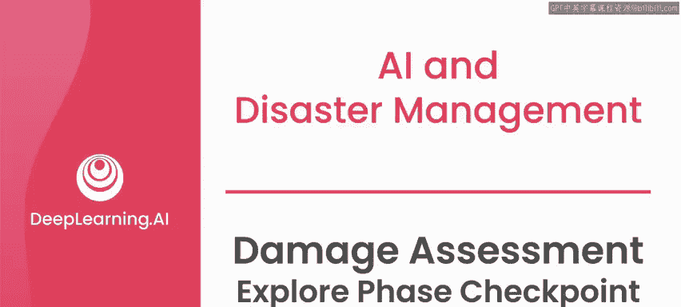
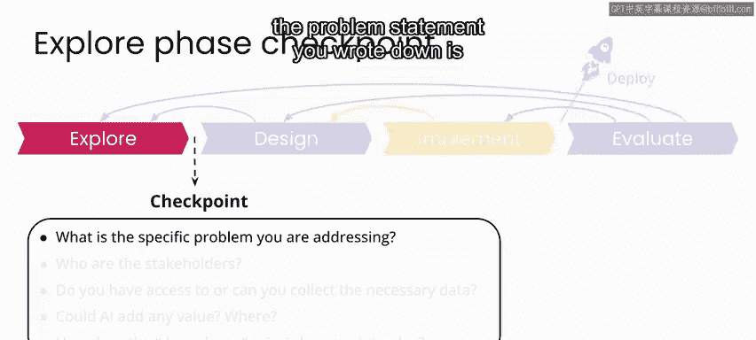
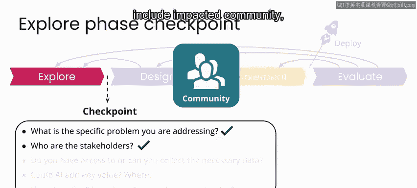
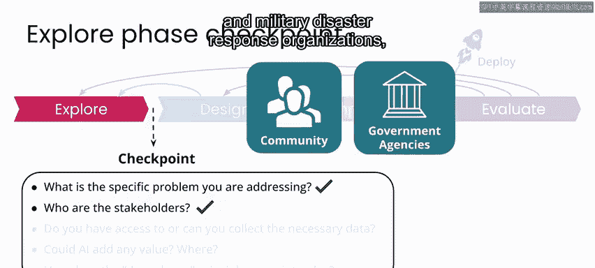
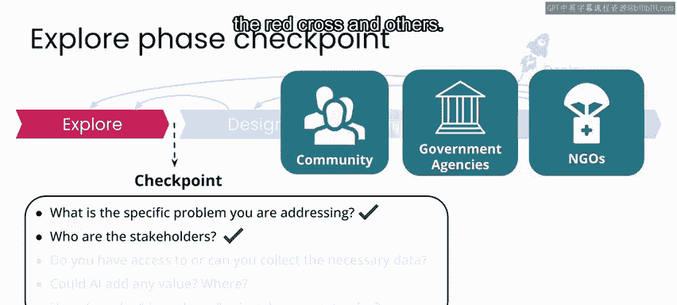
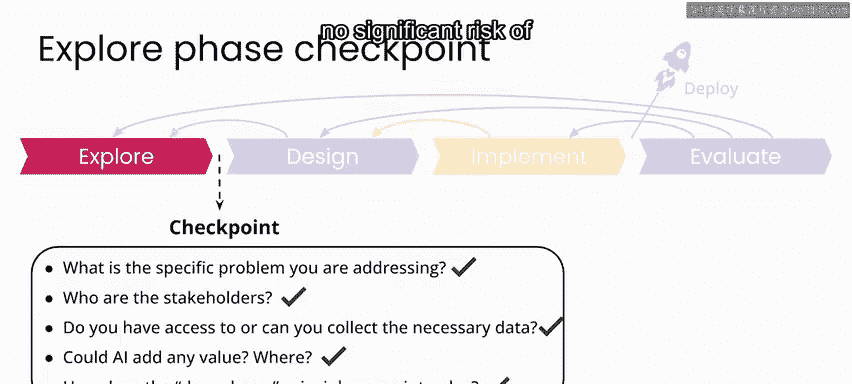
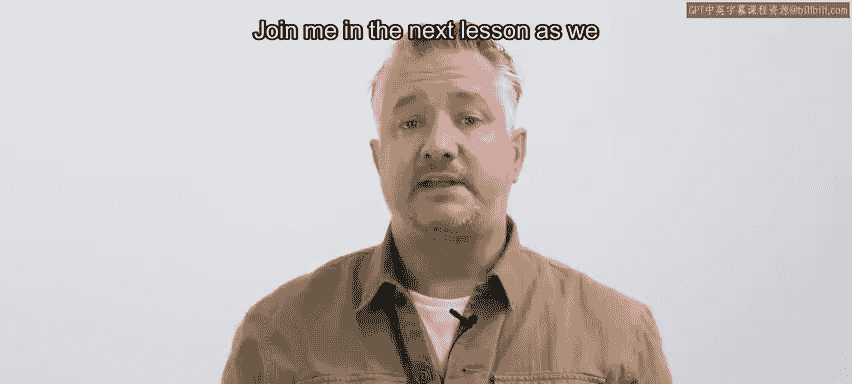

# 吴恩达《AI for Good专业课程》 AI与公共卫生、气候变化、灾难管理｜中英字幕 - P99：17_损害评估探索阶段检查点.zh_en - GPT中英字幕课程资源 - BV13u411F7xZ

At this point you have explored the various aspects of this project using satellite imagery to provide damage assessments following Hurricane Harvey。

 you have considered who the relevant stakeholders are。

 define your problem statement and examine the data that you'll be working with to determine whether or not artificial intelligence can add value in this project。

Now it's time to check whether you have everything you need to move on the design phase。

Following along with the AI for Good project framework that we've been working with， at this point。

 the questions you and your team need to consider are the following。

What is the specific problem you are addressing？Who are the stakeholders？

Do you have access to or can you obtain the necessary data could artificial intelligence add value。

 where and how specifically， and how does the do no harm principle come into play here？

In this case study， the problem statement you wrote down is disaster managers need to identify and assess damaged areas using large volumes of overhead imagery to prioritize response efforts。

 allocate resources， and plan for recovery and reconstruction activities In the problem statement。

 it is clear who some of the key stakeholders are， what solutions you're hoping to build。

 and a sense of what success could look like for this project。

The stakeholders you identified include the impacted of community， government agencies such as FEMA。

 state and local governments， and military disaster response organizations。

Non governmentn organizations such as the Red Cross and others。

You have access to a substantial amount of satellite data that contains labeled images identified as containing visible damage or not。

 given this labeled data set， it is reasonable to assume that artificial intelligence might add value if you can use that data to train an automatic image classification system。

Finally， regarding the Dunno harm principle， as with any imaging of public or private places。

 it could contain images of people or property where privacy and security will be a concern。

Especially if a project like this is deployed during an ongoing disaster。

 it is critical to ensure secure storage of the data and not to publish any information that could reveal any details about at risk communities or damaged property。

In the response that I worked on following Hurricane Sandy。

 the images that we were working with were very high resolution and included discernible images of individuals and damaged property after the response in that case。

 we let one other organization privately review the data that we had collected and labeled in order to validate our results and then we all deleted the data。

Even though that data could potentially provided value to other organizations hoping to deliver tools like the one in this course。

 we could not guarantee in the case of Hurricane Sandy that no harm would be done as a result of publishing the data。

 given that would take months or years for some areas to fully recover。

In the project that you're working on， the event itself was more than five years ago。

 such that the areas shown in the images have， for the most part， recovered from the disaster。

Beyond that the image is a fairly low resolution so no people are identifiable here it is reasonably safe to assume that there is no significant risk of harm that would come from this particular project however。

 you could imagine that if you weren't so certain about this data。

 especially if we haven't provided it for this course。

 then you also might consider labeling task where in addition to damage assessments people could evaluate whether a particular image might be sensitive and have that removed immediately from the data set and with that you've completed the explore phase for the Hurricane Harvey project join me in the next lesson as we move onto the design phase of the project。

