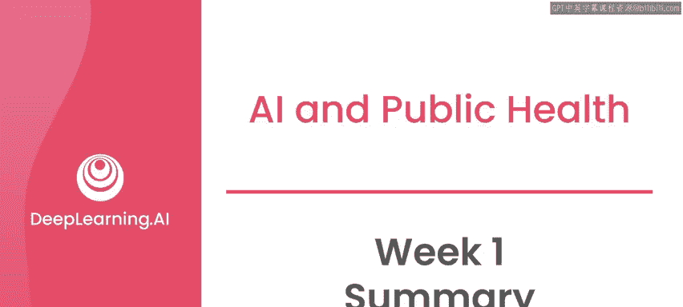
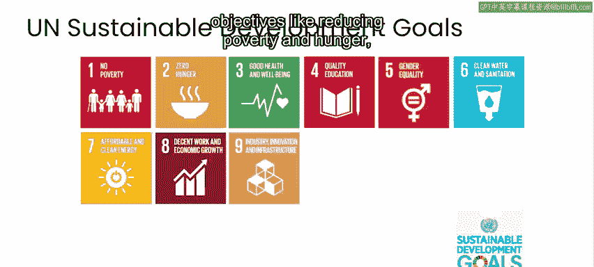
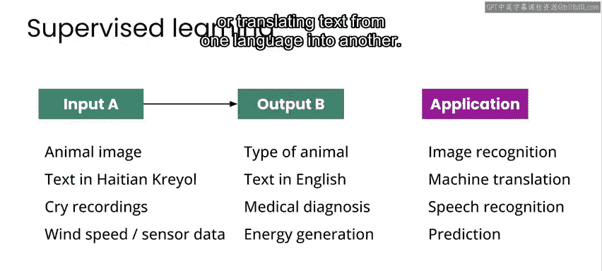
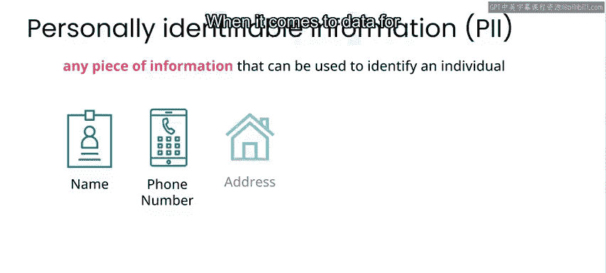

# 吴恩达《AI for Good专业课程》 AI与公共卫生、气候变化、灾难管理｜中英字幕 - P9：8_第1周总结.zh_en - GPT中英字幕课程资源 - BV13u411F7xZ

Congratulations on making it to the end of this first week of the course you're now well on your way to building a great foundation that will serve you well in the AI related projects that you decide to take on here I'll briefly recap the major ideas from this week before we move on to exploring the problem solving framework and first case study for this course in week to We started off this week with a discussion of what AI for good is and some examples of applied AI for good projects。

 This included monitoring illegal mining activities in the Amazon predicting wind power output from turbines。

 diagnosing medical conditions in infants based on the sound of their cry and a few others In general。

 AI for good projects aimed to prevent， mitigate or resolve problems that adversely impact humans or the environment The UN sustainable development goals a a popular framework for discussing objectives like reducing poverty and hunger fighting climate change and promoting clean energy you can find more information about the UN sustainabletain development。

al as well as progress reports from specific projects aiming to achieve these goals by following the link in the resources section at the end of this week。

When it comes to how AI actually works， you saw some intuitive examples of the most common form of machine learning which is supervised machine learning with supervised machine learning。

 your goal is to have your algorithm learned to map something from input A to a particular output B and that might include examples like recognizing what's in an image or making a medical diagnosis based on an audio recording or translating text from one language into another supervised learning can be applied to all sorts of problems as long as you can provide your algorithm with a data set to train on which is to say a data set where the appropriate output B is labeled for each data input A Finally we took a look at some of the considerations that you need to keep in mind when it comes to the impacts of your AI project First and foremost。

 I emphasize that it's important to keep in mind that AI will not necessarily add value to every project that you work on so rather than taking an AI first approach。

To problem solving， you should really think of AI as just one tool in your toolkit of possible options。

When it comes to data for any project that you're working on。

 you need to keep data privacy and security top of mind。

 while there are many interesting projects to work on in the world that don't necessarily involve private personal information from individuals with any project that does。

 you need to take care to protect individuals private information at all stages of your project。

 store any information that is needed and delete the data when your project is finished。

When it comes to publishing results or data products。

 you need to ensure that you're not inadvertently publishing personal information or other information that could be used to identify and in turn create risk or harm to individuals beyond the data itself。

 you still need to take careful consideration of the impact of your AI solution This could be the impact in failure modes。

 when it malfunctions or even what the impact could be when it functions as expected。

At several points throughout this week， I emphasized that in order to ensure that you minimize any potential negative impacts from your project。

 you should adopt a principle of do no harm， make sure to take the time to consider all the potential impacts。

 both positive and negative of your project and remember that in order to do this you will need to gather input and perspectives from all people who are potentially impacted by your project in your effort to ensure that no harm is done。

And with that you're ready to dive into week two of this course here we'll be introducing you to a problem solving framework that you could apply to any AI product and we'll be walking through a case study focused on maternal and infant health but first we have another project Slight This one features Felipe Ovido from Microsoft AI for Goodlab talking about his work using supervised machine learning to assist radiologists in early detection of breastas cancer。

