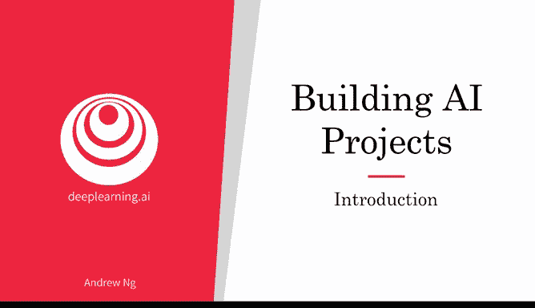
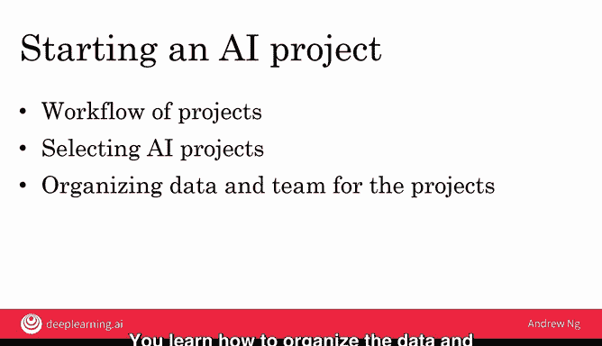

# 吴恩达《AI for everyone》给所有人的AI课（中英字幕） - P10：9_第2周 课程介绍.zh_en - GPT中英字幕课程资源 - BV1yC4y127uj

Welcome back Last week you learn about the basics of AI and machine learning technology。

 but how do you use this technology in a project either if you want to do a project in your proverbial garage or if you want to do a project and a bigger company or maybe even have something that builds up to align with your corporate strategy Let's take a look first in this week you learn what is the workflow of an AI project different projects have different steps so just as a birthday party has a sequence of predictable steps first you figure out the guest list then you find a venue then you order a birthday cake then you send invites and so on so too does an AI project have a sequence of predictable steps and so through this you learn what is the workflow of an AI project and you learn what it feels like to be working on an AI project Second how do you select an AI project seems there a lot of things you could do The second thing you learn this week is a framework for brainstorming and selecting potentially promising projects to work on either by yourself。

All of a few friends or as part of a bigger company effort Finally you also learn how to organize the data as was the team。

 which again could be just you or you friends or a much bigger corporate team。

 you learn how to organize the data and team for executing on an AI project By the end of the week you know what it feels like and how to build your own AI project and maybe you'll be able to start exploring with some of your friends promising ideas to try Let's go on to the next video。

