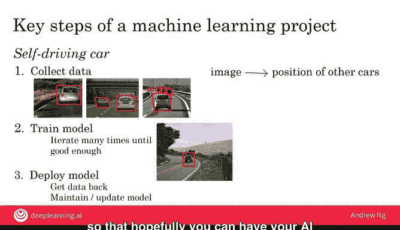

# 吴恩达《AI for everyone》给所有人的AI课（中英字幕） - P11：10_机器学习项目工作流程.zh_en - GPT中英字幕课程资源 - BV1yC4y127uj

Machine learning algorithms can learn input to output or a to B mappings。

 So how do you build a machine learning project in this video you learn what is the workflow of machine learning project。

 Let's take a look as a running example， I'm going to use speech recognition。

 So some of you may have an Amazon Echo or Google Home or Apple Surri device or Baidu Du O device in your homes。

 some years back I' done some work on Google's speech recognition system and it also led Baidu's Du O project。

 And today I actually have a Amazon E in my kitchen。

 So every time I'm baing an egg I will say Alexa set timer for three minutes and then it lets me know when the three minutes are up and my eggs already。

 So how do you build a speech recognition system that can recognize when you say Alexa or hey Google or hey Surri or hello Baid do let's go through the key steps of a machine learning project and just for simplicity。

😊。

Going to use Amazon Echo or detecting the Alexa keyword as this running example。

 If you want to build an AI system or build a machine learning system to figure out when a user has said the wordala。

 the first step is to collect data So that means you would go around and get some people to say the word Alexa for you and you record the audio of that and you'd also get a bunch of people to say other words like hello or say lots of other words and record the audio of that as well。

Having collected a lot of audio data， a lot of these audio clips are people saying either Alexa or saying other things。

 step two is to then train the model， and this means you would use a machine learning algorithm to learn an input to output。

Or A to B mapping， where the input A would be an audio clip。

 and in the case of the first audio clip above， hopefully it will tell you that the user said Alexa。

 and in the case of audio clip to shown on the right。

 hopefully the system will learn to recognize that the user has said hello When an AI team starts to train the model。

 meaning to learn the A to B or input output mapping。

 what happens pretty much every time is the first attempt doesn't work well。

 And so invariably the team will need to try many times or in AI we call this iterate many times you have to iterate many times until hopefully the model looks like it' good enough。

The third step is to then actually deploy the model and what that means is you put this AI software into an actual small speaker and ship it to either a small group of test users or to a large group of users。

What happens in a lot of AI products is that when you ship it。

 you see that it starts getting new data and it may not work as well as you had initially hoped。

 so for example， I am from the UK so I'm going to pick on the British but let's say you had trained your speech recognition system on American accented speakers and you then ship this smart speaker to the UK and you start having British accented people。

 say Alexa， then you may find that it doesn't recognize this speech as well as you had hoped。

And when that happens， hopefully you can get data back of cases such as maybe British accented speakers was not working as well as you're hoping and uses data to maintain and to update the model。

 So to summarize， the key steps of a machine learning project are to collect data。To train the model。

 the A to B mapping and then to deploy the model and throughout these steps。

 there is often a lot of iteration， meaning fine tuning or adapting the model to work better or getting data back even after you've shipped it to hopefully make the product better which may or may not be possible depending on whether you're able to get data back。

 Let's look at these three steps and see how they apply on a different project on building a key component of a self-driving car。

 So remember the key steps of collect data train model and deploy model since we' revisit these three steps on the next slide。

 Let's say you're building a self-driving car。 One of the key components as a self-driving car is a machine learning algorithm that takes as input。

 say a picture of what's in front of your car and tells you where are the other calls So what's the first step of building this machine learning system。

 Hopefully you remember from the last slide that the first step was to collect data。

So if you go is have a machine learning algorithm that can take us input an image and output the position of other cars。

 the data you would need to collect would be both images as well as position of other cars that you want the AI system to output So let's say you start off with a few pictures like this。

 These are the inputs A to the machine learning algorithm。

You need to also tell it what is the output B you would want and so for each of these pictures you would draw a rectangle around the cause in the picture that you wanted to detect and on this slide I'm hand drawing these rectangles but in practice you would use some software that lets you draw perfect rectangles rather than these hand drawn ones and then having created this data。

 what was the second step。Hope you remember that the second step was to train the model。

Now invariably when your AI engineers start training a model they'll find initially that it doesn't work that well。

 for example given this picture maybe the software。

 the first few tries things that that is a car and it's only by iterating many times that you hopefully get a better result like figuring out that that is where the car actually is。

Finally， what was the third step it was to deploy the model？Of course。

 in the self-driving world it's important to treat safety as number one and deploy model or to test the model only in ways that can preserve safety。

 but when you put the software in cars on the road， you may find that their new types of vehicles。

 say golf cost that the software isn't detecting very well， and so you get data back。

 say pictures of these golf course， use the new data to maintain and update the model so that hopefully you can have your AI software continually get better and better to the point where you end up with a software that can do a pretty good job detecting other cars from pictures like these。

In this video you learn what are the key steps of a machine learning project which are to collect data to train the model and then to deploy the model next。

 let's take a look at whether the key steps or what is the workflow of a data science project Let's go on to the next video。

😊。