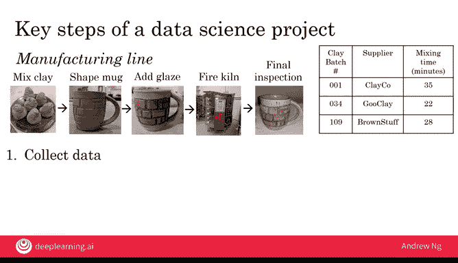

# 吴恩达《AI for everyone》给所有人的AI课（中英字幕） - P12：11_数据科学项目工作流程.zh_en - GPT中英字幕课程资源 - BV1yC4y127uj

Unlike a machine learning project， the output of a data science project is often a set of actionable insights。

 set of insights that may cause you to do things differently。

 so data science projects have a different workflow than machine learning projects。

 let's take a look at what are the steps of a data science project。😊，As our running example。

 let's say you want to optimize a sales funnel， say you run a ecommerce-commerce or online shopping website that sells coffee mugs。

 And so for a user to buy a coffee mug from you， the sequence of steps they'll usually follow first they'll visit your website and take a look at the different coffee mugs on offer。

 then eventually they' get to a product page and then they'll have to put into the shopping card and go to the shopping car page and then they'll finally have to check out So if you want to optimize the sales funnel to make sure that as many people as possible get through all of these steps。

 How can you use data science to hope of this problem。

 let's look at the key steps of a data science project The first step is to collect data。

 So on a website like the one we saw you may have a data that stores when different users go to different web pages in this simple example I'm assuming that you can figure out。

Co that the users are coming from， for example， by looking at their computer's address called an IP address and figuring out what is a country from which they're originating。

 but in practice you could usually get quite a bit more data about users than just what country they're from The second step is to then analyze the data your data science team may have a lot of ideas about what is affecting the performance of your sales funnel For example they may think that overseas customers are scared off by the international shipping costs。

 which is why a lot of people go to the checkout page but they't actually check out and if that's true then you might think about whether to put part of shipping costs into the actual product costs or your data science team may think there are blips in the data whenever there's a holiday。

 maybe more people will shop around the holidays because the buying gives or maybe fewer people will shop around the holidays because they're staying home rather than you sometimes shopping from their work computers and in some country。

There may be time of day blips where in countries that observe a semester， so a time of rest。

 like an afternoon rest， there may be fewer shoppers online and so your sales may go down。

 and they might then suggest that you should spend fewer advertising dollars during the period of CSster because fewer people will go online to buy at that time So a good data science team may have many ideas and so they try many ideas or we'll say iterate many times to get good insights。

 Finally the data science team will distill these insights down to a smaller number of hypotheses about ideas of what could be going and what could be going poorly as well as a smaller number of suggested actions such as incorporating shipping costs into the product costs rather than having it as a separate line item when you take some of these suggested actions and deploy these changes to your website you then start to get new data back as users behave differently now that you advertise differently at the time of semester or have a different checkup。

Po and then your data science team can continue to collect data and reanalyze the new data periodically to see if they can come up with even better hypotheses or even better actions over time。

 so the key steps of a data science project are to collect the data to analyze the data and then to suggest hypotheses and actions and then to continue to get the data back and reanalyze the data periodically。

Let's take this framework and apply it to a new problem to optimizing a manufacturing line。

And so we'll take these three steps and use them on the next slide as well。

 let's say you run a factory that's manufacturing thousands of coffee mugs a month for sale and you want to optimize de manufacturingu line So these are the key steps to manufacturing coffee mugs Step one is the mix the clay so make sure the appropriate amount of water is added Step two is to take this clay and to shape the mugs then you have to add the glaze so that add the coloring protective color then you have to heat this mug and we call that firing the kiln and finally you would inspect the mug to make sure they run dense in the mug and it isn't crack before you ship it to customers。

So a common problem in manufacturing is to optimize the yield of this manufacturing line to make sure that as few damage coffee mugs get produced as possible。

 because those are coffee mugs you have to throw away resulting in time and material waste。

What's the first step of a data science project。 I hope you remember from the last slide to the first step is to collect data。

 So for example， you may save data about the different batches of clay that you've mix such as who supplied the clay and how long did you mix it or maybe how much moisture was in the clay how much water did you add you might also collect data about the different batches of mugs you made So how much humidity was in that batch what was the temperature in the kiln and how long did you fire it in the kiln given all this data you would then ask the data science team to analyze the data and they would as before iterate many times to get good insights and so they might find out for example that whenever the humidity is too low and the kiln temperature is too hot that it cracks in the mug or they may find out that because it's warmer in the afternoon that you need to adjust the humidity and temperature depending on the time of day based on the insights from your data science team。

Get suggestions for hypotheses and actions on how to change the operations of your manufacturing line in order to improve the productivity of the line。

 and when you deploy the changes， you then get new data back that you can reanalyze periodically so you can keep on optimizing the performance of your manufacturing line。

To summarize the key steps of a data science project are to collect the data。

 to analyze the data and then to suggest hypotheses and actions in this video in the last video you saw some examples of machine learning projects and data science projects it turns out that machine learning and data science are affecting almost every single job function what I want to do in the next video is show you how these ideas are affecting many job functions including perhaps yours and certainly that of many of your colleagues let's go on to the next video。

