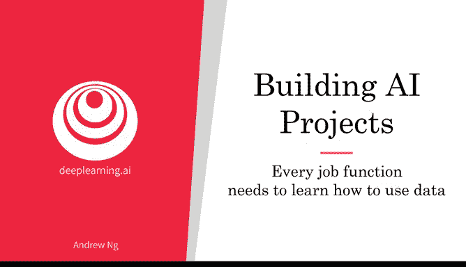
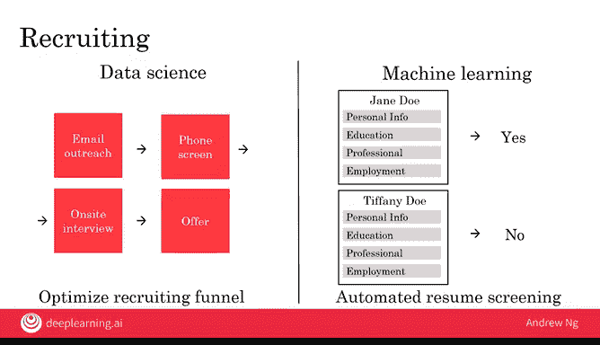
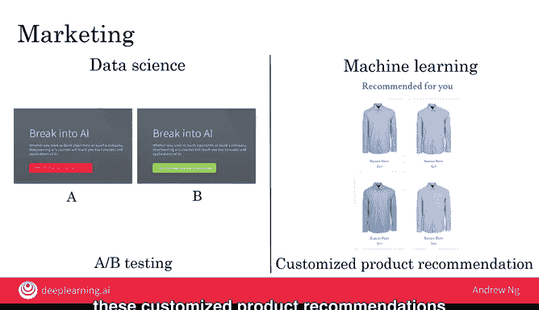
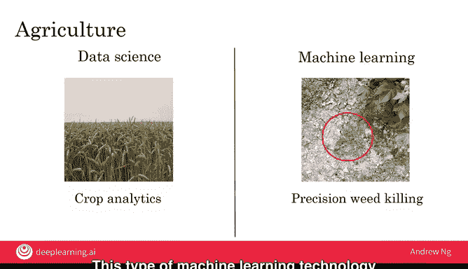

# 吴恩达《AI for everyone》给所有人的AI课（中英字幕） - P13：12_每个职能部门都需要学习数据应用.zh_en - GPT中英字幕课程资源 - BV1yC4y127uj

Data is transforming many different job functions， whether you work in recruiting or sales or marketing or manufacturing or agriculture data is probably transforming your job function What's happened in the last few decades as the digitalization of our society so rather than handing out paper surveys like these surveys are more likely to be done in digital format or doctors still write some handwritten notes but the doctors's handwritten node is increasingly likely to be a digital record and so too it is in just about every single job function and this availability of data means that there's a good chance that your job function can be helped with tools like data science or machine learning Let's take a look and in this video I want to run through many different job functions and discuss how data science and machine learning can or will impact these different types of jobs。

Let's start with sales。 You've already seen in the last video how data science can be used to optimize a sales funnel。

 How about machine learning， If you're a salesperson。

 you may have a set of leads about different people that you could reach out to to convince them to buy something from your company。

 Mach learning can help you prioritize these leads so you might want to prioritize calling up the CEO of the large company rather than the intern at a much smaller company and this type of automated lead sorting is making salespeople more efficient。

 Let's look at more examples， let's say you're a manufacturing line manager you've already seen how data science can help you optimize a manufacturing line。

 How about machine learning， One of the steps of this manufacturing process is the final inspection。

 and in fact today in manufacturingies they can be hundreds or thousands of people using the human eye to check over objects。

 maybe coffee mugs， maybe other things to see。That scratches or dense， and that's called inspection。

So machine learning can take us input a dataset like this and learn to automatically figure out if a coffee mug is defective or not。

 and by automatically finding scratches or dents， it can reduce labor costs and also improve quality in your factory。

This type of automated visual inspection is one of the technologies that I think will have a big impact on manufacturing。

 This is something I've been working on myself as well。

 Let's see more examples How about recruiting when recruiting someone to join your company。

 there may be a pretty predictable sequence of steps where your recruiter or someone else would send an email to a candidate and then you'd have a phone call of them。

 bring them onsite for an interview and then extend an offer and maybe close the offer similar to how data science can be used to optimize a sales funnel recruiting can also use data science to optimize a recruiting funnel and in fact many recruiting organizations are doing so today For example。

 if you find that hardly anyone is making it from the phone screen step to the onsite interview step then you may conclude that maybe too many people are getting to the phone screen stage or maybe the people doing the phone screen are just being too tough and they should let more people get to the onsite interview stage。

This type of data science is already having an impact on recruiting What about machine learning projects Well one of the steps of recruiting is to screen a lot of resumes to decide who to reach out to so you may have to look at when resume and says yes。

 let's email them look at a different one to say no let's not move ahead with this candidate and machine learning is starting to make its way into automated resume screening does raise important ethical questions such as making sure that your AI software does not exhibit undesirable forms of bias and treat people fairly but machine learning is starting to make inroads into this and I hope can do so while making sure that the systems are ethical and fair In the final week of this AI for everyone calls you also learn more about the issues of fairness and ethics in AI What if you work in marketing one of the common ways to optimize the performance of a website is called AB testing in which you launch two versions of a website here。

A has a red button。 version B has a green button and you measure which website causes people to click through more。

 So with this type of data， a data science team can help you gain insights and suggest hypotheses or actions for optimizing a website How about machine learning and marketing today。

 a lot of websites will give customized product recommendations to show you the things you are most likely to want to buy and this actually significantly increases sales on these websites。

 For example， a clothing website after seen the way i shop after a while will hopefully just recommend blue shirts to me because that's frankly。

 pretty the only type of shirt I ever buy。 but maybe other customers will have more diverse and more interesting recommendations than mine But today these customized product recommendations actually drive a large percentage of sales on many large online ecommerce-commerce websites。

 One last example from a totally different sector。 Let's say you work in agriculture maybe you're a farmer working on the large industry。

Fm， how can data science help you today， farmers are already using data science for crop analytics where you can take data on the soil conditions。

 the weather conditions， the prices the different crops in the market and have data science teams make recommendations to what to plant when to plant so as to improve use while maintaining the condition of the soil on your farm。

 This type of data science is and will play a bigger and bigger role in agriculture。

 Let's also look at the machine learning example。 I think one of the most exciting changes to agriculture is precision agriculture。

 Here's a picture that I took on a farm with my cellphone on the upper right as a cotton plant and shown in middle is a weed。

 And so with machine learning we starting to see products that can go onto the farms。

 take a picture like this and spray a weed color in a very precise way just onto the weed so that it gets rid of the weed but without having to spray an excessive amount of weed color。

😊，This type of machine learning technology is both helping farmers increase crop use while also hoping to preserve the environment In this video you saw how all of these job functions。

 everything from sales recruiting to marketing to manufacturing to farm and agriculture。

 how all of these job functions are being affected by data， by data science and the machine learning。

It seems like there's a lot of different things you could do with AI。

 but how do you actually select a promising project to work on。

 Let's talk about that in the next video。