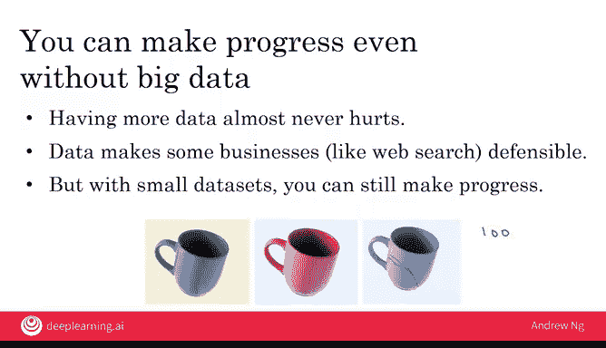

# 吴恩达《AI for everyone》给所有人的AI课（中英字幕） - P14：13_如何选择人工智能项目 第1部分.zh_en - GPT中英字幕课程资源 - BV1yC4y127uj

If you want to try your hand at an AI project， how do you select a worthwhile project to work on。

 Don't expect an idea to unless you come overnight。 Sometimes it happens。

 but sometimes it also takes a few days or maybe a few weeks to come up with a worthy idea to pursue In this video。

 you see a framework for brainstorming， potentially exciting AI projects to pursue。

 Let's say you want to build an AI project for your business。

 You've already seen that AI can't do everything。And so there's going to be a certain set of things that is what AI can do。

 so let's let this circle represent a set of things that AI can do。Now。

 there's also going to be a certain set of things that is valuable for your business。

 So let's let this second circle represent a set of things that are valuable for your business。

 What you would like to do is try to select projects that are at the intersection of these two sets so you select projects hopefully that are both feasible。

 that can be done with AI and that are also valuable for your business。

 So AI experts will tend to have a good sense of what isn and what isn't in the set on the left and domain。

 experts in your business sales and marketing or agriculture or something else will have a best sense of what is actually valuable for your business。

 So when brainstorming projects that AI can do and are valuable for your business I will often bring together a team comprising both people knowledgeable AI as well as experts in your business area to brainstorm together so that together they can try to identify projects at the intersection。

both of these two sets So sometimes we also call these cross functional teams and that just means a team that includes both AI experts as well as domain experts。

 meaning experts in your area of business when brainstorming projects there's a framework that I've used with a lot of companies that are found to be useful So let me share with you three principles of three ideas for how you can have a team brainstorm projects First。

 even though there's been a lot of press coverage about AI automating jobs away and this is an important societal issue that needs be addressed。

When thinking about concrete AI projects， I find it much more useful to think about automating tasks rather than automating jobs take call center operations。

 There are a lot of tasks that happen in the call center ranging from people pick up the phone to answering phone calls reply to emails to taking specific actions such as issuing a refund on behalf of a customer request。

 but all of these tasks that employees in the call center do。

 there may be one call routing or email routing that may be particularly amenable to a machine learning automation and by looking at all these tasks that the group of employees do and selecting one that may allow you to select the most fruitful project for automation in the near term。

 let's look at another example， the job of radiologist。

 there's been a lot of press about how AI may automate radiologists jobs。

 but radiologists actually do a lot of things they read X-rays that's really important。

 but they also engage in their own。Continuing education， they consulted other doctors。

 they may mentor younger doctors。 Some of them also consult directly with patients。

 And so its by looking at all of these tasks that the radiologist does that you may identify one of them。

 let's say AI assistance or AI automation for reading Xs that allows you to select the most fruitful projects to work on。

 So whether we recommend is if you look at your business。

 think about the tasks that people do to see if you can identify just one of them or just a couple of them that may be automateattable using machine learning。

 when'm meeting CEOs of large companies to brainstorm AI projects for the company a common question I'll also ask is what are the main drivers of business value and sometimes finding AI solutions or data science solutions to augment is can be very valuable。

 Finally， a third question that I've asked sometimes led to valuable project ideas is what are the main pain points in your business。

 Some of them。Be soft of AI， some of them can't be solved with AI but by understanding the main pain points in the business that can create a useful starting point for brainstorming AI projects as well。

 I have one last piece of advice for brainstorming AI projects。

 which is that you can make progress even without big data even without tons of data Now don't get me wrong having more data almost never hurts other than maybe needing to pay a bit more for diss or network bandwidth to transmit and slow the data。

 having more data almost always is only helpful and I love having lots of data。

 It is also true that data makes some businesses like web search defensible web search is a long tail business。

 meaning that there are a lot of very， very rare web queries and so seeing what people click on when they search on all of these rare web queries does help the leading web search engines have a much better search experience。

 So big data is great。When you can get it。 But I think big data is also sometimes overhyped and even with a small data。

 you can still often make progress。 Here's an example。

 let's say you're building a automated visual inspection system for the coffee mug So you want to automatically detect that the coffee mug on the right is defective。

 Well， if you had a million pictures of good coffee mugs and defective coffee mugs。

 it'd be great to have that many examples of pictures of good and bad coffee mugs to feed your AI system。

 but I hope that you have not manufactured a million defective coffee mugs because that feels like a very expensive thing to have to throw away。

 So sometimes with as few as1 hundred pictures or maybe10 or sometimes maybe as few as 10。

 you may be able to get started on a machine learning project the amount of data you need is very problem dependent and speaking with an AI engineer on AI expert would help you get better sense。

There are some problems where 1 thousand0 images may not be enough where you do need big data to get good performance。

 but my advice is don't give up just because you don't have a lot of data to start off with。

 and you can often still make progress even with a small data set。In this video。

 you saw a brainstorming framework and set the criteria for trying to come up with projects that hopefully can be doable with AI and then also valuable for your business。

 Now， having brainstormed the list of projects， how do you select one or select a small handful to actually commit to and work on let's talk about that in the next video。

