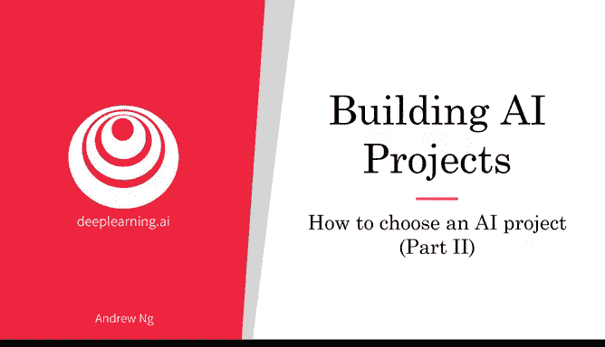
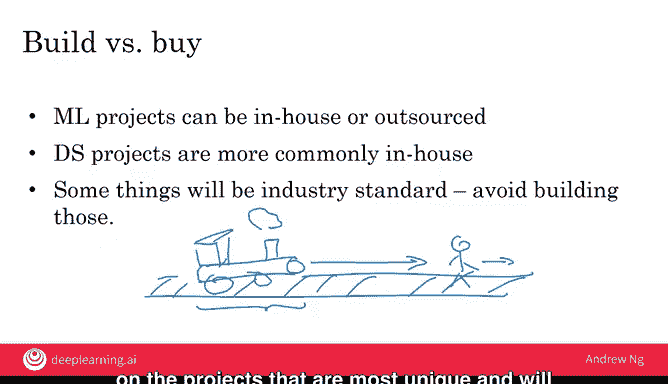

# 吴恩达《AI for everyone》给所有人的AI课（中英字幕） - P15：14_如何选择人工智能项目 第2部分.zh_en - GPT中英字幕课程资源 - BV1yC4y127uj

Maybe you have a lot of ideas for possible AI projects to work on， but before committing to one。

 how can you make sure that this really is a worthwhile project it is a quick project that may take you just a few days maybe just jump in right away and see the works or not but some AI projects may take many months to execute in this video I want to step you through the process that I use to double check if a project is worth that many months of effort let's take a look before committing to a big AI project I will usually conduct due diligence on it due diligence has a specific meaning in the legal world but informally it just means that you want to spend some time to make sure what your hope is true really is true You've already seen how the best AI projects are ones that are feasible so it's something the AI can do as well as valuable we really want to choose projects at the intersection of these two sets。

So to make sure a project is feasible， I will usually go through technical diligence。

And to make sure that the project is valuable I will usually go through a business diligence process let me tell you more about these two steps technical diligence is the process of making sure that the AI system you hope to build really is doable really is feasible so you might talk to AI experts about whether or not the AI system can actually meet the desired level of performance for example。

 if you are hoping to build a speech system that is 95% accurate。

Consulting of AI experts or perhaps reading some of the trade literature can give you a sense of whether this is doable or not。

 or if you want a system to inspect coffee mugs in a factory and you need your system to be 99% accurate again is this actually doable with today's technology A second important question for technical diligence is how much data is needed to get to this design level of performance and do you have a way to get damaged data。

Third would be engineering timeline to try to figure out how long it will take and how many people it will take to build a system that you would like to have built。

 In addition to technical diligence， I will often also conduct business diligence to make sure that the project you envision really is valuable for the business。

 So a lot of AI projects will drive value through lowering costs， for example。

 by automating a few tasks， or by squeezing more efficiency out of the system。

A lot of AI systems can also increase revenue， for example。

 driving more people to checkout in your shopping cart。

 or you may be building an AI system to help you launch a new product or new line of business So business diligence is the process of thinking through carefully for the AI system that you're building such as a speech recognition system that's 95% accurate or a visual inspection system that's 99。

9% accurate would allow you to achieve your business goals whether your business goal is to improve your current business or to even create brand new business in your company when conducting business diligence or often end up building spreadsheet financial models to estimate the value quantitatively such as estimate how many dollars are actually saved or what we think is a reasonable assumption in terms of increased revenue and to model out the economics associated with a project before。

To many months of effort on a project， although not explicitly listed on this slide。

 one thing I hope you also consider doing is the third type of diligence， which is ethical diligence。

 I think there are a lot of things that AI can do that will even make a lot of money but that may not make society better off。

 So in addition to technical diligence and business diligence I hope you also conduct ethical diligence and make sure that whatever you're doing is actually making humanity and making society better off。

 We' also talk more about this in the last week of this course as well。

As you're planning out your AI project， you also have to decide。

 do you want to build or buy This is an HO question in the IT world and we're facing this question in AI as well。

 for example， hardly any companies build their own computers these days they buy someone else's computers and hardly any companies build their own w-fi routers just buy a commercial w-fi router how about machine learning and data science machine learning projects can be inhouse or outsourced I've seen both of these models used successfully Sometimes if you outsource and machine learning project。

 you can have access much more quickly to talent and get going faster on a project it is nice that eventually you build your own inhouse AI team and can also do these projects in house you hear more about this when we talk about the AI transformation playbook in greater detail next week unlike machine learning projects though data science projects are more commonly。

Don in holes they're not impossible to outsource。 you can sometimes outsource them。

 but what I've seen is that data science projects are often so closely tied to your business that it takes very deep day-to-day knowledge about your business to do the best data science projects and so just as a percentage as a fraction。

 I see data science projects in house more than machine learning projects。 Finally。

 in every industry some things will be industry standard and you should avoid building those a common answer to the build versus by question was build the things that are going to be quite specialized to you or completely specialized to you or that allow you to build a unique defense advantage but the things that will be industry standard probably some other company will build and itll be more efficient for you to just buy it rather than build an in house。

 One of my teams that a really poetic phrase which is don't sprint in front of a train。

And what that means is if this is a train。Running on the railway tracks。

And there's the la chimney of the puff of smoke What you don't want to do is to be the person or the engineer trying to sprint faster and faster ahead of the train the train is the industry standard solution and so if there's a company maybe a starter maybe a big company or maybe an open source effort that is building an industry standard solution then you may want to avoid trying to run faster and faster to keep ahead of the train because even though you could sprint faster in the short term eventually the train will catch up and trash someone trying to sprint in front of a train So when there's a massive force of an industry standard solution that is being built you might be better off just embracing an industry standard or embracing someone else's platform rather than trying to do everything in health we all live in a world of limited resources limited time limited data。

 limited engineering resources and so I hope you can focus those resources on the project。

So that most unique can will make the biggest difference to your company through the process of technical diligence as well as business diligence。

 I hope you can start to identify projects that are potentially valuable or that seem promising for your business if the project is a big commitment maybe it'll take many months to do it's not unusual for me to spend even a few weeks conducting this type of diligence before committing to your project。

Now say youve found a few promising projects， how do you engage with an AI team。

 how do you work of an AI team to try to get these projects done。

 let's talk about that in the next video。