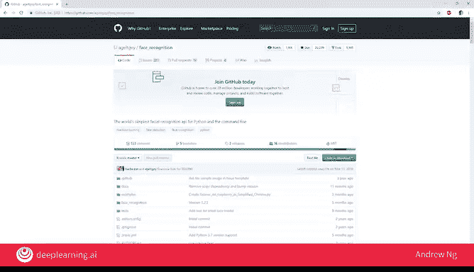
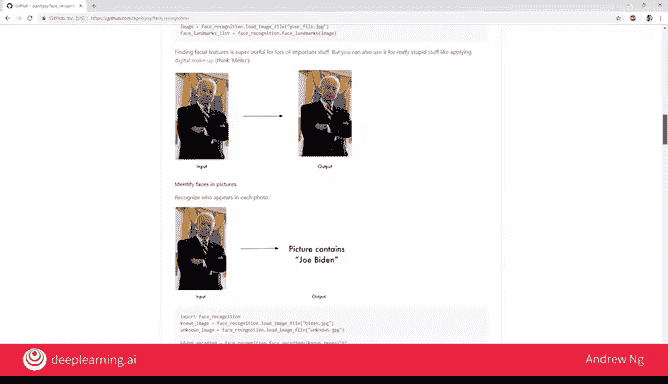
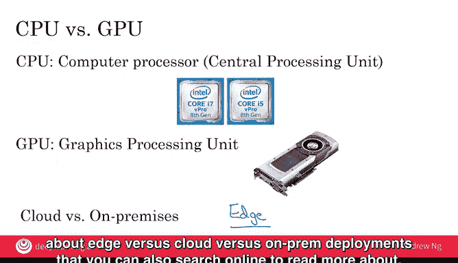

# 吴恩达《AI for everyone》给所有人的AI课（中英字幕） - P17：16_人工智能团队技术工具（可选）.zh_en - GPT中英字幕课程资源 - BV1yC4y127uj

When you work with AI teams you may hear them refer to the tools that they're using to build these AI systems in this video I want to share with you some details and names of the most commonly used AI tools so that you be able to better understand what these AI engineers are doing We're fortunate that the AI world today is very open and many teams will openly share ideas of each other。

 there are great machine learning， open source tools and frameworks that many teams will use to build their systems So if you hear any of these Pytorch。

 Tensorflow， hug face， paddle paddlesicle or R All of these are open source machine learning tools or frameworks that help AI teams be much more effective along of AI technology breakthroughs are also publish freely on the internet on this website called archive Sp like this I hope that other academic communities also freely share their research since I've seen firsthand how much this。

progress in the whole field of AI。 Finally， many teams will also share their code freely on the Internet most commonly on the website called Goodthub。

 This has become the de facto repository for open source software in AI and in other sectors in AI and by using appropriately licensed open source software。

 many teams can get going much faster than if they had to build everything from scratch。 So。

 for example， if I search online for face recognition software on Github。You might find。

A web page like this。 And if you scroll down。

This actually has a pretty good， very readable description of software that is made available on this website for recognizing people's faces and even finding parts of people's faces。

😊。

There's just a ton of software that is really downloadable for doing all sorts of things on the internet and just double check the license or AID would doublecheck the license before using it in a product of course。

 but a lot of the software is open source or is otherwise very permissively licensed for anyone to use。

Although Github is a technical website built for engineers， if you want。

 you should feel free to play around Github and see what other types of AI software people have released online as well。

 In addition to these open source technical tools you often also hear AI engineers talk about CPUs and GPUs here's what these terms mean A CPU is the computer processor in your computer。

 whether it is your desktop， your laptop or a computer server off in the cloud CPU stands for central processing unit and CPUs are made by Intel and AMD and a few other companies This does a lot of the computation in your computer。

GPU stands for Gphics processing unit。 Histor， the GPU was made to process pictures。

 so if you play a video game is probably a GPU that is drawing the fancy graphics but what we found several years ago was that the hardware that was originally built for processing graphics。

 turns out to be very， very powerful for building very large neural networks。

 or very large deep learning algorithms， given the need to build very large deep learning of very large neural network systems。

 the AI community has had this insatiable hunger for more and more computational power to train bigger and bigger neural networks and GPUs have proved to be a fantastic fit to this type of computation that we need to have done to train very large neural networks。

 So that's why GPUs are playing a big role in the rise of deep learning and V is a company that has been。

many GPUus， but other companies， including Qualcomm， as well as Google。

 making its own TUus are increasingly making specialized hardware for empowering these very large neural networks。

 Finally， you might hear about cloud versus onpres or for short onprem deployments cloud deployments referred to if you rent compute service such as from Amazon's AWs or Microsoft's or Google's GCP in order to use someone else's service to do your computation whereas an onprem deployment means buying your own compute service and running the service locally in your own company。

 a detailed exploration of the pros and cons of these two options beyond the scope of this video。

 a lot of the world is moving to cloud deployments。

 whether you search online you find many articles talking about the pros and cons of cloud versus onprem deployments There is one large term you might hear about。

Which is edge deployments。If you are building a self-driving car。

 there's not enough time to send data from a self-driving car to a cloud server to decide if you should stop the car or not and then send that message back to the selfdriving car so the computation has to happen usually in a computer right there inside the car that's called an age deployment where you put a processor right where the data is collected so that you can process the data and make a decision very quickly without needing to transmit the data over the internet to be processed somewhere else。

If you look at some of the smart speakers in your home as well。

 this too is an edge deployment where some not all。

 but some of the speech recognition tasks is done by a processor that is built in right there into the smart speaker that is inside your home。

 The main advantage of edge deployments is it can increase response time of the system and also reduce the amount of data you need to send over the network。

 but there are many pros and cons as well about edge versus cloud versus on-prem deployments that you can also search online to read more about Thanks for finishing this optional video on the technical tools that AI engineers use。

 hopefully when you hear them refer to some of these tools you start to have a better sense of what they mean I look forward to seeing you next week。

