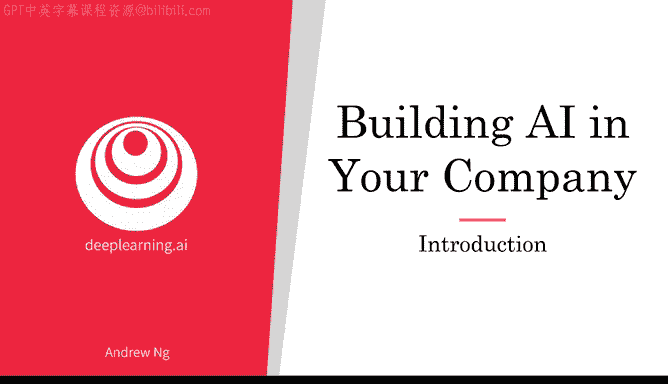
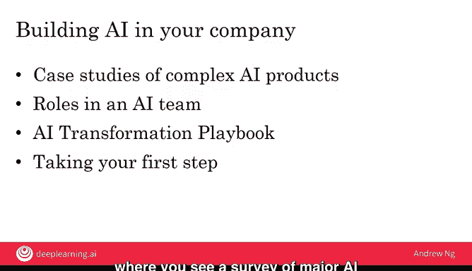

# 吴恩达《AI for everyone》给所有人的AI课（中英字幕） - P18：17_第3周 课程介绍.zh_en - GPT中英字幕课程资源 - BV1yC4y127uj

Welcome back In the last two weeks， you learned what its AI and how to build an AI project This week。

 we'll look at the projects we've talked about already and talk about how projects fit in the context of a company whether it's a for profit nonprofitfi or even within a government entity for the sake of concreteness I'll talk about building AI for companies but equally apply no matter what type organization you're in Now in case some of what you hear this week sounds like CEO level talk don't be intimidated。

 This is actually useful for everyone to know that once to hope your company will help your organization improve using AI and it does take maybe two or three years for a company to become good at AI to embrace not just one AI project with a sequence of valuable AI projects and become much more effective but what I hope to do this week is help you paint a vision for where an organization can go over a longer period of time like that。

 but also end the week with very concrete。Stepps you can take right away so let's get started in detail these are the topics you see this week first is case studies of complex AI products so rather than a single machine learning or data science module like what you saw last week this week youll see how multiple modules can come together to build a much more complex AI product such as a smart speaker or a self-driving car。

You also learn what are the major roles in an AI team so if ever you think your company can build a large AI team with maybe many dozens or maybe even hundreds of people。

 what are the things these people will do will start to paint a roadmap for what building an AI team might look like Third。

 you also learn about the AI transformation playbook of how to help your company become good at AI where it goes beyond doing one or two valuable projects but about making your whole company good at AI and hopefully much more effective and valuable as a result。

Finally， whereas some these steps may take a small number of years to complete。

 we'll wrap up this week's videos with concrete suggestions on how you can take your first step right away to a building AI in your company beyond these major topics will also have a couple of optional videos at the end where you see a survey of major AI application areas and techniques。

So after this week's videos， I hope you have a good vision for how you can help your company use AI and also have first steps you can take right away。

 Let's get started by going on to the next video。