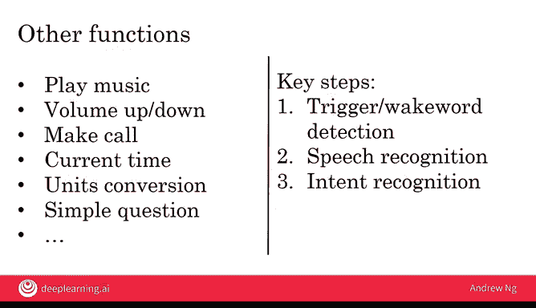

# 吴恩达《AI for everyone》给所有人的AI课（中英字幕） - P19：18_案例研究：智能音箱.zh_en - GPT中英字幕课程资源 - BV1yC4y127uj

What does it feel like to work on a complex AI product where isn't just using a single machine learning algorithm to map from A to B。

 but that learning algorithm is part of a bigger， more complex project or product。

 Want to start of this week with two case studies of building complex AI products first building a smart speaker so that you can start to understand what it might feel like to maybe someday work on a complex AI product within your own company。

 Let's get started smart speakers and voice activated devices like these are changing the world by storm And if you don't already have one in your home。

 maybe you buy one someday。 I'd like to go through a case study of how you would write AI software to get a smart speaker to respond to a verbal command such as hey device tell me a joke for this example rather than using Alexa or Google or Hey Siri or hello by do as the Wakeword or trigger word to be more device agnostic。

going to use hey device as the trigger word wake word to wake up， say a smart speaker。

 and let's say you want to tell you a joke。 So how do you build a piece of AI software to understand the command like this and execute on it。

 These are the steps needed to process the command。 There are gonna be four steps。

 Step1 is the trigger word or the wake word detection。

 the speaker uses a machine learning algorithm to input the audio clip and output that it just hear the wake word or the trigger word hey device So outputs 001 and once it hears the trigger word wake word once it hears hey device。

 it then has to perform step 2， which is speech recognition。

So what the software has to do is take the audio of what came after hey device and map that to。

Tell me a joke。 This is also done with machine learning。 whereasas the first step here。

 Use an A to B mapping to just tell it。 Did it hear the trigger word。

 This uses a different A to B mapping to map the audio to a text transcript of what you just said。

 which in this case is the four words。 Tell me a joke。 Now。

 the album has to figure out what you actually want by saying these four words。

 And so the third step is intent recognition。 That means to take whatever you said。

 and to figure out what you actually want to do。 So today's smart speakers have a limited set of commands。

 such as they can tell a joke or they can tell the time。 So you can say， hey device， what time is it。

 they can play music。 They can sometimes have you make a phone call。

 They can tell you what's the weather。 Hey device， what's the weather tomorrow。

 And so what intent recognition does is take the four words。

The speech recognition is output and use another piece of AI software。

 another A to B mapping that inputs those four words and outputs which of these five or other intents do you have。

 So in this implementation of the machine learning algorithm， the input a。Is the text transcript。

 Tell me a joke。 and the output B is which of these five types of commands did the user just utter。

 Of course， your smart speaker may be able to understand even more commands than just these5 in which case B would be whichever of the5 or 20 or 100 commands。

 your smart speaker knows how to execute no matter how you ask the smart speaker to tell your joke。

 Hopefully the intent recognition component will recognize your intent correctly。

 so that you can also say not just hey device tell me a joke， but also hey device。

 do you know any good jokes or hey device。 tell me something funny。

 turns out there are a lot of ways for you to ask a smart speaker for a joke and a welldesigned intent recognition system should recognize most of them。

 Finally， now that your smart speaker has figured out that you really， really want to hear a joke。

The last step is that there'll be a software engineer that has written a piece of code to randomly select a joke and to play the joke back through the speaker。

 In other words， to execute the joke。Just for the record， my favorite joke is。

 why are there so many shocking results in AI？Because AI is the new electricity。

 shocking electricity。 Get it。 Hope you enjoy that。And so all right， in seriousness。

 you can think of the four steps of the algorithm as these four steps。

 where the first step is trigger word detection， second step。

 speech recognition than intent recognition and then finally the execution of whether command the user ask a smart speaker to execute。

 So the process of having four steps in an AI system like this， or multiple steps。

 This is sometimes called an AI pipeline where you have multiple AI components。

 You actually have multiple machine learning components which process data one step after another。

 and it would not be unusual to have， say four different teams in a company where each team focuses on one of the components of this AI pipeline。

 That's how we often organize projects within a large company。

 Let's now look at the more complex example。 When if you issue a more complex command like pay device set timer for 10 minutes。

These are the steps needed to process the command。 First step same as before is trigger word detection。

 So input an audio。 and just let me know when someone said the trigger word hey device。

 then speech recognition where you input the rest of the audio and transcribe the rest of the sound。

 the rest of the audio set timer for 10 minutes and now intent recognition has to input that text and output that your intent is that you want to set the timer。

One difference between set timer for 10 minutes compared to the earlier example of tell me a joke is that you need to know how long to actually set the time of。

 so in the execution step you actually need to do two things。

 one is extract the duration that means look at the text set time of 10 minutes and pull out the phrase that tells you how long to actually set the time four。

And so if the user were to say， hey device， let me know when 10 minutes is up。

 then this extra duration step would have to pull out again the 10 minute phrase right there and of course there are lots of ways to ask for a 10 minute timer you can also say let me know when 10 minutes are up or set alarm for 10 minutes from now and hopefully the intent recognition and extract duration components will both be robust enough to recognize that all of these are different ways of asking for a 10 minute timer。

And finally， to execute the command， there should be a specialized software component in the smart speaker that can start a timer with a set duration。

 and after it's extracted your intent and the duration which is start the timer with that duration so the alarm goes off at the end of 10 minutes today's smart speakers of many functions other than the two have talked about of telling jokes and sending a timer here are some other functions that many smart speakers today can execute。

 and the key steps of executing these commands are trigger the workward detection speech recognition to trascribe the text of command。

 intent recognition to figure out which of these functions or which of these commands you want to execute and then a specialized program to execute whichever command you utter。

😊。

One of the challenges of the smart speaker world is that if you want your smart speaker to have this many different functions。

 say 20 different functions， then you do need software engineering teams to write 20 specialized pieces of software want to play music。

 want to set the volume， want to make calls want to ask for the current time want to convert units like from teaspoons to tablespoons or to answer very simple questions and on and on and so it's actually quite a lot of work to write all of these specialized programs to execute all the different commands。

 you might want to execute in step4 and smarts speakers today actually do so many things that is difficult for many users to keep straight in their heads exactly what they can and cannot do and so many smart speaker companies have been investing a lot in user training to try to let users know what are the things that smart speakers can do because on one hand they can't do everything that lot of things you can't ask smart speakers do such as please call my three friends and see when all of them。

Able to meet for dinner。 And so it's been an ongoing process for the smart speaker companies to explain to users what they can and cannot do。

Nonetheless， with what they can do using voice to command these speakers is making life much more convenient for many people。

I hope this video gave you a sense of what it takes to build a complex AI product such as a smart speaker in order to help you better understand how these complex products were。

 let's go to see a second case study of how to piece together multiple AI components to build a self-driving car。

 Let's go to the next video。