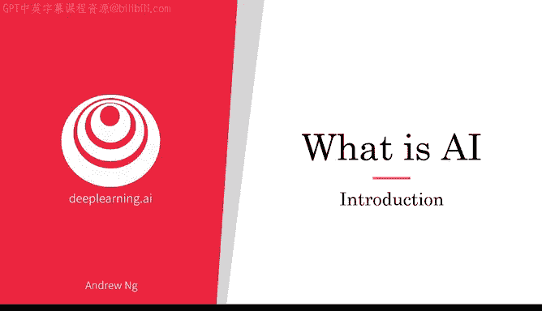
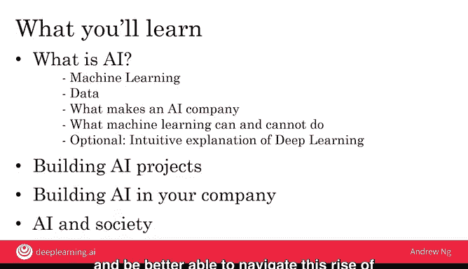

# 吴恩达《AI for everyone》给所有人的AI课（中英字幕） - P1：0_第1周 课程介绍.zh_en - GPT中英字幕课程资源 - BV1yC4y127uj

Welcome to AI for everyone。 AI is changing the way we work and live。

 and this non-technical course will teach you how to navigate the rise of AI。

 whether you want to know what's behind the buzzwords or whether you want to perhaps use AI yourself。

 either the personal context or in a corporation or other organization。

 this course will teach you how and if you want to understand how AI is affecting society and how you can navigate that。

 you also learn that from this course。 in this first week will start by cutting through the hype and giving you a realistic view of what AI really is let's get started。

 Many expertss agree that AI will create a huge amount of value。 For example。

 According to a study by McKinsey Global Institutestits。

 AI will create an additional 13 to 22 trillion dollars of value annually by the year 2033 of this 13 to 22 trillion。

3 to4。😊，Pllion dollars is predicted to come from what's called generative AI。

 which is a relatively new type of AI technology that can produce high quality content specifically text images and audio。

 but the larger portion of value will be from other forms of AI dengenrative AI for example。

 a technology called supervised learning will focus more on these other more mature types of AI technology in dis course。

 AI is already creating tremendous amounts of value in the software industry and the McKinsey study points out that a lot of the value to be created in the future lies outside the software industry。

 For example， in sectors such as retail travel， transportation， automotive materials。

 manufacturing and so on。 I should have a hard time thinking of an industry that I don't think AI will have a huge impact on in the next several years。

 My friends and I used to challenge each other to name an industry where we don't think AI will have a huge impact and my best example was the hairdress industry because it's。

How to use AI robotics to ultimately hairdress。 But I once set this on stage。

 And one of my friends who is a robotics professor was in the audience that day。

 And Sha she stood up and she looked at me in the eye and she said， you know， Andrew。

 most people's hairs cellsles， I couldn't get a robot to cut their hair that way。

 but she looked me and said your hairs styleyle， Andrew， that a robot can do。😊。

There's a lot of excitement， but also a lot of unnecessary hype about AI。

 One of the reasons for this is because AI is actually two separate ideas。

 A large amount of the value we see from AI today is artificial， narrow intelligence or AI。

 These are AIs that do one thing such as a smart speaker or a self-driving car or AI for a web search or AI applications in farming or in a factory。

 These types of AI are one trick ponies。 But when you find the appropriate trick。

 this can be incredibly valuable with the rise of geneative AI。

 things like Cha GpT and bo we're also starting to see AI， there's a bit more general purpose。

 For example， Cha GPT can be a copy editor brainstorming partner。

 textonizer and help with many other tasks。 These models have been an exciting development and is further expanding what we can now do with AI。

 In addition， AI also refers。😊，To the concept of AG or artificial general intelligence。

 This is a goal of building AI that could do any intellectual task that the human can。

 or maybe even be super intelligent and do even more things than any human can。

 I'm seeing tons of progress in A artificial narrow intelligence， as well as on generative AI。

 and it feels like AI research is slowly taking baby steps， tiny baby stepsps to what Agi。

 which is exciting。 But realistic， we're still very far from Agi or artificial general intelligence。

 Unfortunately， the rapid progress in A and geneative AI， which are incredibly valuable。

 that has caused people to conclude that there's a lot of progress in AI， which is actually true。

 but that in turn has caused people to falsely think that we might be on the verge of Agi as well。

 which is leading to some overblown and unnecessary fears about evil sentient robots coming to take over humanity。

 I think AG is an exciting go for research。😊，to work on。

 but it'll take multiple technological breakthroughs before we get there and it may be decades。

 maybe even hundreds of years， I hope， but I'm not sure if we will get there in our lifetimes。

But given how far away AGI is， I think there is no need to undo the anxiety about it in this week。

 you learn what A andI can do and how to apply them to your problems。 They in discourse。

 you also see some case studies of how ANI， these onet ponies can be used to build really valuable applications such as smart speakers and self driving costs In detail。

 in this week， you learn what is AI。 you may have heard of machine learning and the next video will teach you what is machine learning。

You also learn what is data and what types of data are valuable。

 but also what types of data are not valuable。 You learn what it is that makes a company an AI company or an AI first company so that perhaps you can start thinking if there are ways to improve your company or other organization ability to use AI and importantly you also learn this week what machine learning can and cannot do in our society。

 newspapers as well as research papers tend to talk only about the success stories of machine learning and AI。

 and we hardly ever see any failure stories because they just aren't as interesting to report on。

But for you to have a realistic view of what AI and what machine learning can and cannot do。

 I think it's important that you see examples of both so that you can make more accurate judgments about what you may and maybe should not try to use these technologies for Finally。

 a lot of the recent rise of machine learning has been driven through the rise of deep learning。

 sometimes also called neural networks。In the final two optional videos of this week。

 you can also see an intuitive explanation of deep learning so that you will better understand what they can do。

 particularly for a set of narrow ANI tasks。 So that's what you learn this week and by the end of this week。

 you have a sense of AI technologies and what they can and cannot do。In the second week。

 you learn how these AI technologies can be used to build valuable projects。

 you learn what it feels like to build an AI project。

 as well as what you should do to make sure you select projects that are technically feasible as well as valuable to you or your business or other organization。

After learning what it takes to build AI projects in the third week。

 you learn how to build AI in your company in particular。

 if you want to take a few steps toward making your company good at AI。

 you see the AI transformation playbook and learn how to build AI teams and also build complex AI products。

 Finally， AI is having a huge impact on society in the fourth and final week you learn about how AI systems can be biasers and how to diminish or eliminate such biases。

 You also learn how AI is affecting developing economies and how AI is affecting jobs and be better able to navigate this rise of AI for yourself and for your organization。

By the end of this four week course， you'll be more knowledgeable and better qualified than even the CEOs of most large companies in terms of your understanding of AI technology。

 as well as your ability to help yourself or help your company or other organization navigate the rise of AI。

 and so I hope that after this course， you'll be in a position to provide leadership to others as well as they navigate these issues。

Now， one of the major technologies driving the recent rise of AI is machine learning。

 But what is machine learning， Let's take a look in the next video。

