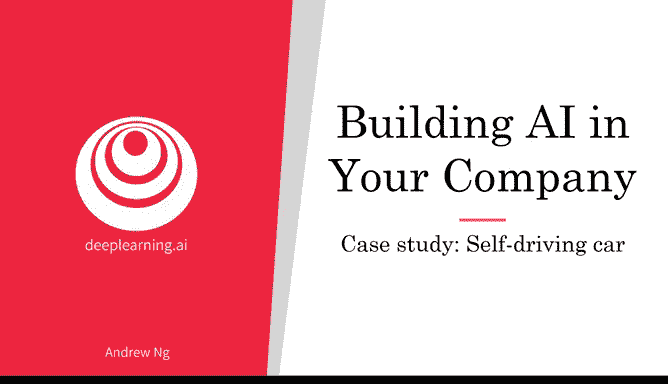
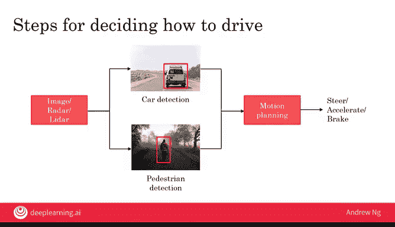
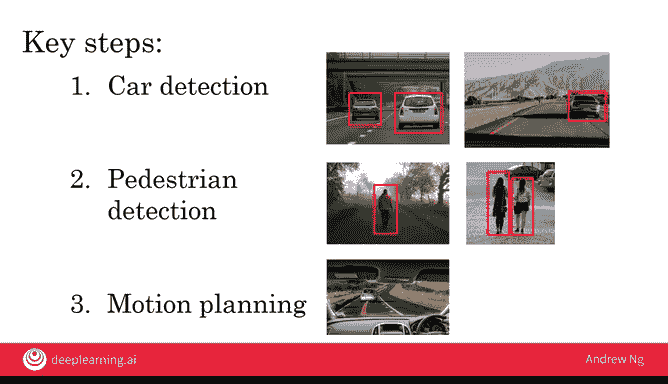
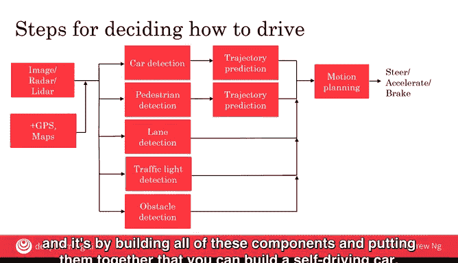

# 吴恩达《AI for everyone》给所有人的AI课（中英字幕） - P20：19_案例研究：自动驾驶汽车.zh_en - GPT中英字幕课程资源 - BV1yC4y127uj

One of the most exciting products of the AI era is the self drivingriving car。

 Sub cars are also one of the most mysterious things you hear about in AI these days In this video。

 what I want to do is share with you a somewhat simplified description of a self-driving car so that you understand how you can piece together multiple AI components in order to build these amazing things。

 Let's get started。😊，These are the key steps for deciding how to drive your self-dring car。

 The car will take us input various sensors such as pictures of what's in front of the car or to the size of behind。

 as well as maybe radar or Liar， meaning laser sensor readings Given this input of a picture and maybe other things it then has to detect other cars So given that hopefullyll figure out there's a car there as well as where the pedestrians because we want to avoid other cars as well as avoid pedestrians both car detection and pedestrian detection can be done with machine learning using input output or A to B mappings that takes us input the picture and maybe radar and Liar sensor inputs and tells us where are the other cars and pedestrians。

Finally， now that you know where are the other cars and where pedestrians。

 you can then feed this information into another specialized piece of software is called a motion planning piece of software that plans the motion or plans the path that you want your car to take so that you can make progress to your destination while avoiding any collisions And once you've planned out the motion for your car。

 you can then translate that into specific steering angle for a steering wheel and acceleration and brake command。

 So how much to step on gas pedal and how much to brake in order to get your car to move at the desired angle as well as speed。

 Let's look at the three key steps of car detection pedestrian detection and motion planning in more detail car detection uses supervised learning so you've already seen how a learning algorithm can take as input pictures like these and output the detected cars for most self drivingriving cars rather than using only a front facingcing camera So a camera that looks。

Forward also often use cameras that look to the left to the right as was to the back so you can detect cars not just to the front but all around it。

 and this is usually done using not just cameras， but other sensors as well。

 such as radar and Liar is pedestrian detection and using a pretty similar type of sensors as well as techniques self driving cars can detect pedestrians Finally I briefly mentioned a motion planning step。

 So what is that here' an example， let's say you're driving your car。

 and there's this blue light blue car in front of you The motion planning software job is to tell you what is the path shown here in red you should drive in order to follow the road and not have an accident and so the motion planning software job is to output the path as well as speed at which you should drive your car in order to follow the road and the speed should be set so that you don't run into the other car but you also drive at a reasonable speed on this road Here's another example if there's this gray car parked on the right。

side of the road so you want to overtake this stopped car。

 then the motion planning software job is to plot a path like that to let you veer a little bit to the left and safely overtake a stopped car So far of given a rather simplified description of selfdriving comprising mainly these three components let's look a little bit more detail of how an actual selfdriving car might work This is a picture you've seen so far input image radar Li sensor readings do car detection and pedestrian detection and that is then fed to motion planning to help you select your path and speed。

 Now in a real selfdriving car you would usually use more than just cameras， radar and Liar。

 most subject cars today will also use GPS to sensorus position as well as aelerometer sometimes called an IMU means accerometers and gyrocopes as well as a map because we know that cars are more likely to be found on the road pedestrians are more likely to be found on。

sideidewalks， although they are sometimes on the road as well and all this is usually additional information that's fed in to detect cars and pedestrians as well as other objects we'll talk about in a second rather than just detecting cars and pedestrians in order to drive safely。

 you also need to know where these cars and pedestrians are going in the future So another common component to cell driving cars is trajectory prediction where there's another AI component that tells you not just the cars and pedestrians you found。

 but also where they're likely to go in the next few seconds so you can avoid them even as they're moving to drive safely requires more than just navigating other cars and pedestrians。

 you also need to know where the lanes so you might detect lay markings if there's a traffic light you also need to figure out wheres the traffic light and is it showing a red yellow or green signal and sometimes there are other obstacles such as unexpected traffic cones or maybe there's a flock of geese walking in front of your car that needs to be detected as well so that your car can avoid even other obstacles。

and causing pedestrians on a large selfdriving car team。

 it would not be that unexpected to have a team or maybe a few people working on each of the boxes shown here in red and is by building all of these components and putting them together that you can build a selfdriving car。

As you can tell， both from this rather complex example of an AI pipeline。

 as well as the early example of the fullstep AI pipeline for the Smart speaker。

 sometimes it takes a team to build all of these different components of a complex AI product。😊。

What I'd like to do in the next video is share you what are the key roles in large AI teams。

 And if you're either a one person or small AI team now， that's okay。

 But I want you to have a vision of what building a large AI team maybe in the distant future might look like。

 Let's go into the next video。😊。