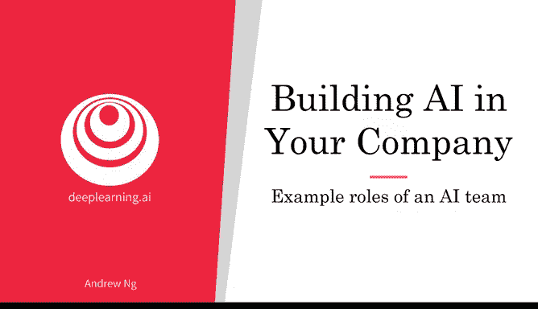
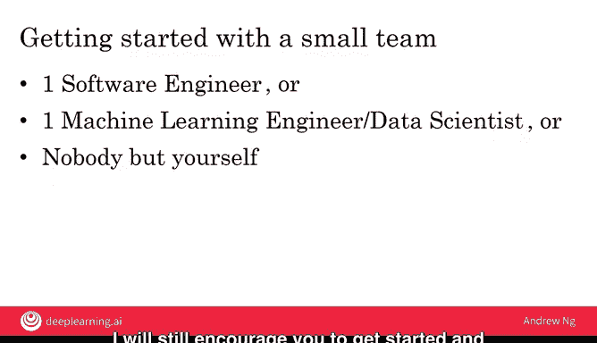

# 吴恩达《AI for everyone》给所有人的AI课（中英字幕） - P21：20_人工智能团队典型角色解析.zh_en - GPT中英字幕课程资源 - BV1yC4y127uj

You saw from the last two videos that some AI products may require a large AI team。

 maybe with 100 engineers or sometimes many more than 100 to build。

What I'd like to do in this video is share you the typical roles and responsibilities of a large AI team like this so you can better understand the types of work needed to build these complex AI products。

 Now， even if you will be working on a much smaller team。

 maybe a one or two or five person team for the foreseeable future。

 I hope this video will still be useful to you because the hope give you a sense that the different types of work。

 then an AI team might need to do， even if you end up executing on this type of work will a much smaller team。

😊，One caveat， because AI is evolving so fast， the job titles and row responsibilities are not yet 100% defined。

 and they are a little bit different across different companies。

 So your company may use the job titles differently than what I'm presenting here。

 But I want to share with you how job titles are often used in many companies so that if yeah someday building up your own AI team and we hear about these roles。

 you would have at least some default understanding of what these job titles mean。

 So let's get started。Many AI teams will have software engineers in them。 So， for example。

 for the smarts speaker， we needed to write specialized software to execute on the joke or to set a timer or to answer questions about today's weather。

 So those are traditional software engineering tasks。

 or if you're building a selfdiving car to make sure that your self car software is reliable and doesn't crash。

 These are software engineering task。 So it's not uncommon for AI teams to have a large fraction。

 sometimes 50%， sometimes much， much， much more than 50% of software engineers in them。

The second common role is the machine learning engineer。

 and so a machine learning engineer might write the software responsible for generating the A to B mapping or for building other machine learning algorithms needed for your product so they might gather the data of pictures of cars and positions of cars train a neural network or train a deep learning algorithm and work iteratively to make sure that the learning algorithm is giving accurate output。

 Another role that you sometimes hear about is the machine learning researcher。

 The typical role of the machine learning researcher is to extend the state of the art in machine learning machine learning and AI more broadly are still advancing rapidly and so many companies for profit nonprofit will have machine learning researchers responsible for extending the state of the art and some machine learning researchers will publish papers but many companies also have machine learning researchers that do research but are less focused on publishing's one。

jobb title that's sort of in between these two， which is the applied machine learning scientists。

 which lives somewhere between machine learning engineer and machine learning researcher and the machine learning scientists kind of does a bit of bow They're often responsible for going to the academic literature or the research literature and finding the state of VR techniques and finding ways to adapt them to the problem that you are facing such as how to take the most cutting edge trigger where the wayward detection algorithm and adapt that to your smart speaker Let's look at some more roles。

 today there are a lot of data scientists working in industries and the role of data scientists is not very well defined and the meaning is still evolving today。

 I think one of the primary responsibilities of data scientists is to examine data and provide insights as well as to make presentations to teams of executives in order to help drive business decision making。

There are also data scientists today doing other tasks。

 so they are also data scientists today whose work looks more like the machine learning engineer that described on the previous slide and the meaning of just job title is still evolving today with the rise of big data there are also more and more data engineers whose main role is to help you organize your data。

 meaning to make sure that your data is saved in an easily accessible。

 secure and cost effectiveffective way So why is saving data such a big deal conscious just saving a hard doesn't be done with it in some companies。

 data volumes have gotten so big。 there's actually quite a lot of work to manage them So give you a sense of the scale in computer science。

1 MB stands for one mebyte and so a typical song on your music player like the typical MP3 file maybe a few mebytes say 5 MBbytes would be a not unusual MP3 file size。

1000 mebytes is called a gigabyte。 A million mebytes is called a terabyte and a billion mebytes is called a petabyte with today's hot disk sizes。

 saving a few mebytes is not a big deal。 just like MP3 file but storing1000 mebytes also called a gigabtes starts to be a bit slower。

 a typical hourlong movie that you stream over the internet maybe about a gigabyte。

 So that's quite a lot of data。 and to give you a sense of the scale。

 a self-driving car may collect multiple gigabytes of information every single minute of operation So it's as if every minute the self-driving car generates enough data to store multiple a long movies。

 So selfdriving cars actually generate a lot of data and saving the data from many days or weeks or months or years of operation starts to require serious data engineering。

 A terabyte is 1000 times bigger than that and a petabyte is yet another1。

T times bigger than that led teams that were responsible for saving several petyte of information per day。

 but other than pretty large Internet companies is not that common for a company to generate multiple pette of information per day。

 And as you move down this scale to bigger and bigger data。

 it becomes harder and harder to make sure the data is storeded in an easy accessible。

 secure and cost effectiveff way， which is why data engineers become more and more important。

 Finally， you also hear some people refer to AI product managers whose job is to help decide what to build。

 In other words， to help figure out what's feasible and valuable。

 Traition product managers job was already to decide what to build as well as sometimes some other the roles。

 But the AI product manager now has to do this in the AI error and are needing new skill sets to figure out what's feasible and valuable in light of what AI can and cannot do today。

 because the field of AI is still evolving， none of these。

Job titles are completely nailed down in stone and different companies will use these job titles somewhat differently。

 but I hope this gives you a sense of some of the different types of work needed to build very complex AI products as well as where some of the job titles are evolving。

 to finish， though I want to reemphas that you can get started with a small team。

 you don't need10 people to do most AI projects。 And so whether you just have one software engineer working with you or just a single machine learning engineer or just a single data scientist or maybe nobody but yourself if either you or an engineer working with you has taken some online courses on machine learning or deep learning or data science that's often enough for you by yourself or for you and an engineer to start looking at some smaller volumes of data start drawing some conclusions or start training some machine learning models to get going。

 So even though've try to painter a vision for。largearge AI team might look like。

 even if you have only a small AI team could be nobody but yourself。

 I would still encourage you to get started and start exploring what the projects you could do。

In this video， you saw what an AI team might look like。 but when you look at a bigger company。

 an AI team doesn't live in isolation。 So how does an AI team fit into a bigger company to help the whole company become good at AI you might remember that in week one that briefly alluded to an AI transformation playbook。

 which is roadmap for you to help a company to help maybe a great company become great at AI now that you've learned what does AI。

 how to do AI projects and even what AI teams and companies and accomplish AI projects and companies might look like。

 let's return to the AI transformation playbook and go much deeper into the individual steps of the playbook so you can understand what it takes to help a company over maybe a small number of years become good at AI and hopefully become much more valuable and much more effective along the way。

 Let's go on to the AI transformation playbook in the next video。😊。

