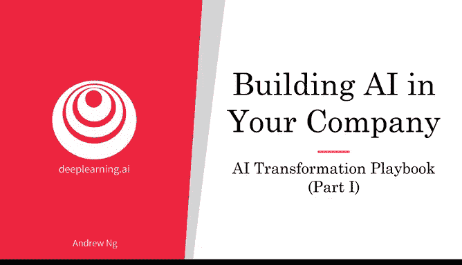
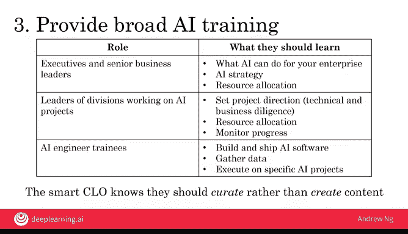

# 吴恩达《AI for everyone》给所有人的AI课（中英字幕） - P22：21_人工智能转型指南 第1部分.zh_en - GPT中英字幕课程资源 - BV1yC4y127uj

How can you help your company become good at AI based on my experience starting leading the Google Bra team。

 as well as Baidu's AI group， which were respectively the leading forces for helping Google and Baidu become good at deep learning AI I've spent a lot of time thinking about what it takes to help a great company become a great AI company and I wound up writing an AI transformation playbook to help other companies on this journey In this video。

 I'd like to share with you the details of the AI transformation playbook so you can better understand what it might take for your company to become good at AI In case some of this seems like things that only COs need to know。

 I think that's not the case and it's useful for everyone in the company to understand what it might take for your work to impact not just a few projects but maybe have a bigger impact on the company as a whole。

 Let's get started。 Here are the five steps that the AI transformation playbook will dive into greater detail in a little bit but briefly step one is for your company to execute pilot project。

To gain momentum。 start to know what it feels like to work on AI projects。

 Step  two is to build an in health AI team。 Step 3 is to provide broad AI training。

 not just to engineers， but to many levels within the company， including executives。

 Step 4 is to develop your AI strategy and step 5 is to develop internal and external communications about your company and AI。

 The way your company will execute the steps may not be totally sequential。

 And so the different steps may overlap。 but this numbering gives a maybe rough sense of the order in which I think you could do these steps。

 In this video， we will go in greater depth on the first three of these three steps。

 and the next video will cover steps 4 and 5。 Let's start to step 1。

 executing pilot projects to gain momentum。 If you want your company to gain momentum with AI。

 The most important consideration for the initial project or projects is for them to be successful rather than necessarily be the most。

Valuable。For example， when I was leading the Google brain team。

 there was still a lot of skepticism at that time about deep learning。

 So my first internal customer was Google's speech recognition team and speech recognition is nice to have useful。

 but it's actually not the most important or valuable project for the company's bottom lines。

 is not as valuable as for example， web search or online advertising。

 But by having my team make the Google speech team more successful。

 It started to fly realtor helped to get momentum because then the peer as the other teams that our brothers and sisters。

 the speech team started to see my team make the speech team more successful。

 And so they also started to gain faith in AI and wanted to work of us。

 So my second internal customer was the Google Maps team to improving the quality of the mapps data using deep learning。

 And with the first and second successes， I then started other conversations with the online advertising team。

 for example。 So when selecting your initial project try to pick something that you think is a good chance of success。

😊，That can start the flywhe turning， even if it may not be the most valuable project that you could eventually do for the company。

 because the goal of the first few projects is just to gain momentum is also nice if you can pick something that can show traction within six12 months。

 So you can start the flywhe turning quickly。 Finally。

 your first one or two pilot projects can be either in house or outsource if you do not yet have a large inhouse AI team might be possible。

 might even be advisable to outsource some or all of your first couple AI projects in order to get more expertise in house and to let you start building that momentum faster。

 Now beyond a certain point， you will need your own inhouse AI team to execute a longterm sequence of maybe many dozens of AI projects。

 And so step2 is to build an in-house AI team。 a lot of companies are organized like this where there's a CEO and multiple business units。

 which I'm。Abbreviates with B that reports up。To the CEO。

 So what I recommend for most companies is to build a centralized AI team。

And then to take the talent in the matrix organization and to matrix them into these different business units to support their work。

 Why essentialized AI team， Let's take an example， maybe this unit is your gift card business unit and the B leader may be great at whatever he or she does。

 it may be great at the gift card business， but unless he or she is knowledgeable AI and knows how to build。

 retain and manage an AI team， it may be very difficult for that business unit leader to hire and retain and appropriately manage their own AI talent。

 So in that case， I think youre also successfully much higher if you find a AI team leader that can be responsible for consistent companywide standards for recruiting retention。

 have aized AI team to give the team a community to talk to each other about how AI applies to your business vertical it may be more efficient to take the AI talent in your centralized AI unit。

And matrix them into the gift card business unit so that your AI talent can work together with the gift card domain experts in order to develop interesting AI projects together。

 One other responsibility for the AI unit is to build company wide platforms。

 If there are software platforms or other tools or data infrastructure that could be useful for the whole company。

 then a single business unit may not have the resources or the incentive to build these company wide platforms or resources that can support the whole company。

 but centralized AI team may be able to help build these companywide tools or platforms that can help multiple business units。

Finally， this new AI business unit can be under the CTO， the CIO。

 the chief data officer or the chief digital officer。

 or it could also be under a new chief AI officer。 the CIO chief AI officer is a role that I'm seeing more and more often in different companies。

 but if some other senior executive has the right skill set， they could also manage the AI unit。

 Finally， one last recommendation， which is that I think it is hopeful if to get the AI unit started。

 the company or the CO provides funding to build up the AI unit rather than require the AI unit to get funding from the business unit。

 eventually after the initial investment and after the initial ramp up。

 the AI unit will have to show us value that is creating for the business units but having CO inject funding at the outset so they can get going will often help you get that initial momentum much faster In addition to。

In inhouse AI team， I also recommend that you provide broad AI training。 Now。

 for a company to become good at AI it's not just that you need engineers to know AI。

 you need multiple people at multiple levels of the company to understand how AI interact with their roles。

 For example， for executives and senior business leaders。

 I recommend that they learn what AI can do for your enterprise that they learn the basics。

 at least of AIs strategy and they learn enough about AI to make resource allocation decisions。

 So how much training should executives and senior business leaders receive。

 I think that numbers of hours of training is not a very good way to measure training。

 but with that caveat， I think you can deliver a lot of this training with maybe four hours also of training。

Leaders of divisions work on AI projects also need to know how to interact in their role with AI。

 I think these leaders would need to understand how to set project direction so how to conduct technical and business diligence how to make resource allocation decisions at the division level as well as how to track and monitor progress of AI projects so this type of training I think would take at least 12 hours although again number of hours is not a great metric for tracking how much you're learning。

Finally， many companies are hiring AI talent from outside。

 but I would also not underestimate the importance and the impact of training up your existing engineering workforce with AI skills for software engineer to become professional AI does take a while so plan for maybe at least100 hours of training but I'm seeing many companies provide training to help engineers learn to build ship AI software to gather and manage data as well as help them become effective at executing on specific AI projects The world today does not have nearly enough AI engineers and so inhe training is a key part of many companies building up of their in health AI capabilities Finally how do you get all this training done thanks to the rise of online digital content ranging from of course online courses to also books and YouTube videos and blog posts There is a lot of great content online about all of these。

subjects and I think a good CO should work with experts to curate this type of content and motivate the team to complete these learning activities rather than necessarily create content。

 which is much more expensive thing to do。

So with steps one to three of the AI transformation playbook。

 I hope that your company will really to start to execute on initial projects， build a team。

 provide the training， and really start to get a lot of momentum going in terms of helping your company become more valuable or more effective using AI。

😊，Looking at the broader picture， AI also affects company strategy and how you align different stakeholders。

 including investors， employees， customers with this transformation of the company。

 Let's go into the next video to talk about AI strategy。

