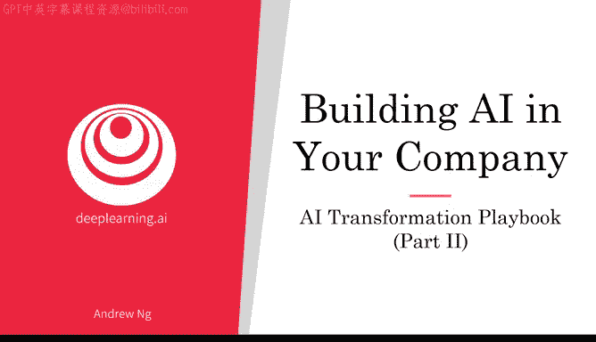
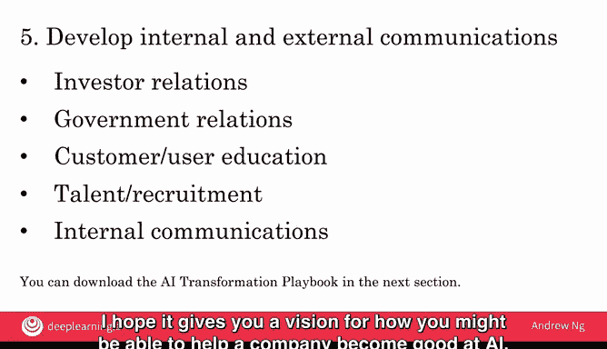

# 吴恩达《AI for everyone》给所有人的AI课（中英字幕） - P23：22_人工智能转型指南 第2部分.zh_en - GPT中英字幕课程资源 - BV1yC4y127uj

In the last video， you learned how to execute pilot projects to game momentum for the inhouse AI team and provide broad AI training。

 but if you want your business to not just gain momentum in the short term using AI。

 but in the long term be a very valuable and maybe even defensible business。

 What can you do Let's talk about AI strategy as well as perhaps important for some companies internal and external communications relative to AI to recap。

 this is the fivestep AI transformation playbook and in this video will dive more deeply into these final two steps。

 Step4 of the AI transformation playbook is to develop an AI strategy。

 which I hope for you may mean to leverage AI to create an advantage specific to your industry sector。

 One unusual part of this playbook is that developing the AI strategy is step4。

 not step1 When I share this with many Cs， a consistent request or piece of feedback I got was can you please put。

Stgy as step one because I'm gonna figure out well。

 thiss my company strategy then want to find the resources and then I'll execute on the strategy。

 But I found that companies that try to define the strategy as step one before getting your feett before trying out AI and knowing what it feels like build an AI project companies like that tend to end up with sometimes very academic strategies that are sometimes not true to life。

 So for example， I've seen some CEOs copy and paste newspaper headlines into the strategy when read that data is important is say my strategy is to focus on collecting a lot of the data。

 but for your company that data may or may not be valuable may or may not be good strategy for your company So I tend to recommend to companies to start the other steps first execute pilot projects。

 start building a little bit of a team start providing some training so that only after you understand AI and understand how it may apply to your business that you then formulate your strategy。

 And I think this will work much better for your company than if you try to formulate an AI strategy。

Before your company， including specifically the executive team。

 has some slightly deeper understanding of what AI Ken cannot do for your industry sector。

In addition， you might consider designing a strategy that is aligned with the virtuous cycle of AI Let me illustrate that with an example from web search。

 one of the reasons that web search is a very defensible business。

 meaning it's very difficult for new entrants to compete with the incumbents with the existing large web search engines is this。

If a company has a better product， maybe a slightly better product。

 then that web search engine can acquire more users and having more users means that you collect more data because you get to observe what different users click on when you search for different terms and that data can be fed into an AI engine to produce an even better product。

 So this means that the company with a somewhat better product ends up with even more users ends up with even more data and doesn an even better product with this link being created by modern AI technology and it makes it very difficult for a new entrant to break into this self-reinforcing positive feedback loop called the Vi cycle of AI。

 Fortunatelyly though this Vi cycle of AI can be used by smaller teams entering new verticals as well。

 So I think today is very difficult to build a new web engine to compete with Google or by do or Bing or Yex。

But if you are entering a new vertical， a new application area where there isn't a entrenched incumbent。

 then you might be able to develop a strategy that lets you be the one to take advantage of this vi cycle。

 Let me illustrate with an example。 There is a company called Blue River that was acquired by John Dere for over 300 million dollars。

 And Blue River makes agricultural technology using AI。

 So what they did was built these machines that would be told behind a tractor。

In a big agricultural field， and this machine would take pictures of crops and figure out which is a crop and which is a weed and use precision AI to cut off just the weeds。

 but not the crop。So I knew saw the founders of Blue River while they were Stanford students taking my claw and so to get the project started。

 they actually just used strapiness sweat。 They used their personalel cameras and went out to a bunch of farms and took a lot of pictures of crops in these agricultural fields so they started to collect pictures of heads of cabbage and weeds around the cabbage once they had enough data start off with a small data they could train a basic product and the first product frankly wasn't that great。

 It was trained on a small data but it kind of worked well enough to start to convince some farmers。

 some users to start to use their product to tow this machine behind the tractor in order to start cooling weeds for the farmers and once this thing was running around the farms through the process of taking pictures of heads of cabbage and cool off weeds they naturally acquired。

and more data And over the next few years， what they did was they were able to enter this positive feedback loop where having more data allows you have a better product。

 have a better product allows you to convince more farmers to use it and having farmers use it allows you to collect more data and over several years entering a vi cycle like this can allow you to collect a huge data asset that then makes your business quite defensible and in fact。

 at the time of acquisition， I'm pretty sure that they had a much bigger data asset of you know pictures of heads of cabbage。

Lying in the field than even the large tech companies had。

 and this actually makes the business relatively defensible from even the large tech companies that have a lot of web search data but do not have nearly as many pictures as this company does of heads of cabbage lying in the agriculture fields。

One more piece of advice， a lot of people think that some of the large tech companies are greater AI and I think that's true。

 some of the large tech companies are very good at AI。

 but this doesn't mean you need to or should try to compete with these large tech companies on AI in general because a lot of AI needs to be specializedize or verticalize for your industry sector and so for most companies it'll be in your best interest to build AI specializedize for your industry and to do great work in AI for your application areas rather than try to compete or feel like you need to compete left and right with the large tech companies on AI over the place which just isn't true for most companies。

Other elements of an AI strategy， we are going to live in an AI power world。

 and the right strategy can help your company navigate these changes much more effectively。

 You should also consider creating a data strategy leaving AI companies are very good at strategic data acquisition。

 For example， some of the large consumer facing AI companies will launch services like a free email service or a free photo sharing service or many other free services that do not monetize but allows them to collect data in all sorts of ways that lets them learn more about you so they can serve you more relevant ads and thereby monetize the data in a way that is quite different than direct monetization of that product。

The way you acquire data is very different， depending on your industry vertical。

 but I have been involved in what feels like these multiyear chess games。

 where other corporate competitors and I are playing multiyear games to see who can acquire the most strategic data assets you might also consider building a unified data warehouse。

 If you have 50 different data warehouses under the control of 50 different vice presidents。

 then it's almost impossible for an AI engineer or for a piece of AI software to pull together all of this data in order to connect the dots For example。

 if the data warehouse for manufacturing is in a totally different place then the data warehouse for customer complaints then how can an AI engineer pull together this data to figure out whether the things that might happen in manufacturing that causes you to ship a faulty cell phone that causes a customer to complain two months later So a lot of needing AI company。

Have put a lot of upfront effort into pulling the data into a single data warehouse because this increases the odds that a engineer or a piece of software can connect the dots and spot the patterns between how a elevated temperature in manufacturing today may result in a faulty device that leads to a customer complaint two months in the future does letting you go back to improve your manufacturing processes There are many examples of this in multiple industries you can also use AI to create network effects and platform advantages in industries where we're to take all dynamics AI can be a huge accelerator。

For example， take the right sharing of the right hailing business today companies like Uber and Lyfts and DD and Grraab seem like they have relatively defensible businesses because there are platforms that connect drivers with passengers and is quite difficult for a new entrant to accumulate both a large rider audience and a large passenger audience at the same time。

Social media platforms like to them Facebook are also very defensible because they are very strong network effects where having a lot of people on one platform makes that platform more attractive to other people。

 so it's very difficult for a new entrant to break in。

If you are working in a business with these types of winner to take all dynamics or when to take most dynamics。

 then if AI can be used to help you with growing faster， for example。

 with accelerating user acquisition， then that can perhaps translate into a much bigger chance that your company will be the one to succeed in this business vertical strategy is very company and industry and situation specific。

 So it's hard to give strategy advices completely general to every single company。

 but I hope that these principles give your framework for thinking about what might be some key elements of an AI strategy for your company now。

AI can also fit into more traditional strategy frameworks， for example。

 Michael Porter many years ago had written about low cost and high value strategies if your company has a lowco strategy then perhaps AI can be used to reduce cost for your business or if your company has a high value strategy to deliver really really valuable products with a higher cost then you might use AI to focus on increasing the value of your products and so AI capabilities can also help augment existing elements of a broader corporate strategy。

Lastly， as you're building these valuable and defensible businesses。

 I hope that you also build only businesses that make people better off AI is the superpower。

 this is a very powerful thing that you can do to build a great AI company and so I hope that whatever you do you do this only in ways that make humanity better off。

The final step of the AI Trans playbook is to develop internal and external communications AI can change a company and its products and it's important to communicate appropriately with the relevant stakeholders about this。

 for example， this may include investor relations to make sure that your investors can value your company appropriately as an AI companyInvest relations may also include government relations。

 for example， AI is entering healthcare which is a highly regulated industry because government has a legitimate need to protect patients。

And so for AI to affect these highly regulated industries。

 I think is important for companies to communicate with governments and to work collaboratively with them in public private partnerships to make sure that AI solutions bring people the benefits it can while also making sure that governments can protect consumers and protect patients so this would be true for healthcare will be true for selfdriving cars it would be true for finance and many other AI industry verticals if your products change then consumer or user education will be important AI talent is very scarce in today's world and so if you are able to showcase some of your initial successes that could really help with talent and recruiting。

Finally， internal communications is also important if you're making a shift in your company。

 then many people internally may have worries， some legitimate and some less rational about AI and internal communications to reassure people where appropriate can only be helpful with these five steps I hope it gives you a vision for how you might be able to help a company become good at AI I hope you enjoyed these two videos on the AI transformation playbook I've seen companies become much more valuable and much more effective by embracing and become good at AI and I hope these ideas may help you take a first step to what helping your company good at AI。

Having said that， I've also seen many common pitfalls that companies run into when trying to implement AI across the enterprise。

 let's take a look at some of these common pitfalls in the next video so that hopefully you can avoid them let's go into the next video。

