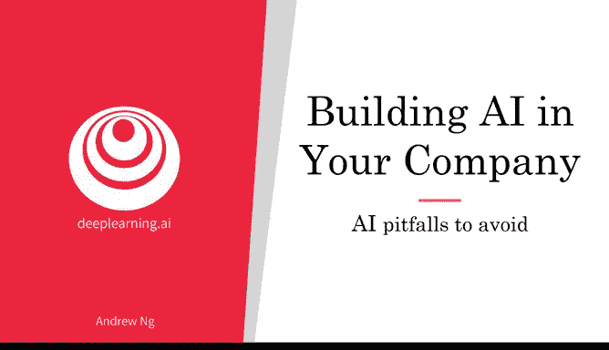
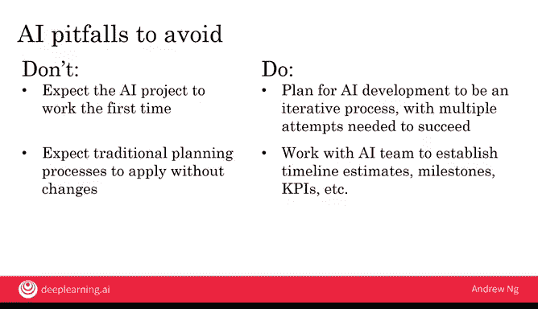

# 吴恩达《AI for everyone》给所有人的AI课（中英字幕） - P24：23_应避免的人工智能陷阱.zh_en - GPT中英字幕课程资源 - BV1yC4y127uj

I hope you be able to use AI to build exciting and valuable projects。

 either for yourself or for your company and make life better both for yourself and for others。

 along the way， I hope you also managed to avoid some of the pitfalls I've seen some AI teams fall into。

 Let's go over five don'ts and dos for if you're trying to build AI for your company。😊，First one。

 don't expect AI to solve everything。 You already know that AI can do a lot。

 but there's also a lot that AI cannot do Instead you should be realistic about what AI can cannot do。

 give limitations of technology data and engineering resources。

 That's why I think technical diligence in addition to business diligence is important for selecting feasible and valuable AI projects。

Second， don't just hire two or three machine learning engineers and count solely on them to come up with use cases for your company Machine learning engineers are a scarce resource。

 but you should instead pair the engineering talent with business talent and work cross functionally to find feasible and valuable projects is often the combination of the machine learning talent with the business talent that can select the most valuable and feasible projects third don't expect the AI project to work the first time。

As you've already seen， AI development is often an iterative process。

 so you plan for it through an iterative process with multiple attempts needed to succeed Four。

 don't expect traditional planning processes to apply without changes Instead you should work with the AI team to establish timeline estimatess。

 milestones Kpis or metrics that do make sense。 the types of timeline estimatess milestones and Kpis or metrics associated with AI projects are a bit different than the same things associated with non-aiI projects。

 so hopefully working with some individuals knowledgeable AI can help you come up with better ways of planning AI projects。

 Finally don't think you need superstar AI engineers before you can do anything instead keep building the team and get going with the team you have realizing that there are many AI engineers in the world today。

 including many that have learned primarily from online courses that can do a great job。😊。

Building valuable and feasible projects。 if you can avoid these AI pitfalls。

 you already be ahead of the game compared to many other companies。

 The important thing is to get started。 Your second AI project would be better than your first。

 your third AI project would better than your second。

 So the important thing is to get started and enter attempt your first AI project。

 In the final video for this week。 I want to share with you some concrete first steps you can take in AI。

 Let's go into the next video。😊。