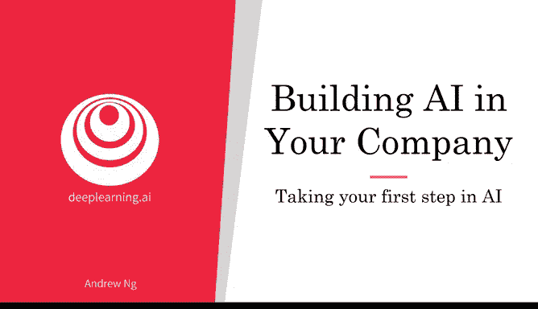
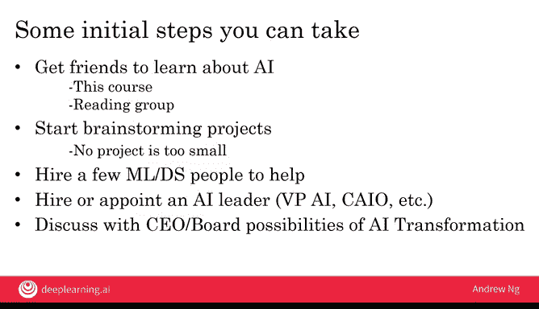

# 吴恩达《AI for everyone》给所有人的AI课（中英字幕） - P25：24_迈出人工智能实践第一步.zh_en - GPT中英字幕课程资源 - BV1yC4y127uj

This week， you saw some examples of what it's like to build a complex AI product like a smart speaker or self-driving car。

 You also learn about the roles and responsibilities of large AI teams and maybe what it's like to build a large AI team and saw the AI transformation playbook for helping a great company become a great AI company。

 in case some of this seems daunting because some of this will take maybe two or three years execute in case of this seems daunting is okay because the more important thing is that you're able to take the first step。

 In fact， by taking this course， you've already taken a great first step。

 So I hope that after this course， you will take also an equally good second step。 So in this video。

 I want to share with you some concrete suggestions for the next step you can take toward AI for yourself or for your company。

😊，Here are some initial steps I would urge you to take rather than going out alone。

 consider having friends in your company or personal friends outside where to learn about AI with you。

 this could mean asking them to take this course with you or after you or starting a reading group to read some books or other materials about AI with what you have learned in this course。

 you will also， especially if you have engineering friends be able to start brainstorming projects。

No project is too small and it's better to start small and succeed than to start too big and not succeed。

 Many projects can be done just by you or perhaps by you and a friend。

 And if you and or a friend take an online course on machine learning that's enough know how for you to get started on many potentially very valuable AI projects。

 in a company， you might also hire a few machine learning or data science people to help out in addition to providing inhouse training to develop the inhouse talent。

 when you're ready to go bigger， you might also try to have your company hire or appoint an AI leader such as a Vp of AI or achieve AI officer。

 But maybe you don't need a very senior AI leader before hiring just a few machine learning or data scientist people to get going more quickly。

 Finally， I've spoken with a lot of Cos and boards about AI transformations。

 And if you want your company to become。Great at AI。

 you might also consider trying to discuss with your CEO the possibility of trying to execute an AI transformation。

 And I think the key question to ask your CEO or your board is will your company be much more valuable and or much more effective if it was great at AI and if you and they think the answer is yes。

 that might be a good reason for the company to try to execute an AI transformation the different items on this list have varying levels of difficulty to execute。

 but I hope you will start with what you can and then grow your AI efforts from there。

I've see many people， some technical， many non technicalchnical help the companies learn about AI and start to use it effectively。

 After these videos， you now have the concrete tools to do the same。

 And so I hope you take advantage of them and help your company。

 help yourself and help others as well。😊，Finally， we have two more optional videos for this week on。

😊，A survey of major AI application areas as well as major AI techniques。

 So if you've ever wondered what do the terms computer vision and natural language processing mean or what is reinforcement learning or what is unsupervised learning please take a look at these videos since we'll teach you these application areas as well as technologies in the next two videos we made these videos optional because they are a little bit more technical but after watching them you will be able to better communicate with AI engineers so I hope you take a look Either way。

 thank you for watching all of these videos this week and look forward to seeing you in next week's videos。

😊。