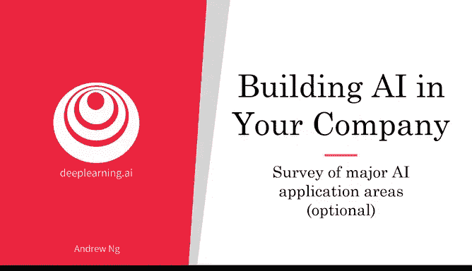
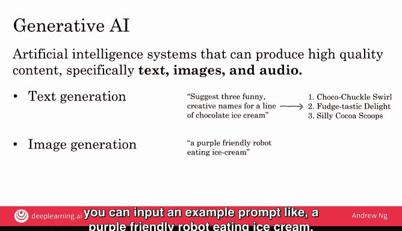
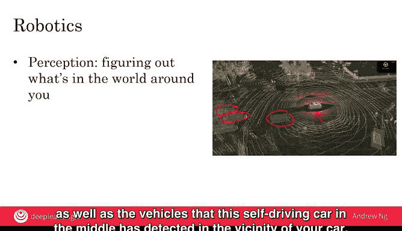
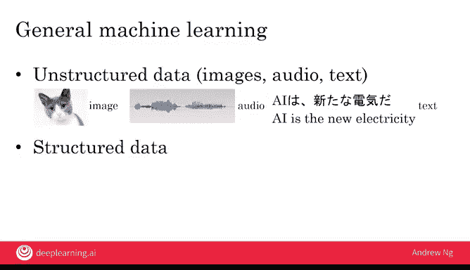

# 吴恩达《AI for everyone》给所有人的AI课（中英字幕） - P26：25_主要人工智能应用领域概览（可选）.zh_en - GPT中英字幕课程资源 - BV1yC4y127uj

AI today is being successfully applied to image video data。

 to language data to speech data to many other areas in this video you see a survey of AI applied to these different application areas and I hope that this may spark off some ideas of how you might be able to use these techniques someday for your own projects as well let's take a look One of the major successes of deep learning has been computer vision。

 let's take a look at some examples of computer vision applications image classification and object recognition refer to taking this input。

 a picture like that and telling us what is in this picture in this case。

 it be a cat rather than just recognizing cats I've seen AI algorithms able to recognize specific types of flowers。

 AI able to recognize specific types of food and the ability to take as input a picture and classify it into what type。

The object that is is being used in all sorts of applications。

 one specific type of image classification that has had a lot of traction is face recognition this is how face recognition systems today work。

😊，A user might register one or more pictures of their face to show the AI what they look like given a new image。

 the AI system can then say， is this the same person I this you or is this a different person so that it can decide if they should unlock the door or unlock the cell phone。

 unlock the laptop or something else based on the identity of the person Of course。

 I hope face recognition will only be used in ways that respect individuals privacy will talk more about AI and society next week as well。

A different type of computer vision algorithm is called object detection。

 So rather than just trying to classify or recognize an object。

 you're trying to detect if the object appears all， for example。

 in building a self-driving card we've seen how an AI system can take us input a picture like this and not just tell us yes or no is there a cause yes or no is there a pedestrian but actually tell us the position of the cause as well as the positions of the pedestrians in this image。

 an object detection algorithm can also take us input a picture like that and just say no。

 I'm not finding any cause or any pedestrians in that image So rather than taking a picture and labeling the whole image which is image classification instead an object detection algorithm will take us input an image and tell us where in the picture different objects are as well as what the types of those objects image segmentation takes us one step further given an image like this and image segmentation algorithm may output that where it tells us not just where the cause in pedestrians but。

As for every single pixel is this pixel part of this car or is this pixel part of a pedestrian so it doesn't just draw rectangles around the objects it detect text instead it draws very precise boundaries around the objects that it finds so in reading x-rays for example。

 it would be an image segmentation algorithm that could look at an x-ray scan or some other image of a human body and carefully segment out where's the liver or where's the heart or where is the bone in this image Comp vision can also deal with video and one application of that is tracking in this example rather than just detecting the runners in this video。

 it is also tracking in a video where the runners are moving over time So those little tails below the red boxes show how the algorithm is tracking different people running across several seconds in a video So the ability to track people and。

And maybe other moving objects in the video helps the computer figure out where things are going If you're using a video camera to track wildlife。

 for example， say birds flying around a tracking algorithm would also be able to help track individual birds flying across the frames of your video。

These are some of the major areas of computer vision。

 and perhaps some of them will be useful for your projects。

AI and deep learning specifically is also making a lot of progress in natural language processing。

 Natural language processing or NLP refers to AI understanding natural language。

 meaning the language that you and I might use to communicate with each other。

 One example is text classification where the job of the AI is the input the piece of text such as an email and tell us what is the class or what is the category of this email。

 such as is the spam or nons spam email There also websites that would input a product description。

 for example， you might write， I have a secondhand cell phone for sale and automatically figure out what is the product category in which the lists product So that would go under cell phones or electronics。

 Or if you write， I have a new t-shirt to sell。 then it would list it automatically under clothing。

One type of text classification that has had a lot of attention is sentiment recognition。

 For example， a sentiment recognition algorithm can take input。 a review like this of a restaurant。

 The food was good and automatically try to tell us how many stars this review might get the food was good is a pretty good review。

 maybe that's a four out of five star review whereas if someone writes service was horrible。

 then a sentiment recognition algorithm should be able to tell us that this corresponds maybe to a one star review。

 a second type of NLP or natural language processing is information retrieval web search is perhaps the best known example of information retrieval where you type in a text query and you want the AI to help you find relevant documents Many corporations will also have internal information retrieval systems where you might have an interface to help you search just within your company set documents for something relevant。

😊，To a me that you might enter name entity recognition is another natural language processing technology。

 Let's illustrate it with an example。 say you have this sentence and you want to find all the people names in this sentence。

 So Queen Elizabeth I second is a person， Sir Paul McCarney as a person， So in the sentence。

 Queen Elizabeth the second night to Sir Paul McCarney for a service of music at the Buckham Palace。

 It would be a name entity recognition system to can find all the people's names in a sentence like this。

 If you want to find all the location names， all the place names in a sentence like that。

 a name entity recognition system can also do so。 name entity recognition systems can also automatically extract names of companies。

 phone numbers， names of countries， and so if you have a large document collection and you want to find automatically all the company names or all the company names that occur together or all the people's names。

Then a name entity recognition system would be the tool you could use to do that。

 Another major AI application area is machine translation。 So， for example。

 if you see this sentence in Japanese AI a laanada then hopefully a machine translation system can input that and output the translation AI the electricity。

 the four items on this slide， text classification information retrieval。

 name entity recognition and machine translation are four major categories of useful NLP applications。

 modern AI specifically deep learning has also completely transformed how software processes audio data such as speech how is speech represented in a computer This is an audio waveform of one of my friends saying the phrase machine learning the X axis here is time and the vertical axis is what the microphone is recording what。

F this recording is little variations， very rapid variations in air pressure。

 which your ear and your brain then interpret as sound and this plot shows as a function of time。

 the horizontal axis how the air pressure is changing very。

 very rapidly in response to someone saying the word machine learning The problem of speech recognition also known as speech to text is the problem of taking us input a plot like this and figuring out what word the words that someone said along of speech recognitions recent progress has been due to deep learning。

 One particular type of speech recognition is trigger word detection or wakeward detection and you saw this in the earlier video with having an AI system detect a trigger word awake word such as Alexa or hey Google or hey device Sp IDd is a specialized speech problem where the task is to listen to someones speak and。

Figure out the identity of the speaker just as face recognition helps verify your identity by taking a picture Sp ID can also help verify your identity by listening to you speak Finally。

 speech synthesis also called text to speech or TTS is also getting a lot of traction textex to speech is a problem of inputting a sentence written in text and turning that into an audio fileInterestinglyly。

 whereas text speech is often abbreviated TTS I don't often see speech to text abbreviated STT One quick example。

 let's take the sentence the quick brown Fox jumps over the lazy dog。

This is a fun sentence that you often see NLP people use because this sentence contains every single letter from A to Z。

 So that's ABC all the way up to X， Y and Z can check all 26 letters appear in this sentence。

 as some letters appear more than once。 If you pass this sentence into a TtS system。

 then you might get an audio output like this。 The quick brown Fox jumps over the lazy dog。

 Mo TtS systems are increasingly sounding more and more natural and human like You've heard me mention generative AI a few times so far in the course。

 Genative AI is a collection of AI systems that can produce high quality media specifically text images or audio。

 Let's take a look at these applications of generative AI in more detail。

 La language models are great at text generation tasks， including writing content from scratch。

 writing summaries， copy editing。 That is editing。Ipro grammar， clarity and so on。 and chatting。

 for example， you can give one of these models an instruction like suggest the funny creative names for a line of chocolate ice cream and the model will generate some creative sound names like these Note that this input text here is known as a prompt and writing prompts to generate the output you want is becoming a useful skill for many jobs。

 I find that having a large language model as a brainstorming partner makes me more productive。

 And if youre able to write prompts effectively， perhaps you find it a useful tool and work。

 or in your personal life as well。 In fact， I think large language models are now at the point where almost all knowledge workers can get at least a bit of a productivityly boost by learning and using them in their daytoday workflow Gative AI can also create new images from scratch software like Mcjoney Dody Adobefily and stable the。

Have learned how to generate images from text descriptions by learning from millions of images on the Internet。

 So with one of these image generation models， you can input an example prompt like a purple friendly robot eating ice cream。

 and the model will generate a high quality image for you that matches your prompt。1 Q robot。 Lastly。

 Gen AI is also capable of generating audio。Previous。

 we saw how speech synthesis models can convert text to speech audio software also exists like simples stable audio or metal Acraft。

 They can generate music and sound effects from a text prompt。

 So by writing a prompt like drum solo 140 BPM or Bes per minute。

 you can use a music generation model to create an audio track like this one。😊。

So。Gative AI is capable of creating several types of content。

 This is affecting many industry sectors and will learn more about the impact of AI。

 including generative AI on jobs next week。 AI is also applied to many applications in robotics。

 and you've already seen one example in the selfdriving car in robotics。

 the term perception means figuring out what's in the world around you based on the sensors you have be it cameras or radar or Liar。

Shown on the right is the 3D laser scan or the LiA scan of a self-ding car。

 as well as the vehicles that this selfdriving car in the middle has detected in the vicinity of your car motion planning refers to finding a path for your robot to follow。

 So if your car wants to make a left turn， the motion planner might plan a path as well as a speed for the car to make a left turn that way。

 and finally， control refers to sending commands to the motors。

 such as your steering wheel motor as well as your gas pedal and brake motors in order to make the car smoothly follow the path that you want on this line a focus on the software and the AI aspects of robotics of course。

 there's also a lot of important work being done to build hardware for robotics as well。

 but a lot of the work of AI on perception， motion planning and control as focused on the software rather than。

The hardware of robotics， in addition to these major application areas。

 machine learning is also very broadly used。The examples you've seen in this video relate mainly to unstructured data such as images。

 audio and text Mach learning is applied at least as much to structured data。

 and that means these tables of data， some of which you saw in the earlier videos。

But because unstructured data， such as images is so easy for humans to understand。

 there's something very universal， very easy for any person to understand and empathize with when we talk about an AI system that recognizes a cat and so the popular press tends to cover AI progress on unstructured data much more than it does AI on structured data。

 structured data also tends to be more specific to a single company and so it's harder for people to write about or understand。

 but AI on structured data or machine learning on structured data is creating tremendous economic value today as well as AI on unstructured data。

I hope this survey of AI application areas gives you a sense of the wide range of data that AI is successfully applied to today。

 and maybe this will even inspire you to think of how some of these application areas may be useful for your own projects。

Now， so far， the one AI technique we've spent the most time talking about is supervised learning。

 That means learning input output or A to B mappings from label data where you give the AI system both A and B but that's not the only AI technique out there。

 In fact， the term supervised learning almost invite the question of what is unsupervised learning or you might also have heard from media articles from the news about reinforcement learning So what are all these other techniques in the next video。

 the final optional video for this week will do a survey of AI techniques and I hope that through that maybe you'll see if some of these other AI techniques and supervised learning could be useful for your projects as well。

 Let's go on to the final optional video for the week。

