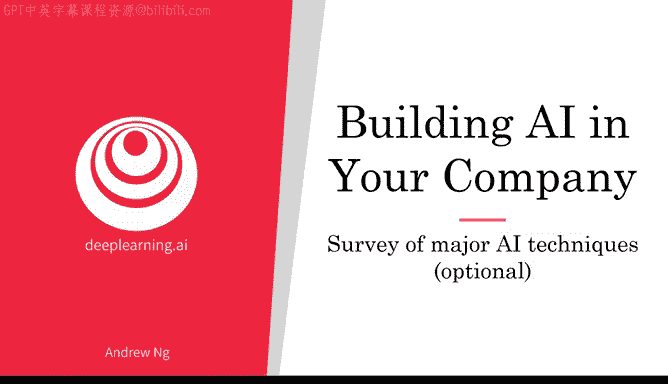
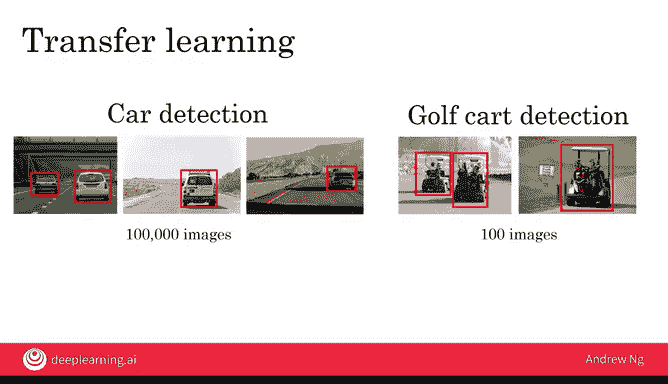
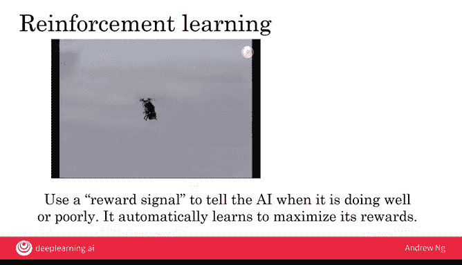
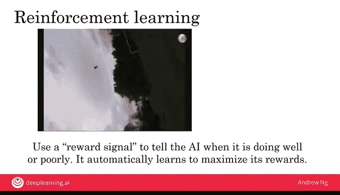
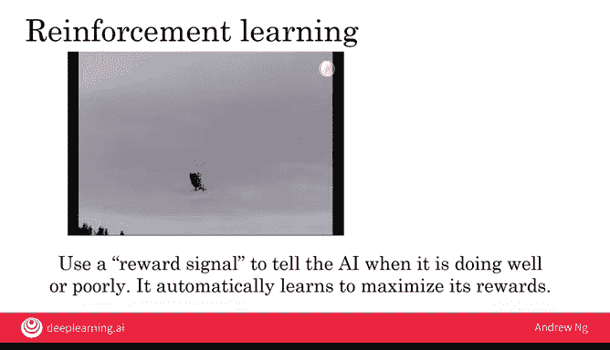
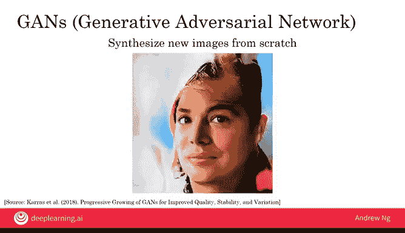
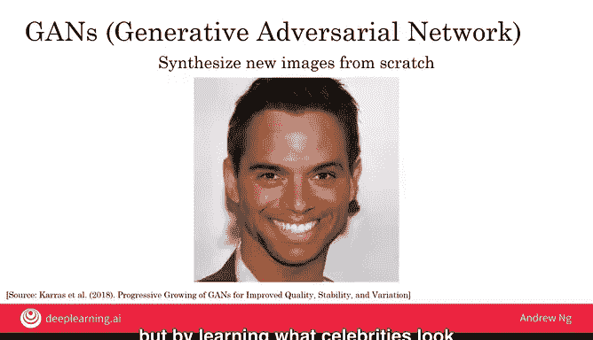

# 吴恩达《AI for everyone》给所有人的AI课（中英字幕） - P27：26_主要人工智能技术概览（可选）.zh_en - GPT中英字幕课程资源 - BV1yC4y127uj

There are a lot of AI and machine learning techniques today。 And while supervised learning。

 that is learning A to B mappings is the most valuable one， at least economically today。

 there are many other techniques that worth knowing about。 Let's take a look。

The best known example of unsupervised learning is clustering。 Here's an example。

 Let's say you run a grocery store that specializes in selling potato chips and you collect data on different customers and keep track of how many different packets of potato chips a single customer buys as well as what's the average price per packet that person paid for their potato chips so you sell some low end cheaper potato chips as well as some highend more expensive packets of potato chips and different people may buy different numbers of potato chip packets in a typical trip to your grocery store。

Given data like this， a clustering algorithm will say that it looks like you have two clusters in your data。

 Some of your customers tend to buy relatively inexpensive potato chips but buy a lot of packets。

 if your grocery store is near a college campus， for example。

 you may find a lot of college students that are buying cheaper potato chip packets but they should buy a lot of them and there's a second cluster in this data of a different group of shoppers that buy fewer packets of potato chips but buy more expensive packets a clustering algorithm looks like data like this and automatically groups of data into two clusters or more clusters and it's commonly used market segmentation and will help you discover things like that if you have a college student audience that buys a certain type of potato chips and a working professional audience that buys fewer potato chips but is willing to pay more and this could help you market differently to these。

segmentsegments。The reason this is called unsupervised learning is the following。

 whereas supervised learning algorithms learn an A to B mapping。

 and you have to tell the algorithm what is the output B that you want。

A unsupervised learning algorithm doesn't tell the AI system exactly what it wants。 Instead。

 it gives the AI system a bunch of data， such as this customer data。

 and it tells the AI to find something interesting in the data。

 find something meaningful in the data。 And in this case。

 a clustering algorithm doesn't know in advance that there's a college student demographic and working professional demographic。

 Instead， it just tries to find what are the different market segments without being told in advance what they are。

 So a supervised learning algorithms given data without any specific design output labels without the target label B can automatically find something interesting about the data。

One example of unsupilvised learning that I had worked on was the slightly infamous Google cat。

 In this project， I had my team run a unsupervised learning algorithm on a very large set of YouTube videos and we ask the algorithm tells us what you find in YouTube videos and one of the many things it found in YouTube videos was cats because somewhat stereotypically YouTube apparently has a lot of cat videos but it was a remarkable result that without telling it in advance that it should find cats the AI system。

 the unsupvised learning algorithm was able to discover the concept of a cat all by itself just by watching a lot of YouTube videos and discovering that boy there are a lot of cats in YouTube videos It's hard to visualize exactly what an AI algorithm is thinking sometimes but this picture on the right is a visualization of the concept of a cat that the system had learned。

Even though supervised learning is an incredibly valuable and powerful technique。

 one of the criticisms of supervised learning is that it just needs so much label data。 for example。

 if you're trying to use supervised learning to get an AI system to recognize coffee mugs。

 then you may give it1000 pictures of coffee mugs or 10。

000 pictures of coffee mugs and that's just a lot of pictures of coffee mugs。

 we would be giving our AI systems。😊，For those of you that are parents。

 I can almost guarantee you that no parent on this planet。

 no matter how loving and caring has ever pointed out 10000 unique coffee mugs to their children to try to teach the children what is a coffee mug。

 so AI systems today require much more label data to learn than with a human child or than would most animals。

 which is why AI researchers hold a lot of hope out for unsupervised learning as a way。

 maybe in the future for AI to learn much more effectively in a more human light and more biological like for much less label data。

 now we have pretty much no idea how the biological brain works。

 and so to realize this vision will take major breakthroughs in AI that none of us know yet today how to realize that many of us hold a lot of hope for the future of unsupervised learning。

Having said that unsupervised learning is valuable today。

 there are some specific applications in national language processing， for example。

 where unsupervised learning actually helps improve the quality of web search quite a bit。

 for example， but the value today of unsupervised learning is still a lot smaller than the value created through supervised learning。

😊，Another important AI technique is transfer learning。 Let's look at an example。

Let's say you built a self-driving car and you have trained your AI system to detect cars。

 but you then deploy your vehicle to a new city and somehow this new city has a lot of golf cars driving around。

 and so you need to also built a golf car detection system you may have trained your car detection system with a lot of images。

 say 100000 images， but in this new city where you just started operating。

 you may have a much smaller number of images of golf car Trans learning is the technology that lets you learn from a task A such as car detection and you the knowledge to help you on a different task B such as golf car detection where transfer learning really shines is if having learned from a very large data set of car detection task A。

 you can now do pretty well on golf car detection， even though you have a much smaller golf cart data because some of the knowledge it has learned from the first task。

What the vehicles look like， what the wheels look like， how the vehicles move。

 maybe that will be useful also for golf car detection Transfer learning doesn't get a lot of press。

 but it is one of the very valuable techniques in AI today and for example。

 many computer vision systems are built using transfer learning and this makes a big difference to their performance you may also have heard of a technique called reinforcement learning So what is reinforcement learning let me illustrate with another example This is a picture of the Stanford autonomous helicopter so it's instrumented with GPS accelmeters and compass so it always knows where it is and let's say you want to write a program to make it fly by itself It's hard to use supervised learning input output A to B mappings because it's very difficult to specify what is the optimal way what is the best way to fly the helicopter when it's in a certain given position reinforcement learning。

Offerice a different solution。I think of reinforcement learning as similar to how you might train a pet dog to behave My family when I was growing up。

 had a pet dog。 So how do you train a pet dog to behave yourself。 Well。

 we let the dog do whatever it wanted to do。 And then whenever it behave well， we would praise it。

 you go oh good dog And whenever it does something bad， you would go bad dog and over time。

 it learns to do more of the good dog things and fewer of the bad dog things。

 reinforcement learning takes the same principle and applies it to a helicopter or to other things。

 So we would have the helicopter fly around in a simulator so it could crash without hurting anyone。

 but we would let the AI fly the helicopter however at once。

 And whenever it flew the helicopter well， we would go oh good helicopter And whenever it crash we would go bad helicopter。

 And then it was the AI's job to learn how to fly the helicopter to get more of the good helicopter rewards and fewer of the bad。

helicopteropter negative froms。More formally， a reinforcement learning algorithm uses a reward signal。

To tell the AI when it's doing well or poorly， this means that whenever is doing well。

 you give it a large positive number to give it a large positive reward and whenever it's doing really bad job。

 you send it a negative number to give it a negative reward。

 And is the AI's job to then automatically learn to behave so as to maximize the rewards。

 So good dog corresponds to giving a positive number and bad dog or bad helicopter corresponds to you giving a negative number another the AI will learn to get more of the behaviors the result in large positive numbers or a large positive rewards。

 Let me show you a video of the Stanford autonomous helicopter after we did this。

 This is a video of the helicopter flying under reinforcement learning control。

 I was the cameraamman that day。 And when you zoom out the camera。

 you see the trees planted in the sky。 So we actually gave it a reward signal， which reward。😊。

The helicopter flying upside down and using reinforcement learning。

 we built one of the most capable autonomous helicopters in the world。In addition to robotic control。

 reinforced learning has also had a lot of traction in playing games。

 games such as Othello or checkers or chess or Go， you might have heard of AlphaGo。

 which did a very good job playing Go using reinforcement learning and reinforcement learning has also been very effective at playing video games。

One of the weaknesses of reinforcement learning algorithms is that they can require a huge amount of data。

 so if you are playing a video game， a reinforced learning algorithm can play essentially an infinite number of video games because it's just computer playing a computer game and get a huge amount of data to learn how to behave better or for playing games like checks or other games。

 it can play a lot of games games itself and for free。

 get a huge amount of data to feed into reinforcement learning algorithm in the case of the autonomous helicopter。

 we have a simulator for the helicopter So could flying simulation for a long time to figure out what works and what doesn't work for flying a helicopter there's so a lot of exciting research work being done to make reinforcement learning work even for settings where you may not have an accurate simulator where it's harder to get this huge amount of data。

😊，Despite the huge amount of media attention on reinforcement learning， at least today。

 it is creating significantly less economic value than supervised learning。

 but there may be breakthroughs in the future that could change that。

 and AI is advancing so rapidly that all of us certainly hope that there will be breakthroughs in all of these areas they were talking about GANs or generative adversarial networks are another exciting new AI technique。

 They were created by my former student Ian Goodfellow。

 GNs are very good at synthesizing new images from scratch。

 Let me show you a video generated by a team from NviDdia that use GNs to synthesize pictures of celebrities and these are all pictures of people that had never existed before。

 but by learning what celebrities look like from a database of celebrity images is able to synthesize all these brand new pictures。

😊。

Doess exciting work by different teams right now on applying GNs to the entertainment industry。

 everything ranging from computer graphics to computer games to media and to just making up new content like this from scratch。

 Finally， the knowledge drop is another important AI technique that I think is very underrated。😊。

If you do a search on Google for Leonardo Da Vinci。

 you might find this set of results with this panel on the right of information about Da Vinci。

 If you do a search on Ada Lovelas， you also similarly find a panel of additional information on the right。

This information is drawn from a knowledge draft， which basically means a database that lists people and key information about these people。

 such as their birthday， when they pass away their bio and other properties of these individuals。

Today， different companies have built knowledge drafts of many different types of things。

 not just people， but also they built these databases of movies of celebrities of hotels of airports of scenic attractions and on and on and on。

 For example， a knowledge draft with hotel information may have a big database of hotels as well as key information about these hotels so that if you look them up on a map。

 you can find the right information relatively quickly。

 The term knowledge draft was initially popularized by Google。

 but this concept has spread to many other companies。Interestingly。

 even though knowledge drafts are creating a lot of economic value for multiple large companies at this point。

 this is one subject that is relatively little studied in the academia。

 and so the number of research papers you see on knowledge drafts seems to be disproportionately small relative to actual economic impact today。

But depending on what industry vertical you work in。

 perhaps some of the techniques for building knowledge drafts will also be useful for building a big database of information about something relevant to your company。

In this video， you learned about unsupvised learning， transfer learning， reinforcement learning。

 Gs and knowledge jobss。 It seems like a lot， doesn't it。

 I hope that some of these ideas will also be useful to your projects and that knowing what these albums are will make it easier for you to have fruitful discussions with AI engineers。

😊，In this week， we've talked a lot about how AI can affect companies。

 maybe how you could use AI to affect your company。 AI is also having a huge impact on society。

 So how we understand the impact that AI is having on society as well as make sure that we do ethical things and that we use AI only to help people and make people better off in the next week。

 we'll talk about AI and society。 Thanks for speaking of me up this point。

 I look forward to seeing you in the final week of videos for this course。

