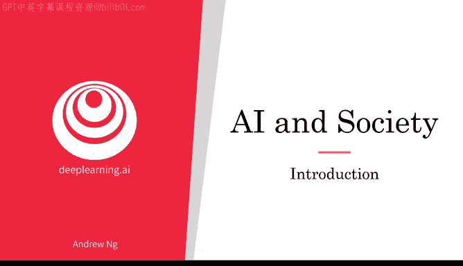
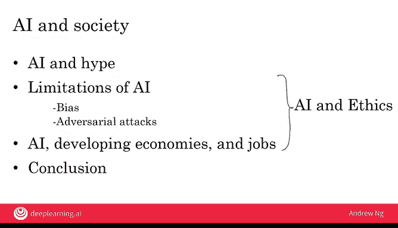

# 吴恩达《AI for everyone》给所有人的AI课（中英字幕） - P28：27_第4周 课程介绍.zh_en - GPT中英字幕课程资源 - BV1yC4y127uj

Welcome back， you're now in the fourth and final week of AI for everyone and so close to finishing this course。

AI is a superpower that enables a small team to affect a huge number of people's lives。

 So whether you're a builder or user of AI or whether you're just someone that cares about AI's impact on society it's important that you learn about these trends so that you can make sure the work you do leave society better off。

 Let's take a look。AI is changing the world， but there's also been a lot of unnecessary hype about it for citizens and business leaders and government leaders to navigate the rise of AI it's important that we all have a realistic view of AI Now in week one you already started to learn about some of the technical limitations of AI AI has other limitations as well。

 For example， AI can be biased and discriminate unfairly against minorities or against other groups。

 So how do we address this。AI technology is also susceptible to adversarial attacks， meaning。

 for example， we love our spam filters。 it helps the email system keep on functioning。

 but there are spammerners that are trying to attack spam filters。

 and even as we develop new AI technologies， some of the new technologies may be susceptible the new types of attacks as well if people are deliberately trying to fool the AI develop economies such as the US and China are already using AI extensively。

 but they also have a big impact on developing economies and on the global jobs landscape。

Many of these issues are implicated in AI and ethics to make sure that the work we do in AI is ethical。

This is a topic that is complex and there aren't simple answers。

 in fact I think the topic of AI and ethics deserves its own for week or much longer course。

 but I hope this week to at least touch on some of the major issues so that even as you build or use AI that you understand some of the major issues associated with the rise of AI Finally at the end of this week。

 we will wrap up AI for everyone。

I look forward to spending these last few videos with you。

 Let's get started by talking more about having a realistic view of AI in a way that goes beyond just the technical and performance limitations of AI。

 Let's go to the next video。😊。