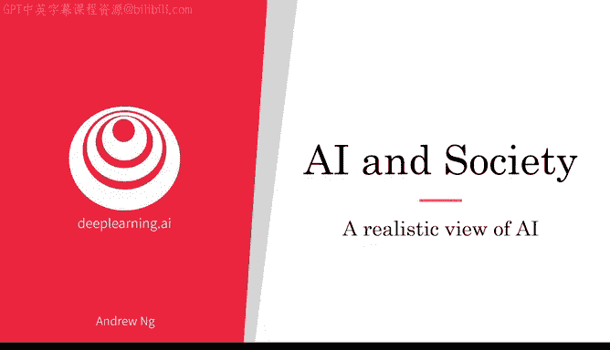
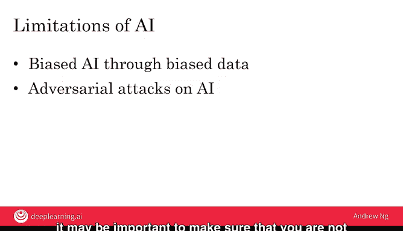

# 吴恩达《AI for everyone》给所有人的AI课（中英字幕） - P29：28_人工智能的现实视角.zh_en - GPT中英字幕课程资源 - BV1yC4y127uj

AI is having a huge impact on society and on so many people's lives。

 so for all of us to make good decisions is' important that we have a realistic view of AI and be neither too optimistic nor too pessim Here's what I mean。

Did you ever read the story of Goldilocks and the three bearers maybe when you're a kid。

 part of the story was that a bowl of porridge should be neither too hot nor too cold and a bed should be neither too firm nor too soft。

 I think we need a similar Goldilock's rule for AI where I think it's important that we be neither too optimistic nor too pessim about what AI technology can or cannot do。

 For example， we should not be too optimistic about AI technologies。

 AI is a very powerful technology， but I wouldn't expect it to solve all of humanity's problems and by itself。

 usher in some sort of global utopia for humanity。 Some of the over optimism stems from people thinking that AI sentience。

 artificial general intelligence or even superintelligence might be right around the corner and that when we get there。

 AI will rapidly invent huge breakthroughs in healthcare and give us off long and healthy lies and also create an insane amount of。

For everyone I wish it were that easy On the flip side。

 some of the most pessimistic fears about AI also relate to thinking superintelligence might be right around the corner and that AI might become sentient and decide to I don't know Co of our humans this seems extremely unlikely to me。

 even though AI hasous， for example， it can give bias unfair or inacted outputs are losing control of it to the point of AI becoming akin to a superior species that it wipes us out is really in the realm of science fiction rather than realistic scenario。

 humanity has loss of experience controlling things more powerful than any individual like corporations and nation states and while AI's output is sometimes unpredictable。

 I'm not worried about us so-called losing control of AI or becoming a competitive species to us。

 I think unnecessary fears and over。opptistic hopes about sentience superintelligence。

 artificial gender intelligence are distracting people from the real issues and is also causinging unnecessary fears about AI in parts of society In contrast。

 I think a more realistic view of AI is that it is a very very powerful tool but that there are also many things that AI cannot do it has some potential harms like bias unfairness and inaccurate outputs that we can mitigate and it is already creating tremendous economic value further we see a surprisingly clear path for it to continue to create even more value in multiple industries。

 so I'm confident and so on many other AI system builders that AI will continue to grow and continue to hope more and more people for the foreseeable future to summarize rather than being too optimistic or too pessimistic the lesson of goy loss is that taking a realistic in between view。

Is just right When you speak with friends about AI。

 I hope you can also tell them about this Goldvylocks rule for AI so that they too can have a more realistic view of AI。

 There are many limitations of AI you have already seen earlier some of the performance limitations but AI has other limitations as well。

 One of the limitations of AI is that explainability is hard and many high performing AI systems are black boxes meaning that it works very well but the AI doesn't know how to explain why it does what it does Here's an example。

 let's you have an AI system。 look at this x-ray image to diagnose if anything is wrong with the patient In this example which is a real example。

 the AI system says that it think the patient has rightsided pnemohorex。

 which means that the right lung is collapsed but how do we know if the AI is right and how do you know。

Should trust the AI systems diagnosis or not there's been a lot of work on making AI systems explain themselves in this example。

 the heat map is the AI telling us what part of the image it is looking at in order to make this diagnosis because it is clearly ba a diagnosis on the right lung and in fact on some key features of the right lung。

 seeing this image may give us more confidence that the AI is making a reasonable diagnosis。

Now to be fair， humans are also not very good at explaining how we make decisions ourselves。

 for example， you've already seen this coffee mug in the last week's videos。

 but how do you know it a coffee mug， how does a human look at this and say that's a coffee mug there are some things you can point to like there's a room for liquid and has a handle but we humans are not very good explaining how we can look at this and decide what it is but because AI is a relatively new thing。

 the lack of explainability is sometimes a barrier to acceptance and also sometimes if an AI system isn't working。

 then its ability to explain itself will also help us figure out how to go in and make the AI system work better So explainability is one of the major open research areas a lot of researchers are working on what I see in practice is that when an AI team wants to deploy something the AI team is often able to come up with an explanation that is good。

ough to enable the system to work and be deployed， so explainability is hard but is often not impossible。

 but we do need much better tools to help AI systems explain themselves。

AI has some other serious limitations as a society。

 we do not want to discriminate against individuals based on their gender。

 based on their ethnicity and we want people to be treated fairly。

 but when AI systems are fed data that doesn't reflect these values then an AI can become biased or can learn to discriminate against certain people the AI community is working hard and is making good progress on these issues。

 but we're far from done and distill a lot of work to do you learn more about bias AI in the next video and some ideas how to make sure that AI systems you work with are less biased。

Finally， many AI systems are making economically important decisions。

 and some AI systems are open to adversarial attacks if someone else is deliberately out to fool your AI system。

So depending on your application， it may be important to make sure that you are not open to these types of attacks on your AI systems。

The issues of AI and discrimination or AI and bias。

 as well as the issue of adversarial attacks on AI are important both to you as a potential builder and user of AI as well as to society in the next video let's dive more deeply into the issue of AI and bias。

