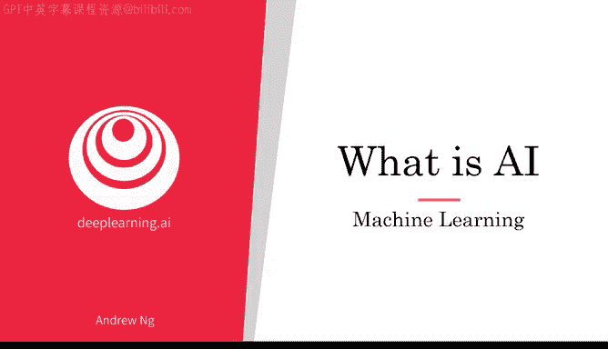
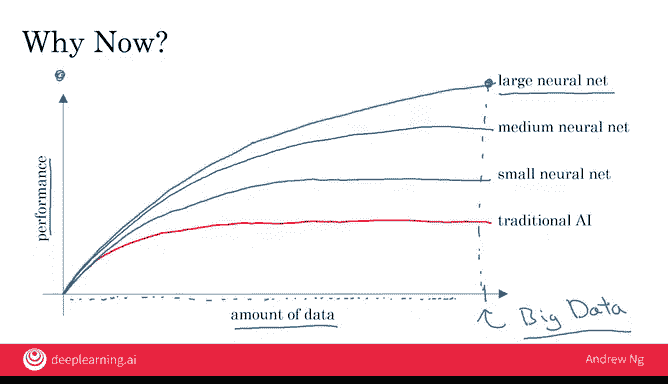

# 吴恩达《AI for everyone》给所有人的AI课（中英字幕） - P2：1_机器学习.zh_en - GPT中英字幕课程资源 - BV1yC4y127uj

The rise of AI has been largely driven by one two in AI called machine learning In this video you learn what is machine learning so that by the end you hopefully be able to start thinking how machine learning might be applied to your company or to your industry。

The most commonly used type of machine learning is a type of AI that learns a。To be or input。

To output mappings， and this is called supervised learning， let's see some examples。

If the input A is an email and the output B you want is is email spam on not 01。

 then this is the core piece of AI used to build a spam filter。

 or if the input A is an audio clip and the AI's job is output the text transfer。

 then this is speech recognition More examples if you want to input English and have it output a different language。

 Chinese Spanish， something else， then this is machine translation。

Or the most lucrative form of supervised learning of this type of machine learning may be online advertising。

 where all the large online ad platforms have a piece of AI that inputs some information above an ad and some information about you and tries to figure out where you click on this ad or not and by showing you the ads that you're most likely to click on。

 this turns out to be very lucrative。 maybe not the most inspiring application。

 but certainly having a huge economic impact today or if you want to build a self-driving car。

 one of the key pieces of AI is an AI that takes this input an image and some information from the radar or from other sensors and outputs the position of other cars。

 so your self-driving car can avoid the other cause or in manufacturing I've actually done a lot of work in manufacturing where you take input a picture of something you've just manufactured such as a picture of a cell phone coming off in assembly line This is a picture of a phone。

 not a picture taken by a phone and you want to output I there a scratch。

Gener some other defect on this thing you've just manufactured， and this is visual inspection。

 which is helping manufacturers reduce or prevent defects in the things that they're making。

 Supervised learning also lies at the heart of generative AI systems like the chat G and bad chatbo to generate text these systems work by learning from huge amounts of text say download it from the internet so that when given a few words as the input。

 the model can predict the next word it comes after these models which are called large language models or LLms generate new text by repeatedly predicting what is the next word they should output。

 given the widespread attention on Lm， let's briefly on the next slide in greater detail at how they work large language models are built by using supervised learning to train a model to repeatedly predict the next word。

 For example， if an AI system has read on the Internet a sentence like my favorite drink is。

Bubble tea， then the single sentence would be turned into a lot of A to B data points for the model to learn to predict the next word。

Specifically， given this sentence， we now have one data point that says。

 given the phrase my favorite drink， What do you predict is the next word。 In this case。

 the right answer is is。And given my favorite drink is whether you predicts the next word and the correct answer is li chi and so on。

 until you have used all the words in the sentence。

 So this one sentence is turned into multiple inputs A and outputs B for the model to learn given a few words as input。

 what is the next word。 When you train a very large AI system on a lot of data。

 say hundreds of billions or even over a trillion words。

 then you get a large language model like chat G that given an initial piece of text called a prompt is very good at generating some additional words in response to that prompt。

 The description are presented here， thus omit some technical details like how the model learns to follow instructions rather than just predict the next word found on the Internet。

 and also how developers make the model less likely to generate inappropriate outputs such as one that exhibit。

😊，or handout harmful instructions。If you're interested。

 you can learn more about these details in the course generative AI for everyone at the heart of Os though is this technology that learns from a lot of data to predict what is the next word using supervised learning So in summary。

 supervised learning just learn input output or A to mappings on one hand input output A B seems quite limit。

 but when you find the right application scenario， this turns out to be incredibly valuable Now the idea of supervised learning has been around for many decades。

 but it's really taken off in the last few years。 Why is this when friends ask me hey Andrew。

 why is supervised learning taking off now there a picture I draw for them。

 And I want to show you this picture now and you may be able to draw this picture for others that ask you the same question as well。

 let's say on the horizontal access you plot the amount of data you have for a task So for speech recognition。

This might be the amount of audio data and transcripts you have。In a lot of industries。

 the amount of data you have access to has really grown over the last couple decades。

 thanks to the rise of the internet， the rise of computers， a lot of what used to be。

 say pieces of paper are now instead recorded on a digital computer So we've just been getting more and more and more data Now let's say on the vertical access you plot the performance of an AI system。

 It turns out that if you use a traditional AI system。

 then the performance would grow like this that as you feed it more data as performance gets a bit better but beyond a certain point it did not get that much better。

 So as if if your speech recognition system did not get that much more accurate or your online advertising system doesn't get that much more accurate at showing the most relevant ads even as you showed the more data AI has really taken off recently due to the rise of neural networks and deep learning to find these terms more precisely in later video don't worry too much about what it means for now but with modern AI with neural networks and deep learning what we saw。

Is that if you train a small neural network。Then the performance kind of looks like this。

 whereas you feed it more data， performance keeps getting better for much longer。

 and if you train a even slightly larger neural network say a medium sized neural net。

Then the performance may look like that。And if you train a very large neural network。

Then the performance just kind of keeps on getting better and better and for applications like speech recognition。

 online advertising， building a Surding car， where having a high performance， highly accurate。

 say speech recognition system is important， this is enable these AI systems get much better and make say speech recognition products much more acceptable to users much more valuable to companies and to users。

Now here are a couple implications of this figure。 If you want the best possible levels of performance。

 your performance to be up here to hit this level of performance。

 then you kind of meet two things One is it really helps to have a lot of data so that's why sometimes you hear about big data having more data almost always helps and the second thing is you want to be able to train a very large neural network and so the rise of fast computers including most law。

 but also the rise of specialized processes such as graphics processor units or GPUs。

 which you hear more about in the later video has enabled many companies not just a giant tech companies but many。

 many other companies to be able to train large neuralnets on a large enough amount of data in order to get very good performance and drive business value In fact it was also this type of scaling。

 increasing the amount of data and the size of the models that was instrumental to the recent breakthroughs in training。

Gative AI systems including the large language models that we discussed just now the most important idea in AI has been machine learning。

 especially supervised learning， which means A to B or input output mappings What enables it to work really well is data in the next video Let's take a look at what is data and what data you might already have and how to think about feeding this into AI systems Let's go on the next video。

