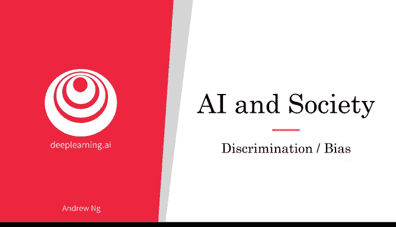
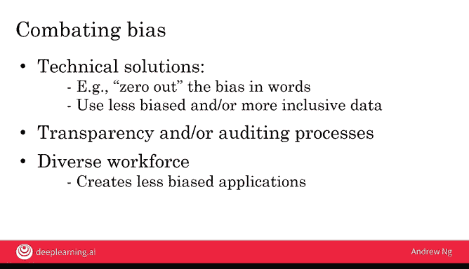

# 吴恩达《AI for everyone》给所有人的AI课（中英字幕） - P30：29_算法歧视与偏见.zh_en - GPT中英字幕课程资源 - BV1yC4y127uj

How does an AI system become biased and therefore discriminate against some people and how we try to reduce or eliminate this effect in our AI systems Let's start with an example。

 a group in Microsoft found this remarkable results that when AI learns from text found on the Internet。

 it can learn unhealthy stereotypes to the credit they also proposed technical solutions for reducing the amount of bias in this type of AI system Here's what they found by having an AI read text on the Internet。

 it can learn about words and you can ask it to reason about analogies so you can quiz the AI system now that you've read all this text on the Internet in the analogy man is to women as father is to what。

So the AI will output the word mother， which reflects the way these words are typically used on the internet If you ask it men is the woman as king is to what。

 then the same AI system will say as king is the queen。

 which again seems reasonable relative to the way these words are use on the internet The research has also found the following result。

 which is that if you ask it man is the computer programmer as women is to what that the same AI system would output the answer women is to homemaker。

And I think this answer is really unfortunate a less biased answer would be of word to say women is to computer programmer if we want our AI system to understand that man and women can equally be computer programmers just as men and women can equally be homemakers then we would like it to output man as a computer programmer as women as computer programmer and also man is a homemaker as woman is the homemaker how does an AI system learn to become bias like this from data。

 let's dive a bit more into the technical details The way an AI system stores words is using a set of numbers So let's say the word man is stored or we sometimes say represent it as a two numbers one1。

 The way an AI system comes up of these numbers is through statistics of how the word man is used on the internet The specific process for how these numbers are computed is quite complex and I won't go into that here。

But these numbers represent the typical usage of these words in practice an AI it might have hundreds or thousands of numbers to store a word。

 but I'm just going to use two numbers here to keep the examples simpler。

 let me take this number and plot it on a chart so the word man I'm going to plot at the position11 on the figure on the right by looking at the statistics of how the words or how the phrase computer programmers used on the internet。

 the AI will have a different pair of numbers， say3 two to store or to represent the phrase computer programmer and similarly by looking at how the word women is used it will come up with a different pair of numbers。

 say two3 to store or to represent the word women， when you ask the AI system to compute the analogy above man is the computer programmer as woman is the what then what the AI system will do is construct a parallelogram that looks like this and it will ask what is the word associated。

ToWith the position 44。Because they will think that is the answer to this analogy。

 One way to think about this mathematically is that the AI thinks the relationship of man to compute the programmer is that you start from the word man go two steps to the right and one step up。

 And so to find the same answer for women as a what。

 you would also go two steps to the right and one step up。Unfortunately。

 when these numbers are derived from text on the internet。

 an AI system finds that the way the wordhomaker is used on the internet causes it to be placed at the position 44。

 which is why the AI system comes up with this biased analogy。

AI systems are already making important decisions today and will continue to do so in the future as well So bias matters for example。

 there's a company that was using AI for hiring and found that theyre hiring too discriminated against women This is clearly unfair and so this company shut down their tool Second there are also some facial recognition systems that seem to work more accurately for light skinned than dark skinned individuals if an AI system is trained primarily on data of lighter skinned individuals then it will be more accurate for that category of individuals。

To the extent that these systems are used in， for example， criminal investigations。

 this can create a very bias and unfair effect for Dkin individuals。

 So many face recognition teams today are working hard to ensure that the systems do not exhibit this type of bias。

There have also been AI or statistical loan approval systems that wound up discriminating against some minority ethnic groups and quoted them a higher interest rate。

 banks have also been working to make sure to diminish or eliminate this type of bias in their approval systems Finally。

 I think it's important that AI systems do not contribute to the toxic effect of reinforcing unhealthy seereotypes。

 For example， if an eighty old girl goes through an image search engine and searches the chief executive officer if they see only pictures of men or if they see no one that looks like themselves either by gender or ethnicity we don't want them to be discouraged from pursuing a career that might lead her to someday be a chief executive officer of a large company because of these issues。

 the AI community has put a lot of effort into combating bias。For example。

 we're starting to better and better technical solutions for reducing bias and AI systems in the example you saw at the start of this video of the AI outputting bias analogies simplifying the description a little bit。

 researchers have found that when an AI system learns a lot of different numbers with which the slow words。

 there are few numbers that correspond to the bias and if you zero out those numbers。

 just set to zero， then the bias diminishes significantly。

A second solution is to try to use less biased and or more inclusive data。 For example。

 if you are building a face recognition system and make sure to include data from multiple ethnicities and all genders then your system will be less biased and more inclusive Second。

 many AI teams are subjecting their systems to better transparency and or auditing processes so that we can constantly check what types of bias if any these AI systems are exhibiting so that we can at least recognize the problem if it exists and then take steps to address it。

 For example， many face recognition teams are systematically checking how accurate their systems is on different subsets of the population to check whether it is more or less accurate on dark skin versus light skin individuals for example。

 having transparent systems as well as systematic auditing processes increases the odds that will。

At least quickly spot a problem in case there is one so you can fix it。 Finally。

 I think having a diverse workforce will also help reduce bias。 If you have a diverse workforce。

 then the individuals at your workforce are more likely to be able to spot different problems and maybe they'll help make your data more diverse and more inclusive in the first place by having more unique points of view as you're building AI systems。

 I think this will help all of us create less bias applications。

AI systems are making really important decisions today and so their biasers or potential for buyers is something we must pay attention to and work to diminish。

One thing that makes me optimistic about this is that we actually have better ideas today for reducing bias in AI than reducing bias in humans。

 so while we should never be satisfied until all AI bias is gone and it will take us quite a bit of work to get there。

 I am also optimistic if we could take AI systems that started off with a level similar to humans because it learned from humans and we can cut down the bias from there through technical solutions or other means so that as society。

 we can hopefully make the decisions we're making through humans or through AI rapidly become more fair and less bias。

😊，In addition to the problem of biasers。One of the other limitations of AI is that it can be open to adversarial attacks in the next video。

 you learn what are adversarial attacks as well as some of the things you could do to guard against them。

 Let's go on to the next video。