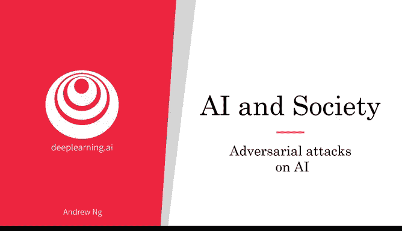
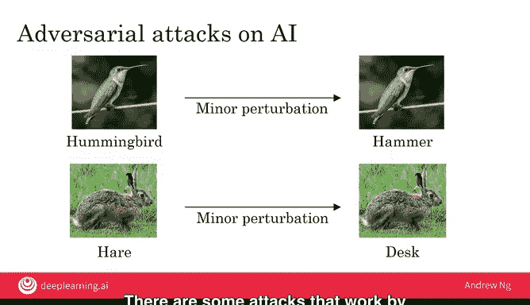
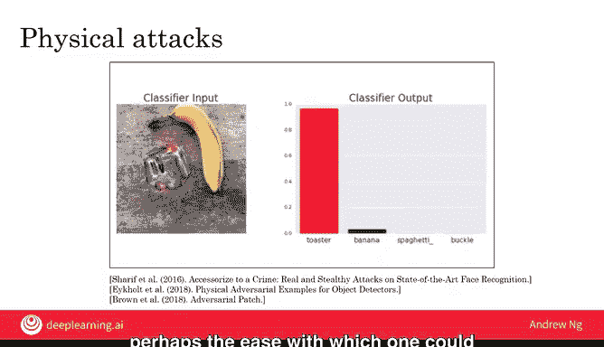
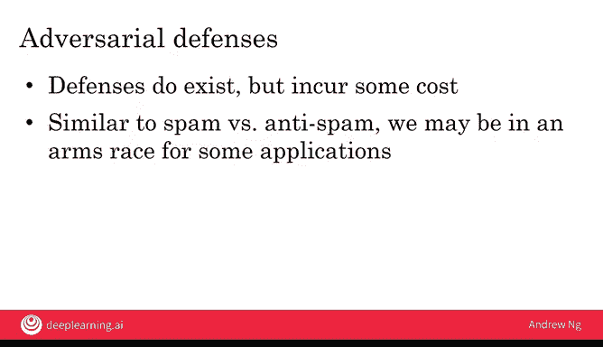

# 吴恩达《AI for everyone》给所有人的AI课（中英字幕） - P31：30_针对人工智能的对抗性攻击.zh_en - GPT中英字幕课程资源 - BV1yC4y127uj

Even though modern AI is incredibly powerful， one of the limitations of modern AI technologies。

 especially deep learning， is that sometimes it can be fool in particular。

 modern AI systems are sometimes susceptible to adversarial attacks if someone else sets out deliberately to fool your AI system。

 let's take a look。Let's say you give an AI system this picture of a bird and ask it to classify the AI system outputs that this is a hummingbird。

 but lest we make a minor perturbation to this image by minor perturbation。

 I mean to change the pixel values just a little bit， an almost imperceptible change to most people。

The same AI system then says this is instead a hammer Now to person。

 you might say how is this even possible， the picture on the right looks almost identical to the picture on the left and in fact。

 the changes are almost imperceptible to the human eye but an AI system sees the work very differently than you and I do and so it is susceptible to if an adversary mix changes to a picture that could be imperceptible to you and me but there results in folding the AI into thinking this picture is something totally different we call this an adversarial attack on an AI system in computer security。

 an attack against a secure system means an attempt to make it do something other than what it was intended to do in the same way an adversarial attack on an AI system is an attempt to make it do something other than what it was intended to do such as trying to forward into outputting incorrect classifications Here's another example Here's a picture of a hair with just a minor perturb。

Or a small change to pixel values， AI instead says this is a desk。

The fact that computers see pictures differently than humans do gives it advantages and disadvantages。

 for example， computer systems are much better than UME at reading barcodes and QR codes。

But the way that deep learning systems work also opens it up to these particular forms of attack。

 which no human would be fooled by Today， AI is being used to filter out spam。

 to try to filter out hate speech and attacks like these will diminish the effectiveness of such filters Now the attacks on this slide require the ability to modify an image directly。

 For example， a spammer might directly modify an image before they try to upload it to a website or send it in an email。

 There are some attacks that work by changing the physical world as well。 For example。

 a group at Connegie Mellon University was able to design a funky pair of glasses like this so that when this man wears this pair of glasses。

 he can fool an AI system into thinking that he is actress Millo Joovitch。

I think it's remarkable that just wearing a pair of glasseslouses like this can fool an AI system into thinking that this man is a well-known actress a different group of researchers from UC Berkeley University of Michigan and other universities showed that if you affix stickers like these onto a stop sign you can fool an AI system into not seeing the stop sign at all it thinks there's something else there other than a stop sign One interesting thing about this example is that it looks like the stop sign just had had some graffiti applied on top of it and most humans would still see this as a stop sign quite easily。

But if you have a computer vision system built into a self-driving car， for example。

 it would be really unfortunate if the car doesn't see the stop sign anymore because of these stickers applied on top of it。

 One last example， this one from a group of researchers at Google is if you show a AI system。

 this picture it will say this is a banana but what the researchers did was design a sticker so that if you place it into the scene。

 it misclassifies this banana let me show you the video that the researchers made shown on the left is the classifier input and shown on the right is the classifier output where it thinks is very likely a banana and maybe this is a small chance is a slug's okay let's see what happens when you put a sticker or put a small patch into the scene。

When the sticker is placed in the scene， the AI system now is all but certain that this picture is a picture of a toaster。

One interesting aspect of this work is that the authors of this paper cited at the bottom of the slide actually publish in their paper a picture of their sticker so that anyone in the world could hypothetically download their paper。

 print out the sticker and stick it somewhere if they want to fool an AI system into thinking there's a toaster where there isn't。

😊，Now， I do not support anyone attacking AI systems to fool them into thinking that Toosis where they're none。

 but this shows， unfortunately far the ease with which one could hypothetically attack these AI systems。

 What can we do to defend against these adversarial attacks。 Fortunatelyly。

 the AI world has been working on new technologies to make them harder to attack。

 The defenses tend to be very technical， but there are ways of modifying neural networks and other AI systems to make them somewhat harder to attack。

 One downside is that these defenses do incur some costs。 For example。

 the AI systems may run a little bit slower。 but this is an area of ongoing research and we' far from having adversarial defenses that seem good enough for all the important applications that we want to apply AI to。

For many AI systems there may be no incentive for anyone to try to attack it， for example。

 if you're running a automatic visual inspection system to check if coffee mugs have scratches in your factory。

 maybe not that many people have any incentive to try to fool your system into thinking a scratch coffee mug doesn't have a scratch on it。

But there are going to be AI applications where there will be attacks as well for those applications。

 I think that similar to spam versus AntiSm where spammers are trying to get the spam email through and spam filters are trying to stop them I think there will be applications where we will be in an arms race as the AI community is building up defenses and there is a community of attackers trying to fool our defenses。

In my experience building AI systems， one of the few times I felt I was at total war with someone else was when I was leading antifr teams fighting against fraud there is。

 unfortunately some amounts of fraud on the internet where people are trying to steal money in payment systems or create fraud accounts and the times I worked on antifr systems was one of the few times that it really felt like a zero sum game had an adversary would put up a defense and they would react they would launch an attack my teams would have to react sometimes within hours to defend ourselves So I think over the next few years。

 even as AI technologies evolves， they will be verticals like that like spam like fraud where teams will be at war in what might feel like a zero sum game against adversaries Having said that I also don't want to overhype the potential of damage for adversarial AI systems it is really important for some applications but there are also plenty of AI applications which are less like。

To be subject to adversarial attacks。Now in addition to adversarial attacks， AI。

 unfortunately can also be used for some adverse or some negative use cases let's take a look at some of them in the next video as well as what we should do to adjust them let's go into the next video。

