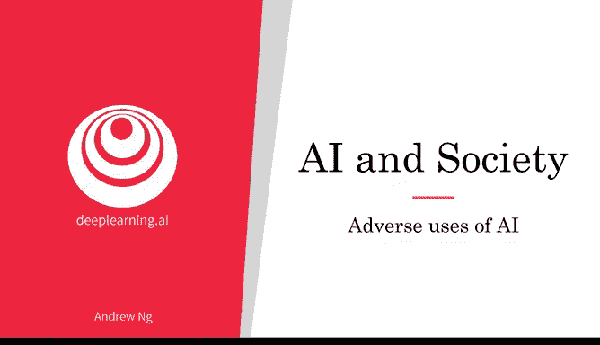
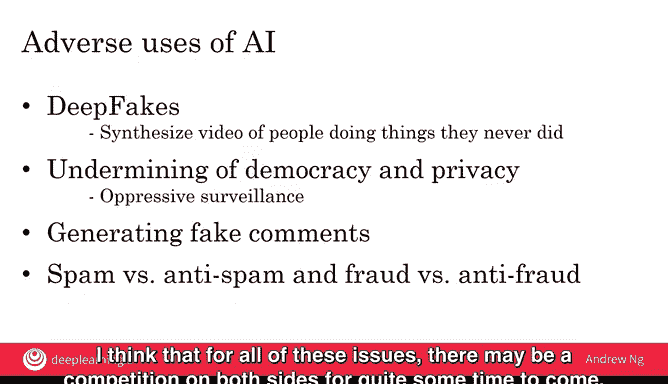

# 吴恩达《AI for everyone》给所有人的AI课（中英字幕） - P32：31_人工智能的恶意应用.zh_en - GPT中英字幕课程资源 - BV1yC4y127uj

AI is incredibly powerful and the vast majority of users of AI are making people， companies。

 countries， society better off， but there are a few adverse users of AI as well。

 Let's take a look at some of them and discuss what we can do about them。

AI technology has been used to create deep fakes， and that means to synthesize video of people doing things that they never actually did。

The website Buzzfeed， created a video of former US President Barack Obama saying things that he never did。

 Buzzfeed was transparent about it， and when they published a video it was really obvious because they told everyone that this is a fake video but if this type of technology is used to target an individual and make others think they said or did things they never actually did then these individuals could be harmed and left to defend themselves against fake video evidence of something they never actually did similar to the wall of spam versus antis spam there is AI technology today for detecting if a video is a deep fake but in today's world of social media where a fake could spread around the world faster than the truth can catch up many people are concerned about the potential of deep fakes to harm individuals there's also a risk of AI technology is being used to undermine。

cracy and privacy for example， many governments around the world are trying to improve their citizens' lives and have a lot of respect for the government leaders that are uplifting their citizens。

 but there are also some oppressive regimes that are not doing the right things by their citizens that may seek to use this type of technology to carry out oppressive surveillance of their citizens while governments have a legitimate need to improve public safety and reduce crime。

 there are also ways of using AI that feel more oppressive than uplifting of its own citizens closely related to this is the rise of fake comments that AI can generate using AI technology is now possible to generate fake comments either on the commercial side。

 fake comments of products or in political discourse。

 fake comments about political matters in public discourse and to generate fake comments much more efficiently than if you only。

Hums writing them。 So detecting such fake comments and weaving them out is an important technology for maintaining trust in comments that we might read online as well。

Similar to the battles of spam representative spam and fraud representative fraud。

I think that for all of these issues， there may be a competition on both sides for quite some time to come。

Similar to the battles of spam versus anti spam fraud versus antifr。

 I'm optimistic about how these battles will play out because if you take spam filters as an example。

 there are a lot more people that are motivated to make sure spam filters do work that anti spam does work。

 then there are the smaller number of spam is trying to get their spam in to your inbox because of this。

 there's a lot more resources on the side of anti spam than on the side of spam。

 because society actually functions better if anti spam and antifr works out well because of this。

 even though the AI community still has a lot of work to do to defend against these adverse use cases。

Because society is genuinely better off if we could have only good users of AI。

 I am optimistic that the balance of resources means that the side of good will prevail。

 but it will still take a lot of work from the AI community over many years to come。Next。

 AI is also having a big impact on developing economies。 Let's take a look at that in the next video。

