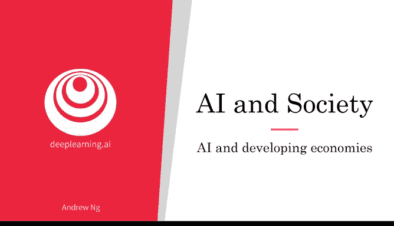
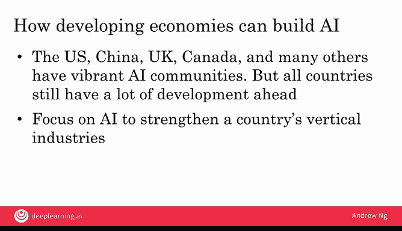

# 吴恩达《AI for everyone》给所有人的AI课（中英字幕） - P33：32_人工智能与发展中经济体.zh_en - GPT中英字幕课程资源 - BV1yC4y127uj

Every time there's a major technological disruption， such as with AI。

 it gives us a chance to remake the world。 AI is a very advanced technology。

 just affecting both developed economies and developed economies so how do we make sure that even as AI creates tremendous wealth that it uplifts all nations Let's take a look。

 There's been a fairly predictable roadmap almost a ladder that many developing economies have successfully executed in order to help the citizens gain skills and climb to higher levels of wealth。

 lot the nations started off with lower end agricultural products。

 exporting crops and then moved to low-end textile manufacturing such as clothing manufacturing and then as the population starts to gain a bit more wealth become a bit more healthy move on to low end components manufacturing such as making less expensive plastic parts。

Then moving on to low-end electronics manufacturing to higher end electronics manufacturing。

 maybe to automotive manufacturing and so on。 And there's been this step by step progression by which developing economies can help their citizens gain skill and become developed economies。

 One of the problems that AI could cause is that a lot of the lower rungs on the ladder are particularly susceptible to automation through AI。

 For example， as factories become more automated or as agriculture becomes more automated。

 they may be less needed and therefore less opportunities for large members of a population of some of these developing economies to get onto the lower rungs of this economic ladder from which they would then climb up。

So if we're knocking out some of the lower rungs of the ladder through AI。

 through AI providing automation on steroids， then it is incumbent on us to see if AI can also create a trampoline to hope some economies jump onto the trampoline and bounce maybe even more quickly to the higher rungs of this ladder with the rise of earlier ways of technology。

 many economies have shown that they can leapfrog， developed economies and jump straight to a more advanced technology for example。

 here in the United States， most of us had landlines。

 phones that were connected via wire to the wall and because so many of us had landline phones that actually took a while to transition to wireless mobile phones In contrast。

 many developing economies， including India and China but many others as well。

 didn't bother to build nearly as many landlines but skipped straight to，Mobile phones。

 So this was a leapfrog where developing economies jumped straight over the earlier generation of technology and didn't bother to lay so many physical cables to every person's health and instead jumped straight to mobile phones。

 We're seeing a similar thing with mobile payments where many developed economies have a mature credit card system and that actually is slowing down their adoption of mobile cell phone payments compared to some developed economies which do not already have entrenched incumbents in the credit card industry。

 I'm also seeing rapid adoption of online education in developing economies in countries that have not yet built all the many。

 many physical schools and universities that they need many educational leaders and governments are seeking ways to more quickly embrace online education compared to some of the developed economies that have this built up。

infrastructure for inperson education While developed economies are also rapidly embracing all of these technologies。

 one of the advantages of developing economies is that without an entrenched incumbent system。

 perhaps the areas that they could build even faster the United States。

 particularly when it comes to ge of AI is in the lead close behind is China。

 which also has tremendous AI talent and the UK Canada India career。

 many places in Latin America and many other countries also have vibrant AI communities but we're still in the early development of AI so I think every country still has a lot of opportunities and a lot of growth ahead。

 My advice to developing economies is to focus on AI to strengthen a country's vertical industries。

 For example， I think most countries today should not try to build their own web search engine。

 they are already great。web search engines and that was last decades' competition Instead。

 if a country has a very strong vertical industry in say coffeebean manufacturing。

 then that country is actually uniquely qualified to do work in AI for coffee manufacturing and building AI for coffee manufacturing would even further strengthen what that country is already good at So rather than needing for every country to compete with the US and China on AI in general。

 I would advise most countries to use AI to strengthen what that country is good at what that country wants to do in the future。

 Finally， public private partnerships， meaning governments and corporations working together can really help accelerate a vertical industry's AI developments in highly regulated sectors ranging from healthcare to transportation like self-driving cars to finance。

 there are certain outcomes that we want in certain outcomes that we don't want and。

That are thoughtful about drafting the right regulations to protect citizens while at the same time。

 enabling the adoption of AI solutions to these industries willll see faster local economic growth。

 as well as faster technology development within their country。 Finally。

 developing economies should invest in education because AI is still so immature。

 There's still plenty of room for every nation to learn more about AI maybe even build up its own AI workforce and participate in a significant way in this AI power world that we're building。

In moments of technological disruption， leadership matters here in the United States。

 we once trusted our government to put a man on the moon and it worked。With the rise of AI。

 it creates a space and in some countries a need for leadership。

 whether at government levels or in companies or in education to help a country enter the AI era and embrace and adopt AI to keep on lifting up its citizens and perhaps even keep on lifting up other people worldwide。

In this video we've touched briefly on the issue of AI and jobs。

 this is an important topic that is widely discussed in many countries right now。

 let's go into the next video to take a deeper look at AI and jobs。

