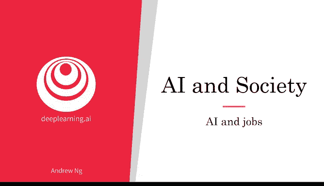
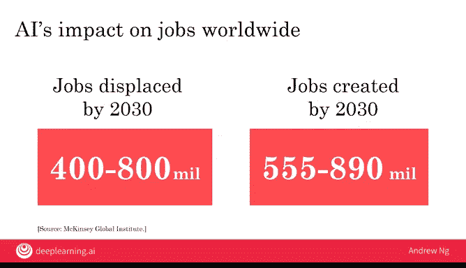
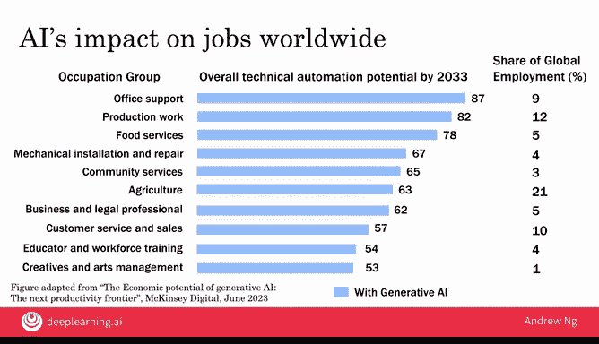
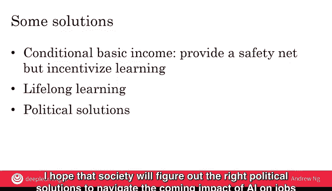

# 吴恩达《AI for everyone》给所有人的AI课（中英字幕） - P34：33_人工智能与就业市场.zh_en - GPT中英字幕课程资源 - BV1yC4y127uj

AI is automation on steroids Before the rise of modern AI。

 automation had already had a huge impact on a lot of jobs with the rise of AI。

 the set of things we can now automate is suddenly much bigger than before。

 and so this is also having an accelerating impact on jobs。

 How many jobs will be displaced how many new jobs we've created。

 I don't think anyone has a firm answer to these questions yet。

 but let's take a look at some studies to try to understand what may be ahead。

 Mackenenzie Global Institute estimated that 400 to 800 million jobs will be displaced by AI automation by 2030 These are very large numbers on the flip side though。

 the same report also estimates that the number of jobs created by AI may be even larger other studies do give numbers that can be a bit different。

 For example a Goldman Sachs study estimates a lower 300 million。

Jobs lost by 2033 route the McKinsey's estimate of 400 to800 million。

 so there's still quite a lot of uncertainty about the impact of AI on jobs though most agree it will be significant but I find it encouraging that many studies estimate quite possibly even more jobs being created than displays so therell be plenty of work for people to do in the future。

 even if unfortunately the need to resco workers could be significant in some sectors and I think many of the jobs in the future we may not even have names for yet be it drone traffic optimizer or 3D printed clothing designer or perhaps in healthcare will have custom DNAbased drug designers So even though there is concern about AI displacing jobs there's also hope of many new jobs maybe even more new jobs being created in the future。

 Now you might wonder how do we estimate how many jobs I like。

To be displaced One typical way that these studies are carried out would be to take a job and think of the tasks that make up their job。

 For example， you might look at the tasks that the radiologist does or look at all the tasks that a taxi driver does。

 and then for each of the tasks estimate how amenable it is to automation through AI。

 And if a job comprises mainly tasks that are highly autoattable。

 then the risk of the job being displaced will be higher。

 most AI engineers find it more useful to think of AI being applied to tasks rather than to people's jobs。

 but this framework allows us to use AI's ability to automate tasks to estimate how many jobs are likely to be displaced。

 So which other jobs that are most likely or least likely to be displaced through AI and automation McKzie looked at the impact of AI including generative AI tools on a wide range of jobs this figure。

which is adapted from data presented in their study。

 presents the 10 jobs that have the most potential for AI automation by 2033。

 the number immediately to the right of each bar like 87 or 82 here is an estimate of the percentage of work tasks that may be automated for that job This list includes a wide range of what McKinsey calls occupation groups including office work。

 mechanical installation and repair business and legal professional work and customer service and sales。

 One thing worth noting here is that gen of AI has had a big impact on the types of jobs that can now be automated by AI The ability of these tools to generate human sounding text。

 to write empathetic emails and to chat to humans has exposed new categories of jobs to AI automation that were previously less susceptible to automation。

 In fact， if you look at the automation potential of these jobs without。

Gative AI toolss， you see some significant increases in the potential for AI automation in the occupations that involve writing and communication style like office support and legal work。

 The numbers in the right column here show how much of the global workforce is employed in each occupation group together these top 10 occupations employ more than 70% of workers around the world。

 a huge number of people。 How do we help citizens and nations navigate the coming impact of AI on jobs here are some possible solutions First。

 conditional basic income you may have heard of universal basic income in which a government would pay citizens with no strings attached I think people do deserve a safety net and for individuals that are unemployed but are able to learn I think a more effective version maybe be conditional basic income in which we do provide the safety net but。

centivize them to keep on learning and keep on investing in their own development by providing a structure to help people that can learn。

 do so， this will increase the odds that those individuals can reenter the workforce contribute to themselves。

 their families and to society as well as to the tax base that is paying for all this。Second。

 building a lifelong learning society by virtue of your taking this course right now。

 you may already be part of this lifelong learning society。

 the old model of education where you go to college for four years and in for the remaining 40 that just doesn't work anymore in today's rapidly changing world。

 and through governments， companies and individuals realizing that all of us need to keep on learning this increases the odds that everyone will be better positioned。

 even as jobs may go away to take advantage of the new jobs being created as well in the future even after completing college。

 I think most individuals should keep on learning throughout their whole lives。

 Finally there are political solutions being explored as well。

 everything from incentivizing or helping with new job creation to legislation to make sure that people are treated fairly I hope that。

Society will figure out the right political solutions to navigate the coming impact of AI on jobs as well。

One question sometimes ask is what should you do if you want to work in AI recently a radiologist resident so a radiologist near the start of his career。

 he actually asked me， he said， hey Andrew I'm hearing a lot about the coming impacts of AI on radiology and he said should I quit my profession and just learn AI and do AI instead and my answer to him was no。

 you could do that， you can actually quit whatever you're doing and pick up AI from scratch it is entirely possible to do that many people have done that"。

There's one other alternative that you could consider though， which is。

 I said to this radiology resident， consider doing work in AI plus radiology because with your knowledge of radiology。

 if in addition you learn something about AI， youd be better positioned to do work at the intersection of radiology and AI than most other people so if you want to do more work in AI。

 it is possible in today's world to learn AI from scratch through online courses and other resourcess but if you take whatever you are already knowledgeable in and learn some AI and do your area plus AI then you might be more uniquely qualified to do very valuable work by applying AI to whatever area you are already an expert in。

So I hope this video helps you navigate the coming impact of AI and jobs。

 let's go on to the next and final video of this course。

