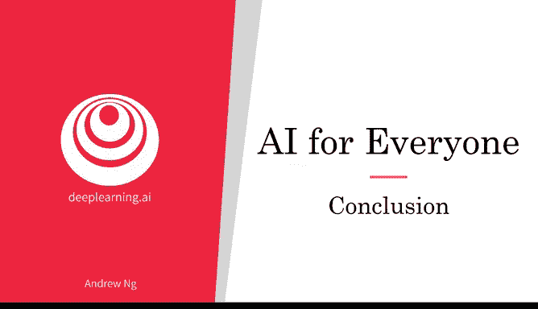
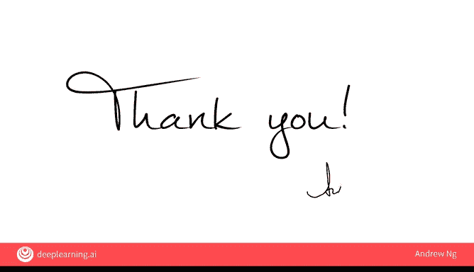
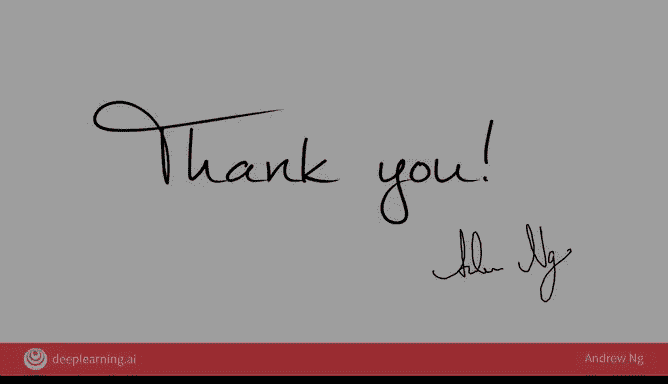

# 吴恩达《AI for everyone》给所有人的AI课（中英字幕） - P35：34_课程总结.zh_en - GPT中英字幕课程资源 - BV1yC4y127uj

Congratulations on coming to the last video of this course。

 AI is a superpower and understanding it allows you to do things that very few people on the planet can。

Let's summarize what you've seen in thiscourse。In the first week you learned about AI technology what is AI and what is machine learning was supervised learning that is learning input output or A to B mappings as well as what is data science and how data feeds into all of these technologies  importantlyly。

 you also saw examples of what AI can and cannot do In the second week you learned what it feels like to build an AI projects you saw the workflow of machine learning projects of collecting data。

 building a system and deploying it as well the workflow of data science projects。

 and you also learned about carrying out technical diligence to make sure a project is feasible together with business diligence to make sure that the project is valuable before you commit to taking on specific AI project In the third week you learned how such AI projects could fit in the context of your company you saw。

amples of complex AI products， such as a smart speaker， a selfdriving car。

 the roles and responsibilities of large AI teams。 And you also saw the AI transformation playbook。

 the fivestep playbook for helping a company become a great AI company。

 I hope these materials throughout these first three weeks can help you brainstorm AI projects or think about how you might be able to use AI in your company or in your organization in this week week four you learned about AI and society。

 you saw some of the limitations of AI beyond just technical limitations and also learned about how AI is affecting developing economies and jobs worldwide。

 you've learned a lot in these four weeks。 But AI is a complex topic。

 So I hope you will keep on learning whether through additional online courses through Cora or deepd AI。

Or books or blogs。 or just by talking to friends。 If you ever want to try your hand at building AI technology its now easier than ever to learn to code and learn how to implement AI technology through these resources。

 If you'd like to keep on receiving information about AI。

 you can also sign up for the deep learningning AI mailing list by going to the deep learning AI website and signing up there。

 I'll occasionally send you useful information about AI through that mailing list。

Congratulations on finishing this course， you're now significantly ahead of many large company CEOs in your understanding of AI and your ability to plan for the rise of AI。

 so I hope that you provide leadership to others as well that are trying to navigate these issues。😊。

Lastly， I want to say to you thank you very much for taking this course。

 I know that you're busy with your own work or school and friends and family and I'm grateful that you spend so much time with me and in this course learning these complex issues relating to both the technology and the impact of AI so thank you very much for both the time and the effort you put into this course。

😊。

