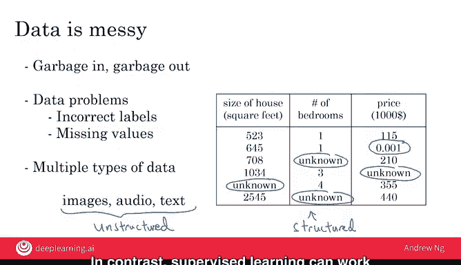

# 吴恩达《AI for everyone》给所有人的AI课（中英字幕） - P3：2_什么是数据.zh_en - GPT中英字幕课程资源 - BV1yC4y127uj

You may have heard that data is really important for building AI systems， but what is data really。

 Let's take a look。Let's look at an example of a table of data。

 which we also call a data set If you're trying to figure out how to price houses that you're trying to buy or sell。

 you might collect a data set like this and this can be just a spreadsheet。

 like a mixel spreadsheet of data where one column is the size of the house。

 say in square feet or square meters and the second column is the price of the house。

And so if you're trying to build an AI system or machine learning system to help you set prices for houses or figureig out that the house is priced appropriately。

 you might decide that the size of the house is a and the price of the house is B and have an AI system。

 learn this input output or A to B mapping。Now， rather than just pricing a house based on the size。

 you might say， well， let's also collect data on the number of bedrooms of this house。 In that case。

 a can be both of these。First two columns， and B can be。Just the price of the house。

So given the table of data， given the data set it's actually up to you。

 up to your business use case to decide what is A and what is B。

Data is often unique to your business， and this is an example of a data that a real estate agency might have if they're trying to help price houses。

 and it's up to you to decide what is a and what is B and how to choose these definitions of A and B to make it valuable for your business。

As another example， if you have a certain budget and you want to decide what is the size of house you can afford。

 then you might decide that the input A is how much does someone spend and B is。

Just the size of the house in square feet。 And that would be a totally different choice of A And B that tells you。

 given a certain budget， what's the size of a house you should be maybe looking at。

 Here's another example of a data set。Let's say that you want to build a AI system to recognize cats in pictures。

 I'm not sure why you might want to do that， but maybe have a fun mobile app。

 and you want to tag all the pictures of cats。 So you might collect the data sets where the input a。

Is a set of different images， and the output B are labels that says。First picture is a cat。

 there's not a cat， there's a cat， there's not a cat， and have an AI， input a picture A。

 and output B is the cats or not so you can tag all the cat pictures on your photo feed or on your mobile app。

In machine learning tradition， there's actually a lot of cats in machine learning。

 I think some of this started when I was leading the Google brain team and we published the results with a somewhat infamous Google cat when an AI system learned to detect cats from watching YouTube videos。

 but since then there's been a tradition of using cats as a running example when talking about machine learning with apologies to all the dog lovers out there。

 I love dogs too。So data is important， but how do you get data。

 how do you acquire data Well one way to get data is manual labeling For example。

 you might collect a set of pictures like these over here and then you might either yourself or have someone else go through these pictures and label each of them so the first one is a cat second one is not a cat。

 the one is a cat fourth one is not a cat and by manually labeling each of these images you now have a data set for building a CA detector to do that you actually need more than four pictures you might need hundreds of thousands of pictures but manually labeling is a tried and true way of getting a dataset where you have both a and B。

Another way to get the data is from observing user behaviors or other types of behaviors。

 So for example， let's say you run a website that sells things online。

 so an ecommerce-commerce or an electronic commercemer website where you offer things to users at different prices and you can just observe if they buy your product or not So just through the act of either buying or not buying your product。

 you may able to collect the data like this we can store the user ID。

 the time the user visit your website， the price you offer the product to the users as well as whether or not they purchased it。

And so just by using your website， users can generate this data from you。

This was an example of observing user behaviors。 We can also observe behaviors of other things such as machines。

 If you run a large machine in a factory and you want to predict if a machine is about to fail or have a fault。

 then just by observing the behavior of a machine， you can then record a data set like this。

 There's a machine I， There's a temperature of the machine。

 there's a pressure within the machine and then did the machine fail or not。

 and if your application is prevents the maintenance。

 say you want to figure out if a machine is about to fail， then you could， for example， choose this。

As the input A and choose that as the output B to try to figure out if a machine is about to fail。

 in which case you might do maintenance， preventative maintenance on the machine。

 The third and very common way of acquiring data is to download it from a website or to get it from a partner thanks to the open internet that just so many that you can download freely。

 ranging from computer vision or image data sets to selfdriving call data sets to speech recognition dataset sets to medical imaging dataset sets to many。

 many more。 And so if your application needs a type of data if you just download off the web。

 keeping in mind licensing and copyright， then that could be a great way to get started on an application and finally if you work of a partner。

 say you're working with a factory， then they may already have collected a big data of machines and temperatures and pressure into the machines fail or not that they could give to you。

Data is important， but it's also a little bit overhyped and sometimes misuseed。

 Let me describe to you two of the most common misuseers or the bad ways of thinking about data When I speak of seals of large companies a few of them have actually said to me hey Andrew。

 give me three years to build up my IT team we collecting so much data and then after three years I'll have this perfect data and then we'll do AI then it turns out that's a really bad strategy instead what I recommend every company is once you started collecting some data go ahead and start showing it or feeding it to an AI team because often the AI team can give feedback to your IT team on what types of data to collect and what types of IT infrastructure to keep on building for example maybe an AI team can look at your factory data and say hey you know what if you can collect data from this big manufacturing machine not just once every 10 minutes but instead once。

One minute then we could do a much better job building a preventative maintenance systems for you so there's often this interplay of this back and forth between IT and AI teams and my advice is usually try to get feedback from AI earlier because it can help you guide the development of your IT infrastructure。

Second， misuse of data。 unfortunately， I've seen some CEOs read about the importance of data in the news and then say。

 hey， I have so much data。 Surely an AI team can make it valuable。

 And unfortunately this doesn't always work out more data is usually better than less data。

 but I wouldn't take for granted just because you have many terabytes or gigabytes of data that an AI team can actually make that valuable。

 So my advice is don't throw data and AI team and assume it would be valuable。 In fact。

 in one extreme case， I saw one company go and acquire a whole string of other companies in medicine on the thesis on the hypothesis that their data would be very valuable。

 And now a couple years later， far as I know the engineers have not yet figured out how to take all this data and actually create value all of it。

 So sometimes it works and sometimes it doesn't， but I would not overinve in just acquiring data for the sake of data until unless。

Also get an AI team to take a look at it because they can help guide you to think through what is the data that is actually the most valuable。

 Finally， data is messy。 you may have heard the phrase garbage in garbage out and if you have bad data then the AI will learn inaccurate things here are some examples of data problems let's say you have this data sets of size of houses number bedrooms in the price。

 you can have incorrect labels or just incorrect data。 for example。

 this house is probably not going to solve $0。001000 just the 1 dollar or data can also have missing values such as we have here a whole bunch of unknown values and so your AI team will need to figure out how to clean up the data or how to deal of these incorrect labels and or missing values and they are also multiple types of data For example。

 sometimes you hear about images audio。And text， these are types of data that humans find it very easy to interpret。

 There's a term for this。 This is called unstructured data。

And there's certain types of AI techniques that could work with images to recognize cats。

 the audio to recognize speech or text， to understand the email or spa。

And then there are also data sets like the one on the right。

 this is an example of structured data and that basically means data that lives in a giant spreadsheet and the techniques for dealing with unstructured data are a little bit different than the techniques for dealing with structured data Gerative AI today is used primarily to generate unstructured data such as text images in audio rather than structured data In contrast。

 supervised learning can work very well for both of these types of data unstructured data and structured data In this video you learned what is data and you also saw how not to misused data for example。

 by overinveting in an IT infrastructure in the hope that it will be useful for AI in the future but we actually checking that it really will be useful for the AI applications you want to build and finally you saw data is messy but the good AI team will be able to help you deal with all of these problems。

Now AI has a complicated terminology where people throw around terms like AI， machine learning。

 data science What I want to do in the next video is share with you what these terms actually mean so that you be able to confidently and accurately talk about these concepts with others let's go on to the next video。

